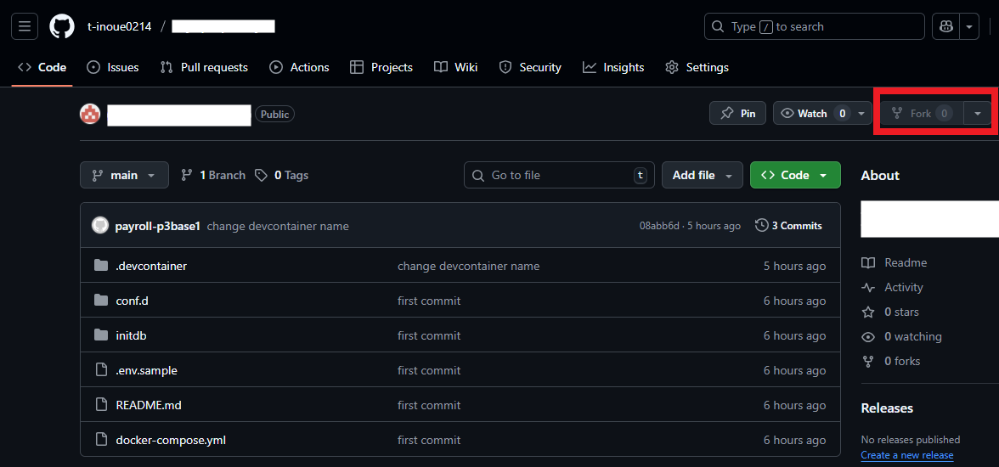
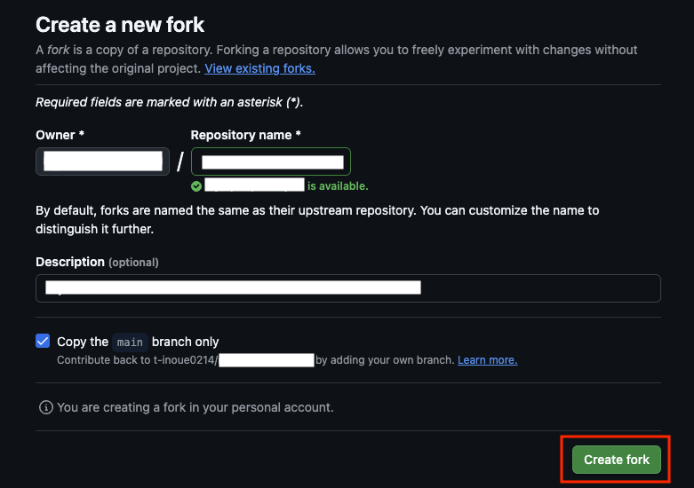
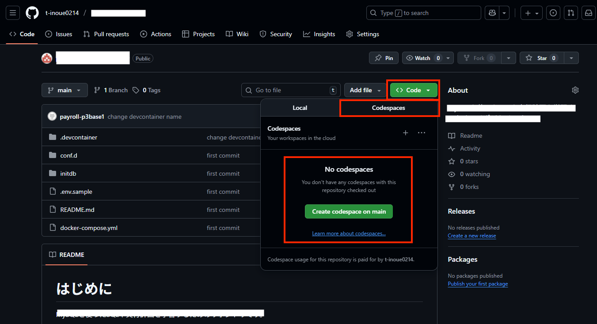
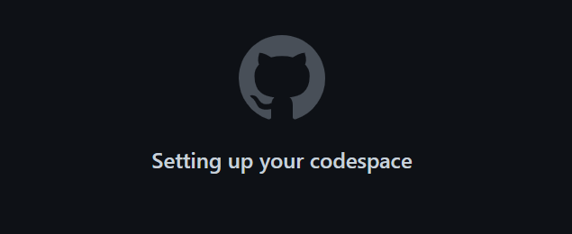
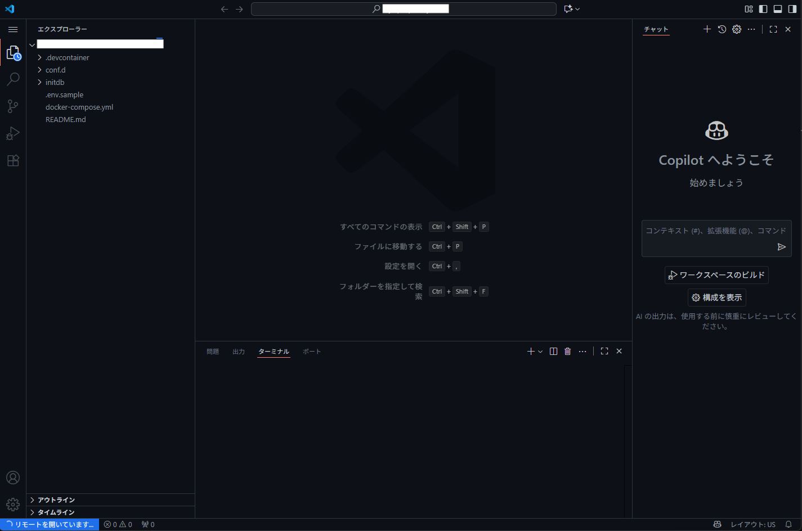
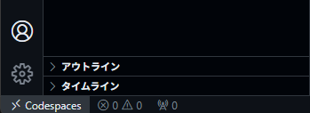

# starter-code-design

デザインパターンとアーキテクチャパターンの「考え方」を学ぶJava実践教材です。同じ業務ロジックを異なるパターンへ分解し直し、実装の違いを比べます。

フレームワークは設計のパターンをある程度決めてくれます。しかし、コンソールツールや小規模なWebアプリ、バッチなどでは、規模と内容に合わせて自分で構造を考える必要があります。知らない設計は思いつけません。まずパターンを知ることから始めます。

> **⚠️ 学習上の重要ルール**
> [Java SE Platform API仕様](https://docs.oracle.com/en/java/javase/21/docs/api/index.html) が最新かつ正確な一次情報です。AIや本教材の記述も、必ず公式ドキュメントと照らして確認してください。

---

## 📋 0. このリポジトリを始める前に

次の知識を前提にしています。パターン名やSOLID原則は知らなくて構いません。

- Javaの基礎（クラス・インターフェース・継承・コレクション・例外）
- Mavenの基本操作（`mvn test` が実行できること）

---

## 💻 1. 開発環境 (Development Environment)

この勉強会では **GitHub Codespaces** を使用します。

面倒な環境構築は不要です。ブラウザさえあれば、すぐに学習を始められます。

1. **GitHubにログイン** してください（アカウントがない場合は作成してください）。

1. このリポジトリをフォークするため、右上の`fork`をクリックする。

    

1. `Create fork`ボタンをクリックして、フォーク（自分のアカウントにコピーして新しいリポジトリを作成）する。

    

1. `Codespace`を起動するため、`Code`タブに移動し、右上にある緑色の`code`のプルダウンメニューを開き、`Codespace`タブを開き、`Create codespace on main`をクリックする。

    

1. `Codespace`の生成にはしばらく時間がかかるため、しばらく待つ。

    

1. `VSCode`が起動するが、画面左下が`リモートを開いています...`の間は待つ。

    

1. 画面左下が`Codespace`になった場合は、`Codespace`が起動完了しました

    

環境が立ち上がったら、左側のファイル一覧から学習したい章のフォルダを開いてください。

### Codespaces利用上の注意

- `Github`の`Codespaces`を利用する。`Codespaces`は設定によってはコストがかかるため、[Codespace の利用上の注意](./CODE_SPACES_SERVICE.md) はよく確認すること。
- コストをかけないためにも、セキュリティの意味でも、使い終わったら [停止方法](./CODE_SPACES_SERVICE.md#3-停止方法) に従って停止することを推奨する。

---

## 🚀 2. 学習の始め方

1. **Codespaces を起動**し、環境の準備を待つ
1. [chapters/README.md](./chapters/README.md) を開く
1. **[第0章](./chapters/00-paradigms.md)** で、プログラミングの考え方の全体像をつかむ
1. 各章で、用意された神クラス（1クラスに全部入った実装）を読み、パターンの考え方を学び、自分の手でクラスに分解する
1. `mvn test` が分解の前後で green であることを確認する

---

## 📚 3. この講座で学ぶこと

題材は「注文処理」（割引計算・在庫引当・決済・通知・監査ログ）の1つだけです。パターンだけを変えて、実装の違いを比べます。

| Part | 内容 |
| :--- | :--- |
| 0. 全体像 | オブジェクト指向・AOPなどの違い、学ぶ順序と深さの目安、良い分け方を判断する物差し（凝集度・結合度、SOLID、コードの臭い） |
| 1. 基本の設計（最初に学ぶ） | クラスの役割分け / トランザクションスクリプト / Layered / ECB / MVC / Event-Driven / 継承よりコンポジション |
| 2. 条件が合えば使う設計 | ドメインモデル / Hexagonal / CQRS、デザインパターン（Strategy / Observer / Decorator / Factory / Template Method） |
| 3. 比べて選ぶ | まず Part 1 の構成で足りるかを問い、足りないときだけ Part 2 から選ぶ基準 |

設計は、アプリ全体の分け方、業務ロジックの置き場所、クラスの作り方の順に決めます。教材もこの順に並べています。

詳細は [chapters/README.md](./chapters/README.md) を参照してください。

---

## ⚙️ 4. 技術スタック

| 要素 | 採用技術 |
| --- | --- |
| 言語 | Java 21 |
| ビルド | Maven 3.x |
| アプリ形態 | コンソールアプリ（HTTP・DBは使わない） |
| テスト | JUnit 5 のみ |

パターン以外のノイズを減らすため、JDKとJUnit 5以外は使いません。

### コーディング制約

- `var` は使用しない。型を常に明示する
- モデルは `private final` フィールドと、`get` なしのアクセサで書く

---

## 📝 重視する思想

パターンは暗記する対象ではありません。「何が変わりやすいか」を考える思考の型です。悪い設計を自分の手で直す体験を通して、その思考を身に付けてください。
