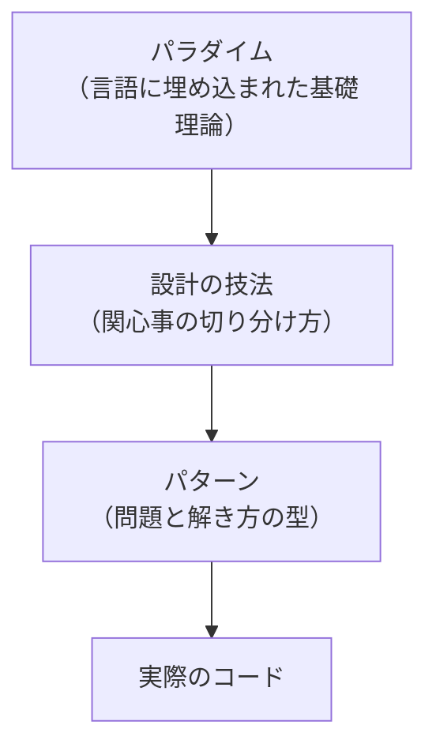
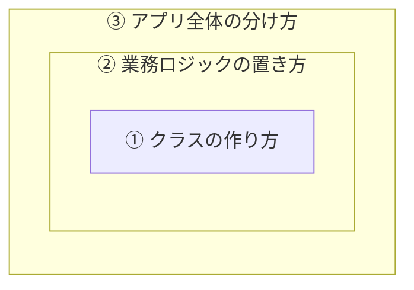
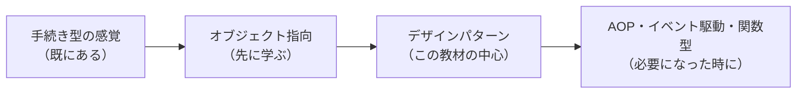
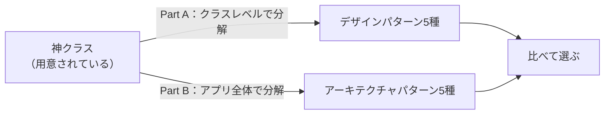

# 第0章: プログラミングの考え方を概観する

## この章のゴール

オブジェクト指向・AOP・関数型などの「考え方」が、それぞれ何を解決しようとしているかを知ります。そのうえで、何から学び、どこまで知っておけば実務に困らないかの目安を持ちます。

## Why: なぜ最初に全体像を見るのか

SaaSやSI案件の現場では、フレームワークがある程度の設計を決めてくれます。しかし、コンソールツール、バッチ、小規模なWebアプリなどでは、規模と内容に合わせて自分で構造を考える場面が必ず来ます。

ところが、知らない設計は思いつけません。だから最初の仕事は、設計の「引き出し」を増やすことです。

その引き出しを増やすときに、よく出てくる言葉があります。「オブジェクト指向」「AOP」「関数型」などです。これらは同じ階層の言葉ではないため、混ぜて理解しようとすると混乱します。この章で整理しておきます。

## 「考え方」には3つの階層がある

最初に、次の3つを区別します。

| 階層 | 問い | 例 |
| :--- | :--- | :--- |
| パラダイム（考え方） | プログラムを何の集まりと見なすか | 手続き型、オブジェクト指向、関数型 |
| 設計の技法 | 関心事をどう切り分けるか | AOP、依存性注入（DI）、イベント駆動 |
| パターン（型） | よくある問題に、どんな形で答えるか | デザインパターン、アーキテクチャパターン |

上の階層ほど抽象的で、言語の仕様に深く埋め込まれています。下の階層ほど具体的で、今日の仕事にそのまま使えます。

## この教材で使う3つの軸

この教材が扱うパターンは、何を決めるための考え方かで、次の3つの軸に分かれます。同じ「設計」という言葉でも、決める対象が違います。

| 軸 | 決めること | 該当するもの | 該当する章 |
| :--- | :--- | :--- | :--- |
| ① クラスの作り方 | 部品の形と、その関係 | デザインパターン（Strategy、Observerなど） | 第2〜6章 |
| ② 業務ロジックの置き方 | ロジックをどこに、どんな形で書くか | トランザクションスクリプト、ドメインモデル | 第7章 |
| ③ アプリ全体の分け方 | 責務の区画と依存の向き | Layered、MVC、ECB、Hexagonal、CQRS、Event-Driven | 第8〜12章 |

内側ほど小さな単位の話で、外側ほど大きな単位の話です。実際の設計では、3つの軸で同時に選びます。たとえば「全体はLayered、業務ロジックはドメインモデル、割引計算はStrategy」のように組み合わせます。

### 混同しやすいポイント

- **トランザクションスクリプト**はアーキテクチャではありません。1つの処理を上から下へ手続きで書く、業務ロジックの置き方です。この教材の神クラスは、実はこれにあたります。小規模なら正解になりうる出発点であり、一概に悪い設計ではありません。第7章でドメインモデルと比べます
- **MVC**は、元々はUIまわりの分け方です。Layeredの「表示層」の中身にあたるため、Layeredと役割が少し違います。第9章で扱います
- **ECB**（Entity / Control / Boundary）は、クラスを役割で分類する考え方です。Clean Architectureの祖先にあたります。第9章ではMVCと、第10章ではHexagonalと並べて比べます

> **💡 読み進め方のコツ**
> 各章の冒頭に「この章は軸①②③のどれか」を書いています。章をまたいで比べるときは、同じ軸の章どうしを比べると違いがはっきりします。

## 主な考え方の違い

| 考え方 | プログラムを何と見なすか | 得意なこと | 弱いところ |
| :--- | :--- | :--- | :--- |
| 手続き型 | 順番に実行する命令の列 | 単純な処理を素直に書く | 規模が大きくなると、データと処理の対応が追えなくなる |
| オブジェクト指向 | 状態と振る舞いを持つ部品の協調 | 変更の影響範囲を部品の中に閉じ込める | 部品の切り方を誤ると、かえって複雑になる |
| 関数型 | 入力から出力を作る関数の合成 | 副作用が少なく、テストしやすい | 状態を持つ業務の表現に工夫がいる |
| AOP（アスペクト指向） | 業務とは別軸の「横断的関心事」 | ログ・認可・トランザクションを本体から分離する | 処理の流れが見えにくくなる |
| イベント駆動 | 出来事（イベント）とその反応 | 送り手と受け手を疎結合にする | 全体の処理順が追いにくい |

### 横断的関心事とは

業務の中心ではないのに、あちこちに現れる処理のことです。ログ出力、認可チェック、実行時間の計測、トランザクション管理などです。

AOPはこれを「本体とは別の軸」として切り出す考え方です。オブジェクト指向だけで整理しようとすると、同じ記述が各クラスに散らばりがちです。

ただし、AOPを使うには多くの場合フレームワークの助けがいります。この教材ではフレームワークを使いません。そこでAOPの考え方は、Decoratorパターン（第4章）で「手で」体験します。

## どちらを先に学ぶべきか

結論から言うと、**先に学ぶのはオブジェクト指向だけで十分** です。理由は3つあります。

1. JavaやC#などの主要な業務用言語は、オブジェクト指向を前提に作られています。言語を使う限り避けて通れません
1. デザインパターンの多くは、オブジェクト指向の道具（インターフェース、ポリモーフィズム、委譲）の組み合わせでできています
1. AOPやイベント駆動は、オブジェクト指向の限界を感じてから学ぶほうが、必要性が腹に落ちます

## どの程度まで知っていればよいか

すべてを理論から理解する必要はありません。理論をきちんと学ぶには長い時間がかかります。仕事をしながら少しずつ身に付けるほうが現実的です。

目安として、オブジェクト指向は次の4点が説明できれば、この教材に進めます。

| 項目 | 一言で言うと |
| :--- | :--- |
| カプセル化 | 内部の状態を隠し、操作の窓口だけを公開する |
| 継承 | 既存の型を土台に、差分だけを書く |
| ポリモーフィズム | 同じ呼び出しで、相手の型に応じた振る舞いをさせる |
| 委譲（コンポジション） | 自分でやらず、持っている部品に任せる |

特に大切なのは、ポリモーフィズムと委譲です。ほとんどのデザインパターンは、この2つの使い方の違いにすぎません。

その他の考え方は、次のように扱います。

| 考え方 | この教材での扱い | 深く学ぶタイミング |
| :--- | :--- | :--- |
| AOP | 第4章で、考え方だけを手作業で体験する | フレームワークでAOPに触れたとき |
| 関数型 | ラムダ式を道具として使う程度にとどめる | 並行処理や大量データ処理が必要になったとき |
| イベント駆動 | 第3章と第12章で扱う | メッセージ基盤を使う案件に入ったとき |

## なぜデザインパターンから入るのか

理論を先に学ぶより、パターンから入るほうが、早く効果を実感できます。理由は次のとおりです。

- パターンは「この問題には、この形」という答え合わせの形になっていて、すぐ使えます
- 既存コードを読むとき、パターン名がわかるだけで設計の意図が読み取れます
- 設計レビューで「ここはStrategyにしませんか」のように、短い言葉で議論できます
- パターンを学ぶうちに、背後にあるオブジェクト指向の理論が自然に身に付きます

## この教材の進め方

第1章では、パターンの良し悪しを判断するための物差し（凝集度・結合度、SOLID、コードの臭い）を学びます。第2章以降は、その物差しを使ってパターンを評価します。

題材は「注文処理」の1つだけです。割引計算、在庫引当、決済、通知、監査ログが1つのクラスに詰め込まれた状態から始めます。

1. 神クラスを読み、変更要求が来たときの困りごとに気づく
1. パターンの考え方を読む
1. 自分の手でクラスに分解する
1. 分解の前後で、同じテストが green であることを確認する
1. 別のパターンで分けた場合と比べる

> **⚠️ よくある失敗・誤解**
> パターンは「使えば良い設計になる道具」ではありません。変更が起きない場所にパターンを適用すると、クラスが増えるだけで読みにくくなります。各章で「やりすぎの境目」も必ず確認します。
>
> **💼 現場Tip**
> 現場で設計を相談するときは、パターン名を覚えているかより、「何が変わりやすいと考えたか」を言葉にできるかが大切です。パターンはそのための共通語彙です。

## もっと良くしてみよう

### 理解確認

1. 「パラダイム」「設計の技法」「パターン」の違いを、それぞれ例を挙げて説明してみましょう
1. 横断的関心事とは何か、注文処理の中から例を2つ挙げてみましょう
1. ポリモーフィズムと委譲を使わずに、if-else だけで「割引の種類が増える」ことに対応すると、何が困るでしょうか

### 発展改善クイズ

1. オブジェクト指向だけで整理しようとすると、ログ出力の記述が各クラスに散らばります。散らばらないようにするには、どんな方法がありそうか、自分なりに考えてみましょう
1. 自分が今関わっているコードの中で、「変わりやすい部分」と「変わりにくい部分」を1つずつ探してみましょう。それらは同じクラスに入っていませんか

---

| | [全章目次](./README.md) | [第1章: 良い分け方を判断する物差し →](./01-yardstick.md) |
| - | :-: | --: |
