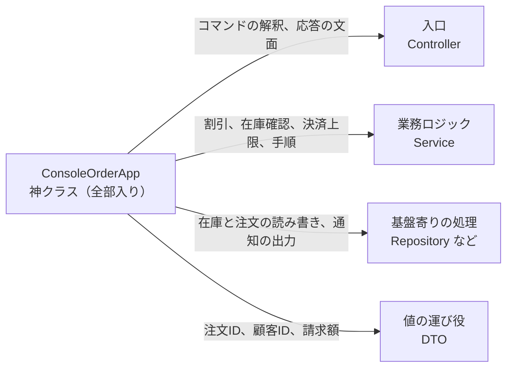
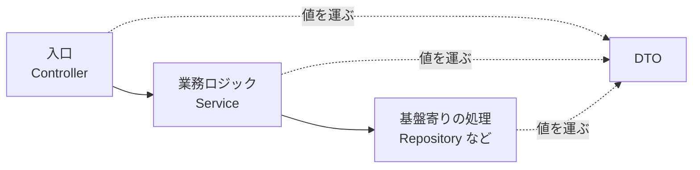

# 第2章: クラスの役割を分ける（入口・業務ロジック・基盤寄りの処理・DTO）

> この章の軸: ①アプリ全体の分け方

## この章のゴール

1つのクラスに詰め込まれた処理を、4つの役割に仕分けます。入口、業務ロジック、基盤寄りの処理、データの運び役（DTO）です。新しいコードを書くとき、どの役割のクラスに置くかを自分で判断できるようになります。

## Why: なぜ役割で分けるのか

機能が増えると、同じクラスに何でも書き足したくなります。しかし、次のような変更要求が来たとき、困るのは誰でしょうか。

- コマンドの形式を変えたい人は、割引ルールのコードを読まないと直せません
- 割引ルールを変えたい人は、画面への出力の細部まで気にしないと直せません
- 保存先を変えたい人は、他のすべての処理を壊さないよう気を付けて直すことになります

役割で分けると、変更の理由ごとに、触るクラスが決まります。Webサービスでも、バッチでも、コンソールツールでも、この考え方は共通です。多くのフレームワークも、この分け方を前提にしています。

## 前提

[第1章](./01-yardstick.md)を読み終えていること。第1章で学んだ「責務」と「変更の理由」という言葉を使います。

### 注文アプリの仕様（第2章、第4〜7章、第10・11章で共通）

| コマンド | 意味 | 応答の例 |
| :--- | :--- | :--- |
| `PLACE 注文ID 顧客ID ランク 商品:単価:数量[;...]` | 注文する | `OK O1 total=9000` |
| `SHOW 注文ID` | 注文を参照する | `ORDER O1 customer=C1 total=9000` |
| `HISTORY 顧客ID` | 顧客の注文履歴を参照する | `HISTORY C1 O1,O2` |

失敗したときは、`ERROR 理由` を返します。詳しい仕様は、共通の契約テスト `OrderAppContractTest` を読むと確認できます。

## 悪い実装を読む

次のファイルを開いてください。

- [ConsoleOrderApp.java](../src/main/java/com/example/orders/ch02_roles/before/ConsoleOrderApp.java)

`handle` メソッドの中に、次の4種類の処理が混ざっています。

1. コマンド文字列の解釈と、応答の文字列の組み立て
1. 業務ルール（重複確認、会員ランク割引、在庫確認、決済上限）
1. データの保持（`stock`、`orderTotal`、`history` の `Map`）
1. 画面への出力（`out.println`）

動作は正しく、テストも通ります。問題は構造です。次の変更要求が来たら、どこを触るか想像してください。

- 割引ルールを変えたい。ルールだけを単体でテストしたい
- 応答の文面を変えたい
- 注文の保存先をデータベースに替えたい

どの変更も、同じメソッドを書き換えることになります。

## 考え方

### 「誰の都合で変わるか」で仕分ける

クラスを分ける基準は、**変更の理由** です。コードの各行に、「この行は誰の都合で変わるか」と問いかけます。答えが同じ行は、同じ役割にまとめます。

| 役割 | 一般的な呼び名 | 変わる理由 | この題材では |
| :--- | :--- | :--- | :--- |
| 入口 | Controller、Handler | 画面や連携先の都合 | コマンドの解釈、応答の文面 |
| 業務ロジック | Service | 事業の都合 | 割引、在庫確認、決済上限、処理の手順 |
| 基盤寄りの処理 | Repository、Notifier、Client | 技術や運用の都合 | 在庫と注文の読み書き、通知の出力 |
| データの運び役 | DTO | 運ぶ項目の変化 | 注文の概要（注文ID、顧客ID、請求額） |

神クラスの中身は、次のように4つの役割へ仕分けられます。矢印の文言は、仕分けの基準になる「誰の都合で変わるか」の中身です。



業務ロジックのクラスは、さらに2種類に分かれます。事業そのものの判断を書くクラス（割引ルールなど）と、基盤に近い共通の処理を書くクラス（日付の整形など）です。この章では、前者を扱います。

### 呼び出しの向き



入口は、受け取った入力を整えて、業務ロジックを呼ぶだけです。業務ロジックは、手順とルールを持ち、基盤寄りの処理を使います。DTO は、役割をまたいで値を運びます。

### 部品を渡して組み立てる（依存性注入の入門）

業務ロジックのクラスが、基盤寄りのクラスを自分で `new` すると、差し替えにくくなります。そこで、**使う部品をコンストラクタで受け取ります**。

```java
// ★重要★ 部品を、外から渡してもらう（依存性注入）
public OrderService(StockRepository stocks, OrderRepository orders, ConsoleNotifier notifier) {
    this.stocks = stocks;
    this.orders = orders;
    this.notifier = notifier;
}
```

部品を作って渡す役は、アプリの起点（`ExerciseOrderApp`）に集めます。この形を、フレームワークなしで手で組み立てるのが、この教材の基本です。

> **⚠️ よくある失敗・誤解**
> クラス名に `Service` と付けただけで、中身が入出力と業務ルールの混ぜ物になっていることがあります。名前ではなく、持っている処理で役割を判断します。

### 適用すると嬉しい状況・損をする状況

| 観点 | 内容 |
| :--- | :--- |
| 嬉しい状況 | 複数の人が、別々の理由で変更する。業務ルールを入出力抜きでテストしたい |
| 損をする状況 | 数十行で終わる使い捨てのツール。クラスを分けても、読む手間が増えるだけの場合 |
| 使わない選択肢 | 1クラスのまま、メソッドだけで分ける。変更の理由が1つしかないなら、それで十分 |

## 課題: 分解してみよう

課題用のクラスは [exercise パッケージ](../src/main/java/com/example/orders/ch02_roles/exercise/) にあります。`ExerciseOrderApp` が、分解前のコピーです。

パッケージは分けません。`exercise` の直下に、役割ごとのクラスを作ります。クラス名の語尾は、テストが確かめます。

### ステップ1: 現状を確認する

```bash
mvn test
```

`RolesStructureTest` の4件が失敗します。役割のクラスが、まだないためです。

### ステップ2: 行に色を付ける

`ExerciseOrderApp` を上から読み、各行を「誰の都合で変わるか」で分類してください。次の問いに答えます。

- 通知の出力（`[NOTIFY]`）は、どの役割ですか
- 「注文が見つかりません」という判断は、どの役割ですか。応答の `ERROR` という文字列は、どうですか
- `Map` を直接持っているのは、どの役割にしたいですか

### ステップ3: 4つの役割のクラスを作る

語尾は、`Controller`、`Service`、`Repository`、`Dto` です。クラス名の前半と、クラスの数は自分で決めます。次の順で作ると、迷いません。

1. 基盤寄りの処理（`Repository` と、通知を出すクラス）
1. 業務ロジック（`Service`）
1. 値の運び役（`Dto`）
1. 入口（`Controller`）

### ステップ4: 組み立て役を残す

`ExerciseOrderApp` には、部品を作って渡す処理だけを残します。コンストラクタの形は変えません。

### ステップ5: 確認する

```bash
mvn test
```

> **🔍 確認・実験してみよう**
> 「ゴールド会員の割引を12%にする」という変更を、完成したコードに加えるとします。触るクラスは、いくつですか。コマンドの形式を変える場合は、どうですか。数えてみてください。

## 動作確認

`mvn test` が、分解の前後で green であることを確認します。`RolesStructureTest` は、次の4点を確かめます。

- 4つの役割のクラスがあること
- 入口に、業務ルールとデータの保持がないこと
- 業務ロジックに、コマンドの解釈と出力がないこと
- 基盤寄りの処理に、業務ルールがないこと

## 解答例と解説

解答例の全文は [answers/ch02_roles/](../answers/ch02_roles/) にあります。自分で書き終えてから開いてください。

<details>
<summary>解答例の要点を見る</summary>

### クラスの配置

| 役割 | クラス | 持っているもの |
| :--- | :--- | :--- |
| 入口 | `OrderController` | コマンドの解釈、応答の文字列 |
| 業務ロジック | `OrderService` | 重複確認、割引、在庫確認、決済上限、手順 |
| 基盤寄りの処理 | `StockRepository`、`OrderRepository`、`ConsoleNotifier` | 在庫と注文の読み書き、通知の出力 |
| DTO | `OrderSummaryDto` | 注文ID、顧客ID、請求額 |

### 組み立て役

```java
// ★重要★ 依存される側から順に作り、使う側に渡す
StockRepository stocks = new StockRepository(stock);
OrderRepository orders = new OrderRepository();
OrderService service = new OrderService(stocks, orders, new ConsoleNotifier(out));
this.controller = new OrderController(service, today);
```

### なぜこの切り方か

- 業務ロジックは、出力先の `PrintStream` と、文字列の `split` を使いません。コマンド文字列なしでテストできます
- 保存先を替えるときは、`Repository` だけを書き換えます
- 通知の出力は、「成立したら知らせる」という業務の判断と、「どう出力するか」という技術の判断に分かれます。後者は `ConsoleNotifier` に置きました
- DTO は、値を運ぶだけです。ルールを持たせると、どの役割のものか分からなくなります

</details>

## 他のパターンと比べる

この章は、役割に仕分ける最初の一歩です。次章以降で、仕分けた役割をどう並べるかを学びます。

| 比べる相手 | 違い |
| :--- | :--- |
| トランザクションスクリプト（第3章） | この章は、クラスの仕分けです。第3章は、業務ロジックの中身を、どんな形で書くかを決めます |
| Layered（第4章） | この章の4つの役割を、層として固定し、依存の向きを守らせます |
| ECB（第5章） | 同じ仕分けを、別の観点（外との接点、処理の流れ、業務の概念）で行います |

> **💼 現場Tip**
> 新しいクラスを足すとき、「このクラスは、誰の都合で変わるか」を口に出してみてください。答えが2つ出るなら、2つのクラスに分けるサインです。

## もっと良くしてみよう

### 理解確認

1. クラスを役割で分けるとき、「変更の理由」を基準にするのはなぜですか
1. 業務ロジックのクラスが、基盤寄りのクラスをコンストラクタで受け取るのはなぜですか
1. DTO にルールを持たせないほうがよいのはなぜですか

### 発展改善クイズ

1. `OrderService` は、具体的な `StockRepository` クラスを直接使っています。保存先をデータベースに替えるとき、`OrderService` は無傷でいられるでしょうか
1. 4つの役割を、パッケージで分けるとしたら、どんな名前にしますか。依存の向きは、どう守りますか

---

| [← 第1章: 良い分け方を判断する物差し](./01-yardstick.md) | [全章目次](./README.md) | [第3章: トランザクションスクリプト →](./03-transaction-script.md) |
| - | :-: | --: |
