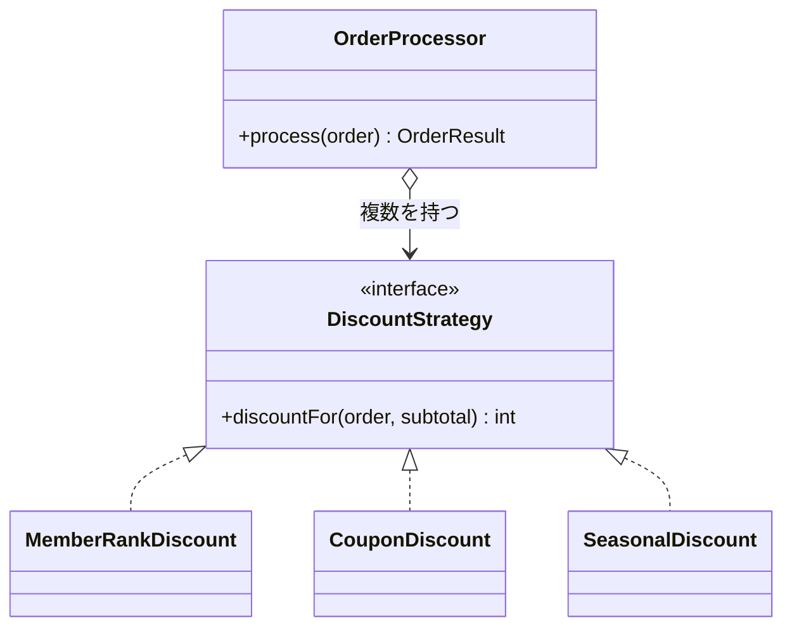

# 第2章: Strategy（割引ルールを差し替え可能にする）

> この章の軸: ①クラスの作り方

## この章のゴール

割引計算の `if-else` の連鎖を、1ルール1クラスに分解します。割引ルールを追加しても、既存コードを書き換えない構造を目指します。あわせて、依存性注入（DI）の基本形であるコンストラクタ注入を体験します。

## Why: なぜStrategyを学ぶのか

営業施策は頻繁に変わります。「法人向けの割引を足したい」「ブラックフライデー限定の割引を足したい」といった要望は、SaaSとSIのどちらでも定番です。

そのたびに、動いている金額計算のコードを書き換えていたらどうなるでしょうか。ほかの割引のロジックにまで影響する恐れもあります。テストも全部やり直しです。

「種類が増えるたびに分岐が増える」形のコードを見かけたら、Strategyの出番だと考えてください。

## 前提

[第1章](./01-yardstick.md)を読み終えていること。第1章で学んだ「変更の散弾」「`if-else` の連鎖」といった臭いの名前を使います。

## 悪い実装を読む

次のファイルを開いてください。第1章の神クラスと同じ内容ですが、この章では金額計算の部分に注目します。

- [DiscountInlineOrderProcessor.java](../src/main/java/com/example/orders/ch02_strategy/before/DiscountInlineOrderProcessor.java)

「2. 金額計算」の段落を読み、次の変更要求が来たらどこを触るか想像してください。

- 法人向けの割引（小計の7%）を足したい
- ブラックフライデー（11月第4金曜日）は15%引きにしたい

どちらも、`process` メソッドの中の `if-else` に分岐を足すことになります。割引が1つ増えるたびに、検証・在庫・決済・通知と同じメソッドを直すことになり、テストのやり直しが必要です。

## 考え方

### 何が変わりやすく、何が変わりにくいか

Strategyの出発点は、次の問いです。

| 問い | この題材での答え |
| :--- | :--- |
| 変わりやすい部分は何か | 割引ルールの種類と、それぞれの計算式 |
| 変わりにくい部分は何か | 「ルールごとの割引額を合計し、小計を超えないように切る」という流れ |

変わりやすい部分と変わりにくい部分が同居していると、変更のたびに全体へ影響します。そこでStrategyは、**変わりやすい部分を共通の窓口（インターフェース）の裏に隠し、呼び出し側は中身を知らない** 形にします。

### 構造



注文処理（`OrderProcessor`）は、`DiscountStrategy` という窓口だけを知っています。会員ランクの割引なのか、クーポンの割引なのかは知りません。割引ルールを足すときは、新しい実装クラスを足して、リストに加えるだけです。

### 依存性注入（DI）の入門

注文処理が `new MemberRankDiscount()` と自分で書いてしまうと、具体的なクラスに結びつきます。ルールを差し替えるには、結局注文処理を書き換えることになります。

そこで、**使う側は窓口の型だけを持ち、実際の部品は外から渡してもらいます**。これが依存性注入（DI）です。最も単純な方法が、コンストラクタで受け取る「コンストラクタ注入」です。

- 使う側は `DiscountStrategy` のリストだけを知る
- 実際に何を渡すかは、組み立てる側（今回は2引数のコンストラクタや `main`）が決める
- テストでは、本物の代わりに簡単な部品を渡せる

SOLID原則で言えば、既存コードを書き換えずに機能を足せる点が開放閉鎖（O）、具体クラスでなく窓口に依存する点が依存関係逆転（D）です。

### 適用すると嬉しい状況・損をする状況

| 観点 | 内容 |
| :--- | :--- |
| 嬉しい状況 | 種類が今後も増える。種類ごとに計算式やルールが異なる。ルールを単体でテストしたい |
| 損をする状況 | 種類が2つで、今後も増えない。計算式が1行で済む。クラスが増えて読む手間のほうが大きい |
| 使わない選択肢 | `if-else` のまま。`enum` に計算メソッドを持たせる。ラムダ式（`DiscountStrategy` は1メソッドなので、ラムダで書ける） |

> **⚠️ よくある失敗・誤解**
> `DiscountStrategy` というインターフェースを作っただけで、呼び出し側が `if (strategy instanceof CouponDiscount)` のように種類で分岐してしまうことがあります。これではStrategyにした意味がありません。呼び出し側は、種類を一切知らない形にしてください。

## 課題: 分解してみよう

課題用のクラスは [exercise パッケージ](../src/main/java/com/example/orders/ch02_strategy/exercise/) にあります。

- `ExerciseOrderProcessor`: 分解前のコピー。ここを書き換えます
- `DiscountStrategy`: 窓口の型。テストが前提にしているため、形は変えません

### ステップ1: 現状を確認する

```bash
mvn test
```

38件のうち、`DiscountStrategyExtensionTest` の2件だけが失敗します。ほかの36件が green なのは、課題の雛形がまだ分解前と同じ動作をしているためです。この2件を green にするのが、この章のゴールです。

### ステップ2: 割引ルールを1つずつ切り出す

`ExerciseOrderProcessor` の「金額計算」の段落には、3種類の割引が書かれています。次の問いに答えながら、それぞれを `DiscountStrategy` の実装クラスとして、同じパッケージに作ってください。

- 割引は、いくつのルールに分けられますか
- それぞれのルールは、`order` と `subtotal` のうち、何を必要としますか
- 「未知のクーポン」というエラーは、どのクラスで投げるのが自然ですか
- クラス名は、ルールの中身がわかる名前になっていますか

### ステップ3: 注文処理を窓口だけに依存させる

3引数のコンストラクタ（`List<DiscountStrategy>` を受け取る）で、受け取ったリストを使って割引額を計算するようにします。ここで次の点を満たしてください。

- 注文処理の中に、具体的な割引クラスの名前が出てこない
- 割引額が小計を超えないようにする処理は、注文処理側に残す（ルールごとではなく、合計に対する規則のため）

### ステップ4: 標準の組み立てを用意する

2引数のコンストラクタは、第1章と同じ動作をするよう、標準の割引ルール一式を渡す形にしてください。**「どのルールを使うか」を決める場所は、この1カ所だけ** にします。

### ステップ5: 確認する

```bash
mvn test
```

38件すべてが green になれば完了です。分解の前後で、契約テスト（`OrderProcessorContractTest`）を一行も書き換えていないことに注目してください。振る舞いを変えずに構造だけを変えられた証拠です。

> **🔍 確認・実験してみよう**
> `DiscountStrategyExtensionTest` を読んでください。法人向け割引を足すテストでは、既存の3つの割引クラスを1行も変更していません。ブラックフライデーの割引を足すとしたら、どのファイルを新しく作り、どのファイルを変更しますか。動かす前に予想してから、実際に試してください。

## 動作確認

```bash
mvn test
```

全件 green であることを確認してください。

## 解答例と解説

解答例の全文は [answers/ch02_strategy/](../answers/ch02_strategy/) にあります。自分で書き終えてから開いてください。

<details>
<summary>解答例の要点を見る</summary>

### 割引ルールのクラス（例: 季節割引）

```java
/**
 * 12月に適用される季節割引です（3%）。
 */
public class SeasonalDiscount implements DiscountStrategy {
    @Override
    public int discountFor(Order order, int subtotal) {
        // 12月だけ割引する
        if (order.orderedOn().getMonthValue() == 12) {
            return subtotal * 3 / 100;
        }
        return 0;
    }
}
```

### 注文処理側（金額計算の部分）

```java
// 割引額は、ルールごとの割引額の合計（どんなルールがあるかは知らない）
int discount = 0;
for (DiscountStrategy strategy : strategies) {
    discount += strategy.discountFor(order, subtotal);
}
// 割引は小計を超えない（合計に対する規則なので注文処理側に残す）
if (discount > subtotal) {
    discount = subtotal;
}
```

### 標準の組み立て

```java
public ExerciseOrderProcessor(Map<String, Integer> stock, PrintStream out) {
    // 標準の割引ルール一式を渡す（組み立て役はここ）
    this(stock, out, List.of(new MemberRankDiscount(), new CouponDiscount(), new SeasonalDiscount()));
}
```

### なぜこの切り方か

- 会員ランク、クーポン、季節の3つは、変更の理由が別々です。営業施策ごとに担当者と時期が異なるため、別のクラスにします
- 「未知のクーポン」のエラーはクーポンの知識なので、`CouponDiscount` が投げます
- 小計を超えないようにする規則は、個々のルールでなく合計に対する規則です。そのため注文処理側に残します。個々のルールに押し込むと、ルールどうしの合計を知らないクラスが規則を持つことになります
- 「どのルールを使うか」を決めるのは、2引数のコンストラクタの1カ所だけです。これがDIの「組み立て役」です

### 変更要求への強さ

法人向け割引を足すときは、`DiscountStrategy` の実装クラスを1つ作り、組み立てのリストに加えるだけです。既存の3つのクラスと、注文処理の本体は変更しません。

</details>

## 他のパターンと比べる

| 比べる相手 | 違い |
| :--- | :--- |
| `if-else` のまま | 種類が少なく変わらないなら、こちらのほうが読みやすい。種類が増える見込みがあるときにStrategyを選ぶ |
| `enum` に計算メソッドを持たせる | 種類が固定で、外から追加しないならこれで十分。ただし、新しい種類を足すたびに `enum` を書き換える |
| Template Method（第6章） | 同じ「差し替え」でも、継承で骨格を共有するか、委譲で部品を渡すかが違う。Strategyは委譲を使うため、実行時に差し替えやすい |
| Decorator（第4章） | Strategyは「どれか1つの方式を選ぶ」、Decoratorは「機能を重ねる」。今回の割引は合算なので、複数のStrategyを並べて使っている |

> **💼 現場Tip**
> 割引や料金のルールは、仕様書とコードを突き合わせて確認する機会が多い箇所です。1ルール1クラスにしておくと、「このクラスが仕様書の第3項に対応する」とレビューで説明しやすくなります。

## もっと良くしてみよう

### 理解確認

1. このコードで「変わりやすい部分」と「変わりにくい部分」は、それぞれどこですか
1. 注文処理が `new CouponDiscount()` と直接書かなくなったことで、何が良くなりましたか
1. 小計を超えない規則を、各ルールの中ではなく注文処理に残した理由を説明してみましょう

### 発展改善クイズ

1. `CouponDiscount` の中には、クーポンコードごとの `if-else` が残っています。クーポンの種類が数十種類に増えたら、どう直すとよいでしょうか。自分なりに考えてみましょう
1. 割引ルールの中に、「ほかのルールの結果を見て決まるもの」（たとえば、クーポンを使ったら季節割引は適用しない）が出てきたら、現在の構造でうまく扱えるでしょうか。次の章へ進む前に考えてみましょう

---

| [← 第1章: 良い分け方を判断する物差し](./01-yardstick.md) | [全章目次](./README.md) | [第3章: Observer →](./03-observer.md) |
| - | :-: | --: |
