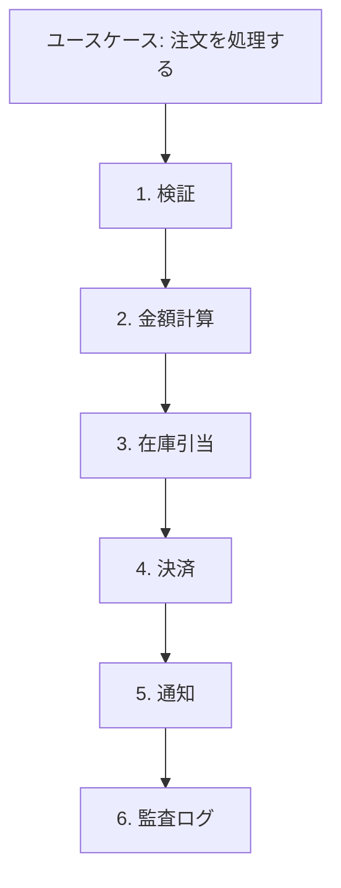

# 第3章: トランザクションスクリプト（1つのユースケースを手続きで書く）

> この章の軸: ②業務ロジックの置き方

## この章のゴール

業務ロジックを「1つのユースケースにつき1つの手続き」として書く形を身に付けます。長いメソッドを、手順の名前が並ぶ読みやすい手続きに整えます。この形は、業務ロジックの標準形です。

## Why: なぜ手続きで書くのか

業務ロジックの書き方には、いくつかの流派があります。その中で、最も素直で、最もよく使われるのが、トランザクションスクリプトです。「注文する」「キャンセルする」のようなユースケースごとに、上から下へ手続きを書きます。

この形は、小さな業務なら、最も速く書けて、最も読みやすい形です。しかし、手続きが1つの長いメソッドに詰め込まれると、読めなくなります。この章では、手続きの形を保ったまま、読みやすく整える方法を学びます。

## 前提

[第2章](./02-roles.md)を読み終えていること。第2章の `Service` が持つ中身を、どう書くかが、この章の話題です。

この章の題材は、注文処理の窓口（`OrderProcessor`）です。1つの `process` メソッドが、検証、金額計算、在庫引当、決済、通知、監査ログを順に行います。

## 悪い実装を読む

次のファイルを開いてください。

- [LongMethodOrderProcessor.java](../src/main/java/com/example/orders/ch03_transaction_script/before/LongMethodOrderProcessor.java)

`process` メソッドは、約80行あります。手続きの形そのものは、悪くありません。コメントで6つの手順に区切られ、上から下へ流れています。しかし、次の問題があります。

- 全体の流れを知りたいだけでも、80行を読む必要があります
- 割引の計算だけを直したいとき、検証や在庫の変数が視界に入ります
- 手順の途中で使う変数（`subtotal`、`discount`、`total`）が、メソッド全体に散らばっています

次の変更要求が来たら、どこを触るか想像してください。

- クーポンの種類を、1つ増やしたい
- 通知に、プッシュ通知を足したい

どちらも、80行のメソッドを開いて、該当箇所を探すことから始まります。

## 考え方

### トランザクションスクリプトとは

1つのユースケースを、1つのメソッドが、上から下へ実行する形です。データの形（DTO や単純なクラス）は、手続きの外に置き、ルールは手続きの中に書きます。



### 手続きを読みやすくする3つの約束

| 約束 | 内容 |
| :--- | :--- |
| 入口は1つ | 外から呼べるのは、ユースケースを表す `public` メソッドだけにする |
| 入口は目次 | `public` メソッドは、手順の名前を並べた短いメソッドにする |
| 手順に名前を付ける | 手順の中身は、`private` メソッドに切り出し、何をするかが分かる名前を付ける |

大切なのは、**クラスを増やさないこと** です。手続きの形を崩さず、メソッドの切り方だけで読みやすくします。

### 適用すると嬉しい状況・損をする状況

| 観点 | 内容 |
| :--- | :--- |
| 嬉しい状況 | 業務ルールが多くなく、ユースケースごとに処理が独立している。業務を理解した人が、すぐ読める |
| 損をする状況 | 同じルールが複数のユースケースに現れる。ルールの重複が増え、直す箇所が散らばる |
| 使わない選択肢 | 同じルールが散らばってきたら、ルールを業務オブジェクトに持たせる（ドメインモデル、第9章） |

> **⚠️ よくある失敗・誤解**
> 「手続きで書くのは、古い書き方だ」というのは誤解です。業務の規模に合っていれば、最も保守しやすい形です。問題は手続きの形ではなく、1つの長いメソッドに詰め込むことです。

## 課題: 分解してみよう

課題用のクラスは [exercise パッケージ](../src/main/java/com/example/orders/ch03_transaction_script/exercise/) にあります。`ExerciseOrderProcessor` が、分解前のコピーです。

### ステップ1: 現状を確認する

```bash
mvn test
```

`TransactionScriptStructureTest` の2件が失敗します。理由は、`process` が長すぎることと、手順の `private` メソッドがないことです。

### ステップ2: 手順に名前を付ける

コメントで区切られた6つの手順に、動詞を使った名前を付けてください。次の問いに答えます。

- 割引の計算は、1つのメソッドで足りますか。会員ランク、クーポン、12月の割引を分けると、読みやすいでしょうか
- 手順の間で受け渡す値は、何ですか。メソッドの戻り値と引数で表せますか
- 決済の拒否で在庫を戻す処理は、どの手順に属しますか

### ステップ3: 1つずつ切り出す

手順を1つ切り出すたびに、`mvn test` で契約テストが green のままであることを確かめます。

### ステップ4: process を目次にする

`process` を、手順の名前を並べるだけのメソッドにします。20行以内が目安です。

### ステップ5: 確認する

```bash
mvn test
```

> **🔍 確認・実験してみよう**
> 「クーポンの種類を1つ増やす」という変更を加えるとき、読む必要があるメソッドは、何個ですか。分解前の80行と比べてください。

## 動作確認

`mvn test` が、分解の前後で green であることを確認します。`TransactionScriptStructureTest` は、次の3点を確かめます。

- 外から呼べるメソッドが `process` だけであること
- 手順ごとの `private` メソッドが5つ以上あること
- `process` が20行以内であること

## 解答例と解説

解答例の全文は [answers/ch03_transaction_script/](../answers/ch03_transaction_script/) にあります。自分で書き終えてから開いてください。

<details>
<summary>解答例の要点を見る</summary>

### process は目次になる

```java
@Override
public OrderResult process(Order order) {
    validate(order);
    int subtotal = subtotalOf(order);
    int discount = discountOf(order, subtotal);
    int total = subtotal - discount;
    reserveStock(order);
    charge(order, total);
    notifyCustomer(order, total);
    writeAuditLog(order, total);
    return new OrderResult(order.id(), subtotal, discount, total);
}
```

### 手順の切り方

| メソッド | 役割 |
| :--- | :--- |
| `validate` | 入力の検証 |
| `subtotalOf`、`discountOf` | 小計と割引の計算。割引は、ランク、クーポン、12月の3つの小さなメソッドに分かれる |
| `reserveStock` | 在庫の確認と引当 |
| `charge` | 決済。拒否したときは在庫を戻す |
| `notifyCustomer`、`writeAuditLog` | 通知と監査ログ |

### なぜこの切り方か

- クラスは増やしていません。手続きの形は同じで、メソッドの切り方だけを変えました
- `process` を読めば、注文処理の流れが分かります。細部が必要なときだけ、下のメソッドを読みます
- 割引の計算を3つに分けたので、クーポンを足すときの変更が `couponDiscount` に閉じます

</details>

## 他のパターンと比べる

| 比べる相手 | 違い |
| :--- | :--- |
| ドメインモデル（第9章） | ドメインモデルは、ルールを業務のオブジェクト（在庫、金額など）に持たせる。同じルールが複数のユースケースに現れたら、移行を考える |
| Strategy（第12章） | 割引の if-else が、種類の追加のたびに伸びるなら、差し替え可能な部品にする。この章の `couponDiscount` を切り出す形 |
| Layered（第4章） | 層の中の「業務層」に置くクラスの書き方が、この章のトランザクションスクリプト |

> **💼 現場Tip**
> メソッドの長さは、行数ではなく、「1画面で全体が見えるか」で判断します。1つのメソッドが2画面を超えたら、手順の名前を付けて切り出すサインです。

## もっと良くしてみよう

### 理解確認

1. `public` メソッドを `process` だけにするのは、なぜですか
1. 手続きの形を保ったまま読みやすくする方法と、クラスに分ける方法の違いは何ですか
1. トランザクションスクリプトが向かなくなるのは、どんなときですか

### 発展改善クイズ

1. `discountOf` の中の、会員ランクの割引とクーポンの割引を、別のクラスに切り出すとしたら、どんな条件がそろったときですか
1. 在庫の `Map` を `ExerciseOrderProcessor` が直接持っています。第2章の考え方で、どう直しますか

---

| [← 第2章: クラスの役割を分ける](./02-roles.md) | [全章目次](./README.md) | [第4章: Layered →](./04-layered.md) |
| - | :-: | --: |
