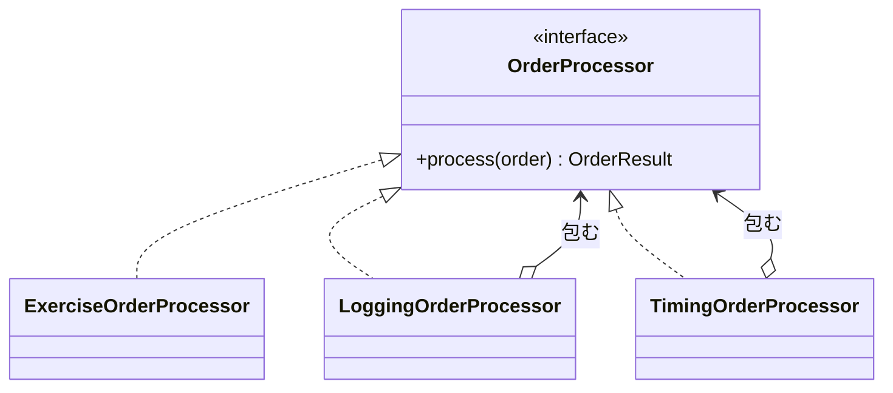
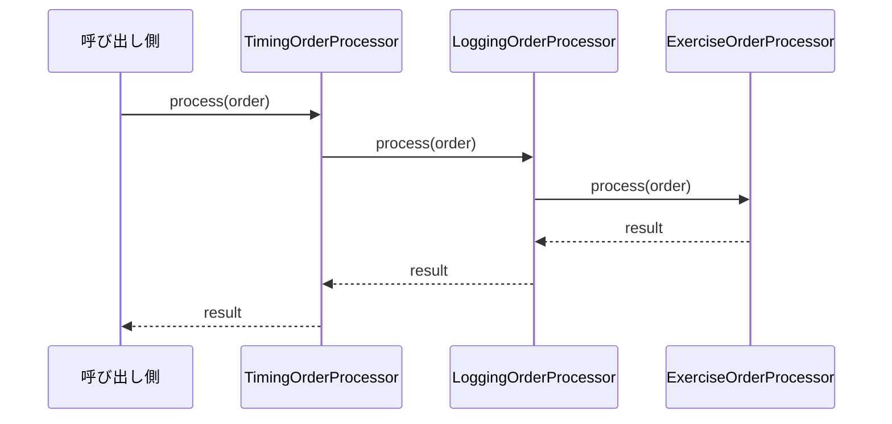

# 第4章: Decorator（ログと計測を本体に混ぜずに重ねる）

> この章の軸: ①クラスの作り方

## この章のゴール

ログ出力と実行時間の計測を、注文処理の本体から取り除きます。同じ窓口を持つ「包む側のクラス」として重ねられる構造にします。第0章で触れたAOPの考え方を、手作業で体験する章です。

## Why: なぜDecoratorを学ぶのか

ログ、計測、認可チェック、トランザクション管理は、業務の中心ではありません。しかし、ほぼすべての処理に必要です。第0章で学んだ「横断的関心事」です。

本体に直接書くと、2つの問題が起きます。1つ目は、ユースケースが増えるたびに同じ記述をコピーすることです。2つ目は、業務ロジックが `try / catch / finally` に埋もれて、読みにくくなることです。

## 前提

[第3章](./03-observer.md)を読み終えていること。

## 悪い実装を読む

次のファイルを開いてください。

- [LoggingInlineOrderProcessor.java](../src/main/java/com/example/orders/ch04_decorator/before/LoggingInlineOrderProcessor.java)

`process` メソッドの冒頭と末尾に注目してください。ログの開始、`try`、成功のログ、`catch` での失敗のログ、`finally` での計測が、本来の注文処理を包んでいます。

次の変更要求が来たら、どこを触るか想像してください。

- ログの書式を変えたい
- 本番では計測を止めて、検証環境でだけ計測したい
- 認可チェックを足したい

どれも、注文処理の本体を書き換えることになります。しかも、計測の有無を切り替えるには、本体に `if` を足すしかありません。

## 考え方

### 何が変わりやすく、何が変わりにくいか

| 問い | この題材での答え |
| :--- | :--- |
| 変わりにくい部分は何か | 「注文を受けて、結果を返す」という窓口（`OrderProcessor`） |
| 変わりやすい部分は何か | 窓口の前後に付ける処理の種類と、その組み合わせ |

Decoratorは、**同じ窓口を実装した別のクラスで、本体を包みます**。包む側は、中に同じ窓口を持ちます。呼び出す側は、本体と包まれたものを区別できません。

### 構造





### AOPとの関係

第0章では、AOPは「横断的関心事を、本体とは別の軸で切り出す考え方」と紹介しました。Decoratorは、それを手作業で行う形です。

| 観点 | Decorator（この章） | AOPフレームワーク |
| :--- | :--- | :--- |
| 包む作業 | 自分でクラスを書き、組み立てる | 設定や注釈で宣言すると、自動で包まれる |
| 処理の流れ | コードを追えば見える | 見えにくい（宣言を探す必要がある） |
| 向いている規模 | 横断的処理が少ない | 横断的処理が多く、対象が多い |

フレームワークが裏でやっていることは、この章で書くクラスと同じです。仕組みを知っていると、フレームワークの挙動に戸惑いにくくなります。

### 適用すると嬉しい状況・損をする状況

| 観点 | 内容 |
| :--- | :--- |
| 嬉しい状況 | 横断的な処理が複数あり、組み合わせや有無を切り替えたい。本体を業務ロジックだけに保ちたい |
| 損をする状況 | 横断的な処理が1つで、対象も1カ所だけ。窓口（インターフェース）がなく、包む対象が決まっていない |
| 使わない選択肢 | 本体に直接書く。継承で拡張する。AOPフレームワークを使う |

> **⚠️ よくある失敗・誤解**
> デコレータは、本体の振る舞いを変えてはいけません。結果を書き換えたり、例外を握りつぶしたりすると、呼び出し側が混乱します。ログのデコレータは、失敗を記録した後で、**例外をそのまま投げ直す** 必要があります。

## 課題: 分解してみよう

課題用のクラスは [exercise パッケージ](../src/main/java/com/example/orders/ch04_decorator/exercise/) にあります。

- `ExerciseOrderProcessor`: 分解前のコピー。ログと計測を取り除きます
- `LoggingOrderProcessor`, `TimingOrderProcessor`: 中身が空の雛形。形（コンストラクタ）は変えません

### ステップ1: 現状を確認する

```bash
mvn test
```

この章の `DecoratorTest` の5件が失敗します。雛形のデコレータが、何もせず委譲するだけだからです。

### ステップ2: ログのデコレータを書く

`LoggingOrderProcessor` に、開始・成功・失敗のログを書いてください。次の問いに答えてください。

- 注文が `null` のとき、注文IDはどう取り出しますか
- 失敗したとき、例外はどうしますか
- 成功したときのログに、請求額が必要です。どこから取りますか

### ステップ3: 計測のデコレータを書く

`TimingOrderProcessor` に、かかった時間の出力を書いてください。時計は `LongSupplier` で外から渡されます。

- なぜ `System.nanoTime()` を直接呼ばないのでしょうか
- 失敗したときも、時間を出力すべきでしょうか。そのためには、どんな構文が必要ですか

### ステップ4: 本体から取り除く

`ExerciseOrderProcessor` から、ログと計測の記述をすべて取り除いてください。取り除いた後、`process` メソッドから `try / catch / finally` が消えているはずです。

### ステップ5: 重ねる順序を決める

テストでは、`Timing(Logging(本体))` の順に重ねています。逆の `Logging(Timing(本体))` にすると、出力はどう変わりますか。動かす前に予想してください。

### ステップ6: 確認する

```bash
mvn test
```

> **🔍 確認・実験してみよう**
> 認可チェックのデコレータを、自分で足してみてください。たとえば「ゴールド会員だけが、10万円を超える注文をできる」というルールです。新しく作るファイルと、変更するファイルを数えてみましょう。

## 動作確認

```bash
mvn test
```

## 解答例と解説

解答例の全文は [answers/ch04_decorator/](../answers/ch04_decorator/) にあります。自分で書き終えてから開いてください。

<details>
<summary>解答例の要点を見る</summary>

### ログのデコレータ

```java
@Override
public OrderResult process(Order order) {
    // 注文IDは null の可能性があるため、安全に取り出す
    String orderId = order == null ? null : order.id();
    out.println("[LOG] start order=" + orderId);
    try {
        // 本来の処理に委譲する
        OrderResult result = delegate.process(order);
        out.println("[LOG] end order=" + orderId + " total=" + result.total());
        return result;
    } catch (RuntimeException e) {
        // 失敗を記録し、例外はそのまま呼び出し側へ返す
        out.println("[LOG] failed order=" + orderId + " reason=" + e.getMessage());
        throw e;
    }
}
```

### 計測のデコレータ

```java
@Override
public OrderResult process(Order order) {
    long startedAt = nanoClock.getAsLong();
    try {
        return delegate.process(order);
    } finally {
        // 成功でも失敗でも、かかった時間を出力する
        long elapsedMillis = (nanoClock.getAsLong() - startedAt) / 1_000_000;
        String orderId = order == null ? null : order.id();
        out.println("[TIME] order=" + orderId + " elapsed=" + elapsedMillis + "ms");
    }
}
```

### なぜこの切り方か

- ログと計測は、変更の理由が別々です。ログの書式は運用の都合、計測は性能調査の都合で変わるため、別のクラスにします
- 時計を外から渡すのは、テストで時間を固定するためです。`System.nanoTime()` を直接呼ぶと、結果が毎回変わり、テストできません
- 失敗時にも計測を出力するため、`finally` を使います
- 重ねる順序で結果が変わります。`Timing(Logging(本体))` の計測には、ログ出力の時間も含まれます。`Logging(Timing(本体))` では、計測の出力がログの開始と終了の間に入ります

</details>

## 他のパターンと比べる

| 比べる相手 | 違い |
| :--- | :--- |
| Strategy（第2章） | Strategyは中身の方式を差し替える。Decoratorは同じ窓口のまま、前後に処理を足す |
| Observer（第3章） | Observerは処理が終わった後の反応を、複数登録する。Decoratorは処理の前後と失敗を含めて包む |
| Layered（第8章） | 層は役割の違うクラスを縦に分ける。Decoratorは同じ役割のクラスを横に重ねる |

> **💼 現場Tip**
> 本番障害の調査では、「どの処理に何秒かかったか」を示すログが頼りになります。計測を本体に混ぜずにデコレータにしておくと、計測の追加や削除が簡単になり、本番に入れる判断もしやすくなります。

## もっと良くしてみよう

### 理解確認

1. デコレータとそれに包まれる本体は、なぜ同じインターフェースを実装する必要があるのでしょうか
1. ログのデコレータが、例外を握りつぶすと、何が困りますか
1. 横断的関心事をAOPフレームワークに任せるとき、何が楽になり、何が見えにくくなりますか

### 発展改善クイズ

1. 重ねるデコレータが5つになると、組み立てのコードが読みにくくなります。組み立てを整理するには、どんな方法がありそうでしょうか。自分なりに考えてみましょう
1. 注文処理のたびに、ログに出す注文IDを引数で渡すのは手間です。ログに共通の情報（ユーザーIDなど）を自動で付けたいとき、どうするとよいでしょうか。次の章へ進む前に考えてみましょう

---

| [← 第3章: Observer](./03-observer.md) | [全章目次](./README.md) | [第5章: Factory →](./05-factory.md) |
| - | :-: | --: |
