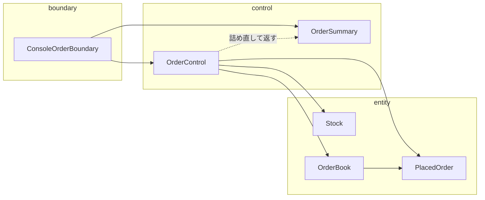
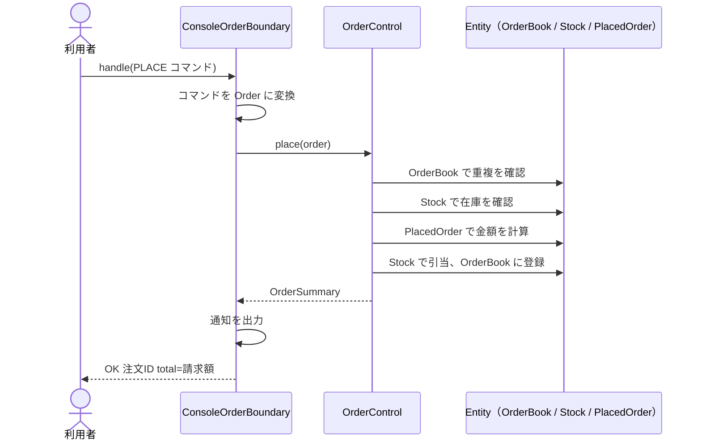

# 第5章: ECB（外との接点・処理の流れ・業務の概念で分ける）

> この章の軸: ①アプリ全体の分け方

## この章のゴール

クラスを、Boundary（外との接点）、Control（処理の流れ）、Entity（業務の概念）の3つに分けます。同じアプリを Layered で分けた第4章と比べて、「何を基準に分けているか」の違いを説明できるようになります。

## Why: なぜもう一つの分け方を学ぶのか

第4章の Layered は、**技術的な関心事**（表示、業務、保存）で縦に積みます。もう1つの有力な分け方が、ECB（Entity / Control / Boundary）です。ECB は、**業務の概念** を中心に置きます。

業務の担当者と話すときは、「在庫」「注文」のような概念で会話します。コードの構造が業務の言葉に対応していれば、仕様変更の入れ先はすぐ決まります。要件定義や設計書を書く現場では、ECB のほうが馴染みやすい現場もあります。

## 前提

[第4章](./04-layered.md)を読み終えていること。第4章と同じ注文アプリ（`OrderApp`）を、別の切り口で分けます。仕様は第4章と同じです。

## 悪い実装を読む

次のファイルを開いてください。第4章と同じ神クラスです。

- [ConsoleOrderApp.java](../src/main/java/com/example/orders/ch05_ecb/before/ConsoleOrderApp.java)

第4章では、このクラスを「表示・業務・保存」の技術の軸で切りました。今回は、別の問いで切ります。

- 「在庫」は、どの行に現れていますか。在庫に関するルールは、何ですか
- 「注文」は、どの行に現れていますか。注文に関するルールは、何ですか
- 外の世界（コマンド文字列、コンソール）と接している行は、どれですか

## 考え方

### 3つの役割

| 役割 | 責務 | この題材では |
| :--- | :--- | :--- |
| Entity | 業務の概念と、その概念が持つルール | 在庫（足りなければ引き当てられない）、注文（金額計算、決済上限）、注文の台帳（IDは重複しない） |
| Control | 処理の流れ。どの Entity を、どの順で使うか | 注文を受け付ける手順 |
| Boundary | 外の世界との接点。入力を受け、出力を返す | コマンドの解釈、応答の文字列、通知の出力 |


### 依存の向き

守る約束は3つです。

1. Boundary は、Control だけを呼ぶ。Entity を直接は使わない
1. Control は、Entity を使う。Boundary を知らない
1. Entity は、他の2つの役割（Control と Boundary）を知らない

Boundary が Entity を直接使わないので、Control は、Boundary に返す値を詰め直します（`OrderSummary`）。この値は、第2章で学んだ DTO にあたります。

### Layered との違い

| 観点 | Layered（第4章） | ECB（この章） |
| :--- | :--- | :--- |
| 分ける基準 | 技術的な関心事（表示・業務・保存） | 業務の概念との関係（外・流れ・概念） |
| ルールの置き場所 | 業務層のクラス全体 | Entity が、自分に関するルールを持つ |
| 保存 | 永続化層が担う | この教材では、台帳（Entity）がメモリ上で持つ |
| 向く場面 | 技術の担当が分かれているチーム | 業務の概念を中心に設計・会話するチーム |

どちらが優れているというより、見る角度が違います。実際には、Layered の業務層の中身を ECB の考え方で整理するなど、組み合わせて使われます。

> **⚠️ よくある失敗・誤解**
> Control に、すべてのルールを書いてしまうと、Layered の業務層に、手続きを詰め込んだだけになります。ルールは、それを一番よく知っている Entity に持たせます。

### 適用すると嬉しい状況・損をする状況

| 観点 | 内容 |
| :--- | :--- |
| 嬉しい状況 | 業務の言葉（概念）が、設計書や会話の中心にある。ルールを概念ごとに整理したい |
| 損をする状況 | ルールがほとんどなく、データを右から左へ渡すだけの処理。概念を作る意味が薄い |
| 使わない選択肢 | 第4章の Layered のまま、業務層に手続きとして書く（第3章） |

## 課題: 分解してみよう

課題用のクラスは [exercise パッケージ](../src/main/java/com/example/orders/ch05_ecb/exercise/) にあります。`ExerciseOrderApp` が、分解前のコピーです。

次の3つのパッケージを、`exercise` の下に作ってください。

- `boundary`
- `control`
- `entity`

### ステップ1: 現状を確認する

```bash
mvn test
```

`EcbStructureTest` の5件が失敗します。3つのパッケージが、まだないためです。

### ステップ2: 概念を探す

`ExerciseOrderApp` を読み、業務の名詞を拾い出してください。次の問いに答えます。

- 「在庫が足りない」という判断は、どの概念が持つべきですか
- 「請求額を計算する」「決済の上限を確認する」は、どの概念が持つべきですか
- 注文IDの重複を確認するには、どんな概念が必要ですか

### ステップ3: Entity から作る

依存される側から作ると、迷いません。

1. `entity`: 概念ごとのクラス。自分に関するルールを持たせる
1. `control`: 処理の流れ。Boundary に返す値の型もここに置く
1. `boundary`: コマンドの解釈、応答の組み立て、通知の出力

### ステップ4: 組み立て役を残す

`ExerciseOrderApp` には、部品を作って渡す処理だけを残します。

### ステップ5: 確認する

```bash
mvn test
```

> **🔍 確認・実験してみよう**
> 「シルバー会員の割引を8%にする」という変更を加えるとき、触るクラスはどれですか。第4章の Layered で同じ変更をするときと比べてください。

## 動作確認

`mvn test` が、分解の前後で green であることを確認します。`EcbStructureTest` は、`import` を読んで、3つの依存の約束が守られているかを確かめます。

## 解答例と解説

解答例の全文は [answers/ch05_ecb/](../answers/ch05_ecb/) にあります。自分で書き終えてから開いてください。

<details>
<summary>解答例の要点を見る</summary>

### クラスの配置

| 役割 | クラス | 持っているもの |
| :--- | :--- | :--- |
| Entity | `Stock` | 在庫数、「足りなければ引き当てられない」ルール |
| Entity | `PlacedOrder` | 小計、会員ランク割引、決済上限のルール |
| Entity | `OrderBook` | 注文の台帳、「IDは重複しない」ための確認 |
| Control | `OrderControl`、`OrderSummary` | 注文を受け付ける手順、Boundary に返す値 |
| Boundary | `ConsoleOrderBoundary` | コマンドの解釈、応答の文面、通知の出力 |

### 依存の向き（クラス図）

矢印は「使う」関係です。Boundary は Entity を直接使わず、Control が返す `OrderSummary` を受け取ります。



### PLACE の流れ（シーケンス図）



### Control は流れだけを知っている

```java
public OrderSummary place(Order order) {
    if (book.contains(order.id())) {
        throw new OrderValidationException("注文IDが重複しています: " + order.id());
    }
    stock.assertAvailable(order.lines());
    PlacedOrder placed = PlacedOrder.from(order);
    stock.reserve(order.lines());
    book.add(placed);
    return summaryOf(placed);
}
```

### なぜこの切り方か

- 割引や決済上限の計算は、`PlacedOrder` が持ちます。Control を読んでも、割引の率は出てきません
- 在庫のルールは `Stock` にあるので、在庫を使う別の処理を足しても、同じルールを使えます
- 通知は、利用者へ知らせる出力なので、Boundary に置きました
- Boundary は Entity を知りません。画面の都合が、業務の概念を汚しません

</details>

## 他のパターンと比べる

| 比べる相手 | 違い |
| :--- | :--- |
| Layered（第4章） | 技術の軸で縦に積むか、業務の概念を中心に置くか。ルールを持つクラスが、層のクラスか、概念のクラスかが違う |
| MVC（第6章） | MVC は、画面まわりを入力・表示・データの役割で分ける。ECB の Boundary が、MVC の View と Controller にあたる |
| ドメインモデル（第9章） | ECB の Entity にルールを持たせる考え方を、さらに深める。値オブジェクトやリポジトリを加える |
| Hexagonal（第10章） | ECB の Boundary を、外部との差し替え可能な接続口として整理し直した形と見ることもできる |

> **💼 現場Tip**
> 設計書に「画面」「処理」「データ」のような列があれば、それが Boundary、Control、Entity のサインです。設計書とコードの構造が対応していると、仕様変更の影響範囲を、設計書の段階で見積もれます。

## もっと良くしてみよう

### 理解確認

1. Boundary が Entity を直接使わないのは、なぜですか
1. ルールを Control ではなく Entity に持たせると、何が嬉しいのですか
1. Layered と ECB で、同じ「割引の変更」を行うとき、触るクラスはどう違いますか

### 発展改善クイズ

1. `Stock` が `Map` を直接持っています。保存先をデータベースに替えるとき、どこを変えればよいでしょうか
1. Boundary が通知を出力しています。メール送信に替えるとき、Boundary はどう変わりますか。複数の通知先に増えたら、どうでしょうか

---

| [← 第4章: Layered](./04-layered.md) | [全章目次](./README.md) | [第6章: MVC →](./06-mvc.md) |
| - | :-: | --: |
