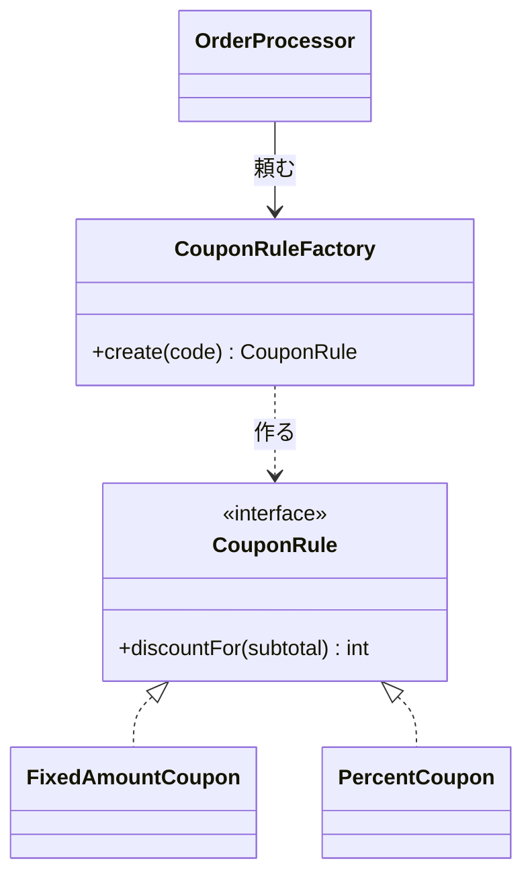

# 第5章: Factory（どの実装を使うかの判断を切り離す）

> この章の軸: ①クラスの作り方

## この章のゴール

クーポンコードから割引ルールを選ぶ判断を、使う側から切り離して「工場」に集めます。新しいクーポンを足しても、注文処理の本体を書き換えずに済む構造を目指します。

## Why: なぜFactoryを学ぶのか

[第2章](./02-strategy.md)では、割引ルールを1つずつのクラスに分けました。しかし、そのクラスを **いつ、どれを選ぶか** という判断は残ります。

この判断が使う側に書かれていると、次の問題が起きます。使う側が、すべての具体的なクラスを知ることになります。新しい種類を足すたびに、使う側も書き換えます。同じ判断を別の場所でも書きたくなると、コピーが増えます。

## 前提

[第4章](./04-decorator.md)を読み終えていること。この章でも、第2章と同じ形のDI（コンストラクタ注入）を使います。

## 悪い実装を読む

次のファイルを開いてください。「2. 金額計算」の中の、クーポンを扱う部分に注目します。

- [CouponInlineOrderProcessor.java](../src/main/java/com/example/orders/ch05_factory/before/CouponInlineOrderProcessor.java)

クーポンコードの文字列を `if` で見分けて、割引額を直接計算しています。次の変更要求が来たら、どこを触るか想像してください。

- 新しいクーポン `VIP20`（20%引き）を足したい
- クーポンの種類が数十になり、期限や利用回数の条件も付けたい
- 注文の検証とは別に、画面でもクーポンコードを事前に確認したい

どれも、注文処理の本体の中を書き換えます。画面でも使いたいとなると、同じ判断をもう1カ所書くことになります。

## 考え方

### 何が変わりやすく、何が変わりにくいか

| 問い | この題材での答え |
| :--- | :--- |
| 変わりにくい部分は何か | 「コードを渡すと、割引ルールが得られる」という約束 |
| 変わりやすい部分は何か | どのコードが、どのルールに対応するか |

Factoryは、**生成の判断を1カ所に集め、使う側は結果の窓口（インターフェース）だけを受け取る** 形にします。使う側は `new` を書かず、具体的なクラス名も知りません。

### 構造



### Factoryにはいくつかの種類がある

| 種類 | 概要 | この教材での扱い |
| :--- | :--- | :--- |
| Simple Factory | 条件に応じて実装を返す、1つのクラスやメソッド | この章で作る形 |
| Factory Method | 何を作るかを、サブクラスが決める | テストの匿名サブクラスで差し替える形として登場する |
| Abstract Factory | 関連する部品の一式を、まとめて作る | 紹介のみ（例: 本番用の部品一式とテスト用の部品一式） |

### 工夫のポイント

- **クーポンなし（`null`）は「割引0のルール」として返します。** 使う側の `null` 判定がなくなります。このように「何もしない」実装を用意する考え方を、Null Objectと呼びます
- **`if` は消えず、工場の中の1カ所に隔離されます。** 数が増えたときは、登録表（`Map`）に置き換える方法もあります。それは発展クイズで考えます

### StrategyとDIの組み立て役との違い

| 役割 | 判断の内容 | 判断のタイミング |
| :--- | :--- | :--- |
| Strategy（第2章） | 差し替える部品の形を決める | 設計時 |
| DIの組み立て役（第2章） | 起動時にどの部品を渡すか決める | アプリ起動時に1回 |
| Factory（この章） | 入力に応じて、どの部品を使うか決める | 実行時に何度も |

> **⚠️ よくある失敗・誤解**
> 工場を作っても、使う側が `if (rule instanceof PercentCoupon)` のように具体的なクラスを調べていては意味がありません。工場の意味は、使う側に具体的なクラス名を見せないことです。

## 課題: 分解してみよう

課題用のクラスは [exercise パッケージ](../src/main/java/com/example/orders/ch05_factory/exercise/) にあります。

- `ExerciseOrderProcessor`: 分解前のコピー。ここを書き換えます
- `CouponRule`: 窓口の型。形は変えません
- `CouponRuleFactory`: 中身が空の雛形。`create` の形は変えません

### ステップ1: 現状を確認する

```bash
mvn test
```

この章の `CouponRuleFactoryTest` の4件が失敗します。

### ステップ2: ルールのクラスを作る

クーポンの割引は、何種類の計算式に分けられますか。それぞれを `CouponRule` の実装クラスにしてください。

- 固定額を引くものと、割合で引くものの違いは、どこに現れますか
- 数字（500、10）は、クラスの外から渡しますか。それとも、クラスの中に書きますか

### ステップ3: 工場を作る

`CouponRuleFactory.create` に、コードからルールを作る判断を書いてください。

- `null` のとき、何を返しますか
- 未知のコードのとき、何を返しますか。呼び出し側は、何を期待していますか

### ステップ4: 注文処理から判断を取り除く

3引数のコンストラクタで受け取った工場を使って、クーポンの割引額を計算してください。注文処理の中に、クーポンコードの文字列が残っていないことを確認します。

### ステップ5: 標準の組み立てを用意する

2引数のコンストラクタは、標準の工場を渡す形にしてください。

### ステップ6: 確認する

```bash
mvn test
```

> **🔍 確認・実験してみよう**
> `CouponRuleFactoryTest` の最後のテストを読んでください。`VIP20` は、標準の工場にはありません。それでも、注文処理は割引を計算できます。注文処理のどこも変更していない点に注目してください。

## 動作確認

```bash
mvn test
```

## 解答例と解説

解答例の全文は [answers/ch05_factory/](../answers/ch05_factory/) にあります。自分で書き終えてから開いてください。

<details>
<summary>解答例の要点を見る</summary>

### 工場

```java
public CouponRule create(String code) {
    // クーポンなしは「割引0」のルールとして扱い、呼び出し側の null 判定をなくす
    if (code == null) {
        return subtotal -> 0;
    }
    if (code.equals("WELCOME500")) {
        return new FixedAmountCoupon(500);
    }
    if (code.equals("SAVE10")) {
        return new PercentCoupon(10);
    }
    throw new OrderValidationException("未知のクーポンです: " + code);
}
```

### 注文処理側

```java
// クーポンの種類は知らず、工場が作ったルールに任せる
discount += couponFactory.create(order.couponCode()).discountFor(subtotal);
```

### なぜこの切り方か

- 「どのコードがどのルールか」という知識は、工場だけが持ちます。注文処理は、ルールの種類を知りません
- 固定額と割合は計算式が違うため、別のクラスにします。数字はコンストラクタで渡し、同じクラスを使い回せるようにします
- 未知のコードの例外は、工場が投げます。コードを解釈するのは工場の責務だからです
- 工場をコンストラクタで受け取るため、テストでは `VIP20` を足した別の工場に差し替えられます

</details>

## 他のパターンと比べる

| 比べる相手 | 違い |
| :--- | :--- |
| Strategy（第2章） | Strategyは部品の形（窓口）を作る。Factoryは、入力に応じてどの部品を使うか選ぶ。両者は組み合わせて使うことが多い |
| Template Method（第6章） | Template Methodは、処理の骨格の中で差分だけを継承で埋める。Factoryは、部品の生成を切り離す |
| enum | 種類が固定なら、`enum` の `valueOf` で十分なことも多い。外から種類を足したいなら、工場が向く |

> **💼 現場Tip**
> 画面の入力チェックと、サーバー側の業務ロジックで、同じ判断が2カ所に書かれることはよくあります。判断を工場に集めておくと、両方から同じ工場を呼べて、仕様の食い違いを防げます。

## もっと良くしてみよう

### 理解確認

1. 工場を使うと、使う側が知らなくて済むことは何ですか
1. 「クーポンなし」を `null` のまま扱う場合と、割引0のルールにする場合で、使う側のコードはどう変わりますか
1. DIの組み立て役と、工場の違いを説明してみましょう

### 発展改善クイズ

1. クーポンの種類が数十種類に増えたとき、工場の中の `if` の連鎖をどう整理するとよいでしょうか。自分なりに考えてみましょう
1. クーポンに「期限」や「利用回数の上限」が付いたとき、工場とルールのどちらがその情報を持つべきでしょうか。次の章へ進む前に考えてみましょう

---

| [← 第4章: Decorator](./04-decorator.md) | [全章目次](./README.md) | [第6章: Template Method →](./06-template-method.md) |
| - | :-: | --: |
