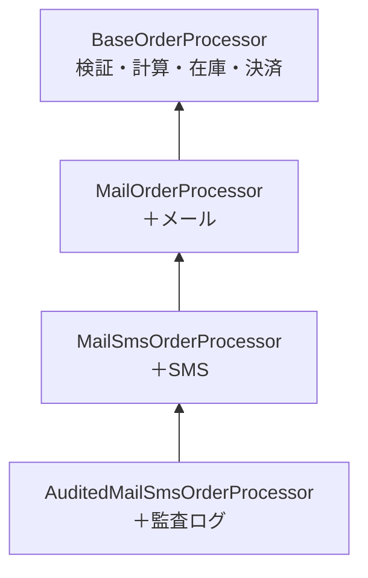
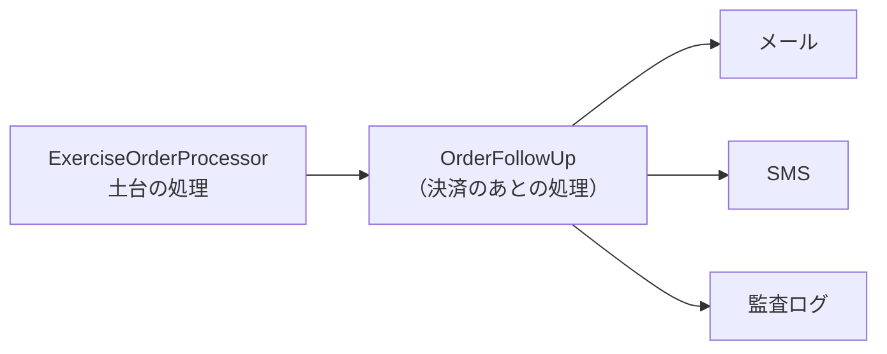
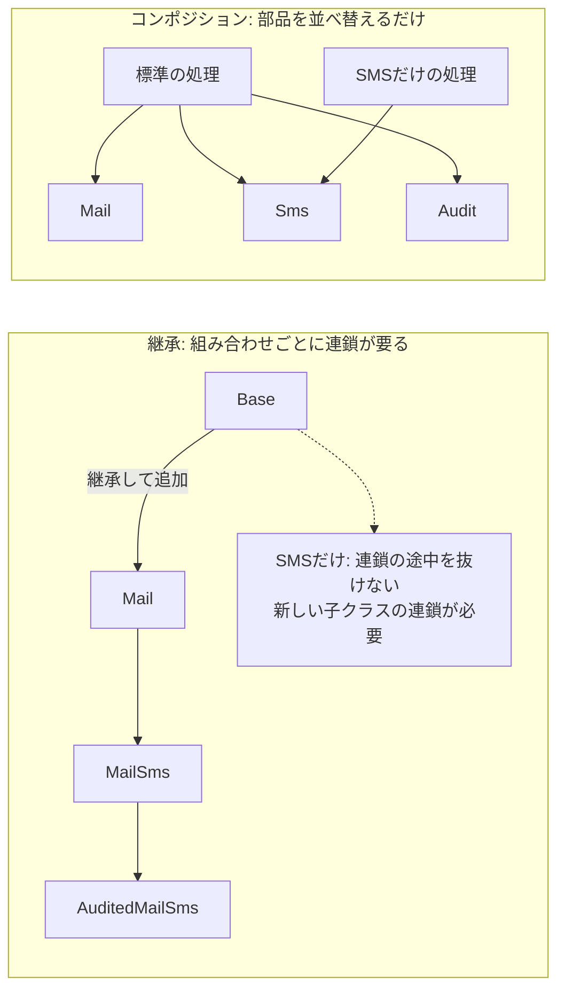

# 第8章: 継承よりコンポジション（部品を持って任せる）

> この章の軸: ③クラスの作り方

## この章のゴール

「継承で処理を足していく」設計の限界を体験し、「部品を持って任せる」形（コンポジション）に直します。クラスの再利用が必要な場面で、まずコンポジションを選べるようになります。

## Why: なぜ継承より委譲を選ぶのか

継承は、既存のクラスに処理を足す手っ取り早い方法です。しかし、次の問題があります。

- 親と子が強く結び付く。親を変えると、すべての子に影響する
- 組み合わせが固定される。「メールは要るがSMSは要らない」を作るには、新しい子クラスが要る
- 実行時に切り替えられない

コンポジションは、必要な部品を持って、仕事を任せる（委譲する）形です。部品を組み替えるだけで、振る舞いを変えられます。多くの現場で「抽象クラスよりコンポジション」と言われるのは、このためです。

## 前提

[第2章](./02-roles.md)を読み終えていること。第2章では、業務ロジックが基盤寄りの部品をコンストラクタで受け取る形（依存性注入）を使いました。この章は、その考え方を、クラスの再利用の観点から掘り下げます。

## 悪い実装を読む

次のファイルを開いてください。

- [BaseOrderProcessor.java](../src/main/java/com/example/orders/ch08_composition/before/BaseOrderProcessor.java)（土台）
- [MailOrderProcessor.java](../src/main/java/com/example/orders/ch08_composition/before/MailOrderProcessor.java)
- [MailSmsOrderProcessor.java](../src/main/java/com/example/orders/ch08_composition/before/MailSmsOrderProcessor.java)
- [AuditedMailSmsOrderProcessor.java](../src/main/java/com/example/orders/ch08_composition/before/AuditedMailSmsOrderProcessor.java)

土台のクラスに、メール、SMS、監査ログが、子クラスの連鎖で足されています。それぞれの子は、`super.process(order)` を呼んでから、自分の処理を足します。



動作は正しく、テストも通ります。次の変更要求が来たら、どうなるか想像してください。

- 「SMSは要るが、メールは要らない」顧客向けの処理を作りたい
- 「監査ログは要るが、通知は要らない」バッチ向けの処理を作りたい
- 通知の種類に、プッシュ通知を足したい

連鎖の途中を抜くことはできません。組み合わせごとに、新しい連鎖を作ることになります。

## 考え方

### 何を変わる部分と見なすか

土台の処理（検証・計算・在庫・決済）は、どの組み合わせでも同じです。変わるのは、**決済のあとに何をするか** です。そこで、変わる部分を部品として切り出します。



土台のクラスは、`List<OrderFollowUp>` を持ち、決済のあとに順に呼ぶだけです。何を入れるかは、組み立てる側が決めます。

### 「SMSだけ」を作るとき

要件が「SMSだけ送る処理」に変わったとき、継承とコンポジションでは、作るものが変わります。



### 継承とコンポジションの比べ方

| 観点 | 継承 | コンポジション |
| :--- | :--- | :--- |
| 関係 | 子は親の一種である（is-a） | 持っている部品に任せる（has-a） |
| 組み合わせ | 連鎖ごとに子クラスが要る | 部品を並べ替えるだけ |
| 切り替え | 作るときに固定 | 組み立てるときに決められる |
| テスト | 親ごとテストする | 部品を1つずつテストできる |
| 結合 | 強い（親の変更が子に波及） | 弱い（部品の窓口だけ知る） |

継承が適切な場面もあります。振る舞いの骨格を親に固定し、差分だけを子が持つ場合です。これは第16章（Template Method）で扱い、この章と比べます。

> **⚠️ よくある失敗・誤解**
> コードの重複を消すためだけに、継承を使うのはよくある失敗です。「子は親の一種と言えるか」を、まず問います。言えなければ、コンポジションを選びます。

### 適用すると嬉しい状況・損をする状況

| 観点 | 内容 |
| :--- | :--- |
| 嬉しい状況 | 追加の処理の組み合わせが、顧客や場面ごとに変わる。部品を単体でテストしたい |
| 損をする状況 | 組み合わせが1通りしかなく、今後も増えない。部品の窓口（インターフェース）が、読む手間を増やすだけの場合 |
| 使わない選択肢 | 追加の処理を `process` に直接書く。変更が起きないなら、それが最も単純 |

## 課題: 分解してみよう

課題用のクラスは [exercise パッケージ](../src/main/java/com/example/orders/ch08_composition/exercise/) にあります。継承版のコピーと、部品の窓口 `OrderFollowUp` が置いてあります。

### ステップ1: 現状を確認する

```bash
mvn test
```

`CompositionStructureTest` の3件が失敗します。追加の処理がまだ呼ばれないことと、継承の子クラスが残っていることが理由です。

### ステップ2: 部品に切り出す

3つの子クラスが足している処理を、`OrderFollowUp` を実装する部品にします。次の問いに答えます。

- 各部品は、何を持っておくべきですか。出力先だけで足りますか
- 部品に渡す情報は、`Order` と `OrderResult` で足りますか

### ステップ3: 土台に委譲させる

`ExerciseOrderProcessor` の `process` の最後で、持っている部品を順に呼びます。コンストラクタで受け取る `List` を使います。

### ステップ4: 標準の組み合わせを作る

`standard` メソッドが、メール、SMS、監査ログの3つの部品を渡して、処理を作るようにします。契約テストは、このメソッドで作った処理に当たります。

### ステップ5: 継承の子クラスを削除する

使わなくなった3つの子クラスを削除します。

### ステップ6: 確認する

```bash
mvn test
```

> **🔍 確認・実験してみよう**
> 「SMSだけ」を送る処理を作ってみてください。新しく書くクラスは何個ですか。継承版で同じ処理を作るときと比べてください。

## 動作確認

`mvn test` が、分解の前後で green であることを確認します。`CompositionStructureTest` は、次の3点を確かめます。

- 追加の処理を、既存クラスを変えずに差し込めること
- 追加の処理が、渡した順に実行されること
- 継承（`extends`）で処理を足す子クラスが残っていないこと

## 解答例と解説

解答例の全文は [answers/ch08_composition/](../answers/ch08_composition/) にあります。自分で書き終えてから開いてください。解答例を重ねる場合は、先に3つの子クラスを削除してください。

<details>
<summary>解答例の要点を見る</summary>

### クラスの配置

| クラス | 役割 |
| :--- | :--- |
| `ExerciseOrderProcessor` | 土台の処理。決済のあとに、持っている部品を順に呼ぶ |
| `OrderFollowUp` | 決済のあとの処理の窓口 |
| `MailFollowUp`、`SmsFollowUp`、`AuditFollowUp` | 部品。メール、SMS、監査ログ |

### 委譲する部分

```java
OrderResult result = new OrderResult(order.id(), subtotal, discount, total);
// ★重要★ 決済のあとの処理は、持っている部品に任せる（委譲）
for (OrderFollowUp followUp : followUps) {
    followUp.run(order, result);
}
return result;
```

### 組み立てる部分

```java
// ★重要★ 部品の組み合わせは、使う側が決める
return new ExerciseOrderProcessor(stock, out,
        List.of(new MailFollowUp(out), new SmsFollowUp(out), new AuditFollowUp(out)));
```

### なぜこの切り方か

- 「SMSだけ」は、`List.of(new SmsFollowUp(out))` で作れます。新しいクラスは要りません
- プッシュ通知は、`OrderFollowUp` を実装する新しいクラスを足すだけです。土台のクラスは変わりません
- 各部品は、単体でテストできます。`OrderResult` を渡せば、土台の処理を動かさずに確かめられます

</details>

## 他のパターンと比べる

| 比べる相手 | 違い |
| :--- | :--- |
| Template Method（第16章） | 継承で骨格を固定し、差分を子クラスに書く。この章は、差分を部品として持たせる。骨格が固定で、差分が数個に収まるなら、Template Method も選択肢 |
| Strategy（第12章） | この章の「部品を持って任せる」形の一つ。アルゴリズムを差し替える目的に特化している |
| Observer（第13章） | この章の `OrderFollowUp` の一覧は、Observer の形に近い。通知先が増減するなら、Observer として整える |
| Decorator（第14章） | 部品が、同じ窓口を持ったまま、別の部品を包む形。処理の前後に何かを足したいときに使う |

> **💼 現場Tip**
> コードレビューで `extends` を見つけたら、「子は親の一種と言えるか」「親が変わったとき、子はどうなるか」を問います。答えに自信がなければ、部品に切り出す案を出すサインです。

## もっと良くしてみよう

### 理解確認

1. 継承で処理を足すと、組み合わせが増えたときに困るのは、なぜですか
1. コンポジションで、土台のクラスが部品の窓口だけを知っていると、何が嬉しいのですか
1. 継承のほうが適切な場面は、どんなときですか

### 発展改善クイズ

1. 結果は、部品を呼ぶ順序で変わることがあります。順序に意味のある部品と、意味のない部品は、どう扱いますか
1. 部品の1つが例外を出したとき、残りの部品を呼ぶか、中断するか。どちらがよいでしょうか

---

| [← 第7章: Event-Driven](./07-event-driven.md) | [全章目次](./README.md) | [第9章: ドメインモデル →](./09-domain-model.md) |
| - | :-: | --: |
