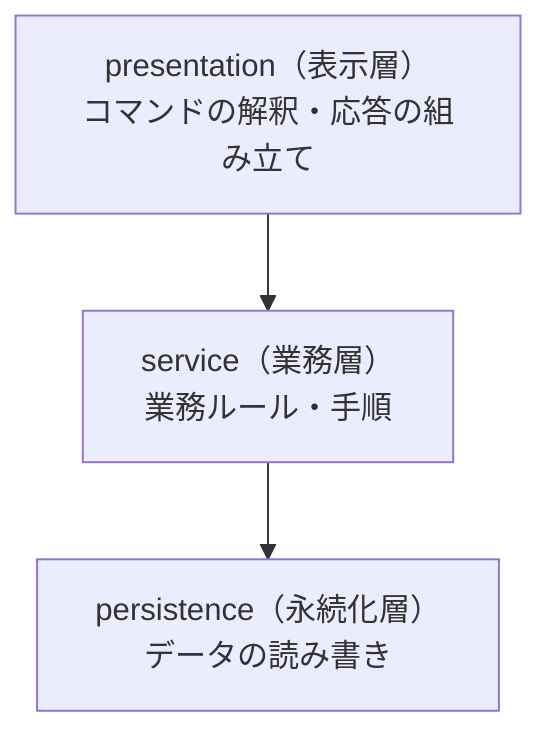

# 第8章: Layered（表示・業務・データ保存の層に分ける）

> この章の軸: ③アプリ全体の分け方

## この章のゴール

コマンドを解釈する処理、業務ルール、データの保存を、3つの層に分けます。層どうしの依存の向きを「上から下だけ」に保ちます。この章から、題材は「コマンドを受けて応答を返す注文アプリ」に変わります。

## Why: なぜ層に分けるのか

アプリが大きくなると、変更の理由はバラバラになります。画面の入力形式を変えたい人、割引のルールを変えたい人、保存先をデータベースに替えたい人は、それぞれ別の人で、別の時期に動きます。

1つのクラスにすべてを書くと、誰かの変更が他の人の領域を壊します。層に分けるのは、**変更の理由ごとに、変更の影響範囲を閉じ込める** ためです。多くのフレームワークも、この考え方を基本にしています。

## 前提

[第7章](./07-domain-model.md)を読み終えていること。第7章までは「注文処理」の窓口（`OrderProcessor`）を分解しました。この章からは、コマンド文字列を受ける窓口（`OrderApp`）を分解します。

### 注文アプリの仕様（第8〜12章で共通）

| コマンド | 意味 | 応答の例 |
| :--- | :--- | :--- |
| `PLACE 注文ID 顧客ID ランク 商品:単価:数量[;...]` | 注文する | `OK O1 total=9000` |
| `SHOW 注文ID` | 注文を参照する | `ORDER O1 customer=C1 total=9000` |
| `HISTORY 顧客ID` | 顧客の注文履歴を参照する | `HISTORY C1 O1,O2` |

失敗したときは、`ERROR 理由` を返します。詳しい仕様は、共通の契約テスト `OrderAppContractTest` を読むと確認できます。

## 悪い実装を読む

次のファイルを開いてください。

- [ConsoleOrderApp.java](../src/main/java/com/example/orders/ch08_layered/before/ConsoleOrderApp.java)

`handle` メソッドの中に、4つの関心事が混ざっています。

1. コマンド文字列の解釈（`split` や `Integer.parseInt`）
1. 業務ルール（重複確認、割引、在庫確認、決済上限）
1. データの保持（`stock`、`orderTotal`、`history` の `Map`）
1. 出力（`out.println`）と応答の文字列の組み立て

次の変更要求が来たら、どこを触るか想像してください。

- コマンドの形式を、別の形式に変えたい
- 割引ルールを変えたい。業務ルールだけを単体でテストしたい
- 注文の保存先を、データベースに替えたい

業務ルールのテストに、コマンド文字列を組み立てる必要があります。どの変更も、同じメソッドを書き換えることになります。

## 考え方

### 何が変わりやすく、何が変わりにくいか

アーキテクチャパターンでは、クラス単位ではなく **関心事の単位** で分けます。

| 関心事 | 変更の理由 | 変更する人 |
| :--- | :--- | :--- |
| 入出力（コマンドの形式、応答の文面） | 利用者や連携先の都合 | 画面や連携の担当 |
| 業務ルール（割引、在庫、決済上限） | 事業の都合 | 業務の担当 |
| データ保存（保存先、保存形式） | 技術や運用の都合 | 基盤の担当 |

### 3つの層



| 層 | 責務 | してはいけないこと |
| :--- | :--- | :--- |
| 表示層 | 入力の解釈、応答の組み立て | 業務ルールを書く。永続化層を直接呼ぶ |
| 業務層 | 業務ルール、処理の手順 | 表示層を知る。応答の文面を作る |
| 永続化層 | データの読み書き | 業務ルールを書く。上の層を知る |

守るルールは1つです。**依存は上から下へ一方向にします。** 下の層は、上の層を知りません。

### 層をまたぐ型に注意する

永続化層の型（`OrderRecord`）を、表示層まで返してはいけません。保存形式が変わるたびに、表示層まで影響するからです。業務層が、自分の型（`OrderSummary`）に変換して返します。

> **⚠️ よくある失敗・誤解**
> 層に分けたはずなのに、表示層から永続化層を直接呼んだり、業務層が表示用の文字列を作ったりすることがあります。形だけ分けても、依存が逆流していれば、変更の影響は閉じ込められません。

### 適用すると嬉しい状況・損をする状況

| 観点 | 内容 |
| :--- | :--- |
| 嬉しい状況 | 複数の人が、別々の理由で変更する。業務ルールを画面抜きでテストしたい |
| 損をする状況 | 小さな使い捨てのツール。層を通り抜けるだけのメソッドが増えるだけの場合 |
| 使わない選択肢 | 1クラスのままにする。画面と保存を直結する簡易なアプリ |

## 課題: 分解してみよう

課題用のクラスは [exercise パッケージ](../src/main/java/com/example/orders/ch08_layered/exercise/) にあります。`ExerciseOrderApp` が、分解前のコピーです。

次の3つのパッケージを、`exercise` の下に作ってください。

- `presentation`（表示層）
- `service`（業務層）
- `persistence`（永続化層）

### ステップ1: 現状を確認する

```bash
mvn test
```

`LayeredStructureTest` の4件が失敗します。層のパッケージが、まだないためです。

### ステップ2: 関心事に色を付ける

`ExerciseOrderApp` を上から読み、各行を4つの関心事（解釈、ルール、データ、出力）に分類してください。次の問いに答えます。

- 通知の出力（`[NOTIFY]`）は、どの層に置きますか
- 応答の文字列（`OK ...`）は、どの層が作りますか
- 「注文が見つかりません」というエラーは、どの層が判断しますか

### ステップ3: 下の層から切り出す

依存される側から作ると、迷いません。

1. `persistence`: 在庫と注文の保存（`Map` を隠す）
1. `service`: 業務ルールと手順
1. `presentation`: コマンドの解釈と応答の組み立て

### ステップ4: 組み立て役を残す

`ExerciseOrderApp` には、部品を作って渡す処理だけを残します。コンストラクタは変えません。

### ステップ5: 確認する

```bash
mvn test
```

> **🔍 確認・実験してみよう**
> 試しに、業務層のクラスに `import ...presentation...` を1行足してみてください。構造のテストはどう反応しますか。動かす前に予想してから確認します。

## 動作確認

```bash
mvn test
```

## 解答例と解説

解答例の全文は [answers/ch08_layered/](../answers/ch08_layered/) にあります。自分で書き終えてから開いてください。

<details>
<summary>解答例の要点を見る</summary>

### クラスの配置

| 層 | クラス | 役割 |
| :--- | :--- | :--- |
| 表示層 | `OrderCommandController` | コマンドの解釈、応答の文字列の組み立て |
| 業務層 | `OrderService`, `OrderSummary`, `OrderNotifier` | 業務ルール、層をまたぐ型、通知 |
| 永続化層 | `StockRepository`, `OrderRepository`, `OrderRecord` | 在庫と注文の読み書き |
| ルート | `ExerciseOrderApp` | 部品の組み立て |

### 組み立て役

```java
// 下の層から順に作り、上の層に渡す
StockRepository stocks = new StockRepository(stock);
OrderRepository orders = new OrderRepository();
OrderService service = new OrderService(stocks, orders, new OrderNotifier(out));
this.controller = new OrderCommandController(service, today);
```

### 層をまたぐ型の変換（業務層）

```java
// 永続化層の型を、業務層の型に変換して返す
return new OrderSummary(record.orderId(), record.customerId(), record.total());
```

### なぜこの切り方か

- コマンドの形式や応答の文面は、表示層だけが知ります。業務層は、`OrderResult` のような業務の型だけを返します
- 業務層は、注文を受け付ける手順とルールだけを持ちます。業務ルールを、コマンド文字列なしでテストできます
- 永続化層は、データを読み書きするだけです。保存先を替えるときは、この層だけを書き換えます
- 通知は、業務の一部（成立したら知らせる）として、業務層に置きました。ただし、業務層が `PrintStream` を持つ形は理想的とは言えません。第10章で見直します

</details>

## 他のパターンと比べる

| 比べる相手 | 違い |
| :--- | :--- |
| ドメインモデル（第7章） | 第7章は「ルールをどのオブジェクトに持たせるか」。Layeredは「ルールを持つクラスを、どの層に置くか」。両方を組み合わせて使う |
| MVC（第9章） | Layeredは役割を縦に積む。MVCは、画面まわりを役割（入力・表示・データ）で分ける |
| Hexagonal（第10章） | Layeredは上から下へ依存する。そのため、業務層が永続化層の具体的なクラスに依存する。Hexagonalはこの依存の向きを逆にする |

> **💼 現場Tip**
> レイヤー構成のコードレビューでは、まず `import` 文を見ます。上の層の名前が下の層に出ていないか、表示層から永続化層を直接呼んでいないかは、`import` を読むだけで判定できます。

## もっと良くしてみよう

### 理解確認

1. 層に分けるとき、「変更の理由」を基準にするのはなぜですか
1. 永続化層の型を、表示層まで返さないのはなぜですか
1. 下の層が、上の層を知らないと、何が嬉しいのですか

### 発展改善クイズ

1. 業務層の `OrderService` は、永続化層の具体的なクラス（`StockRepository`）を直接使っています。保存先をデータベースに替えるとき、業務層は無傷でいられるでしょうか。自分なりに考えてみましょう
1. 通知のために、業務層が `PrintStream` を持っています。メール送信に替えたら、業務層はどう変わりますか。次の章へ進む前に考えてみましょう

---

| [← 第7章: トランザクションスクリプトとドメインモデル](./07-domain-model.md) | [全章目次](./README.md) | [第9章: MVC →](./09-mvc.md) |
| - | :-: | --: |
