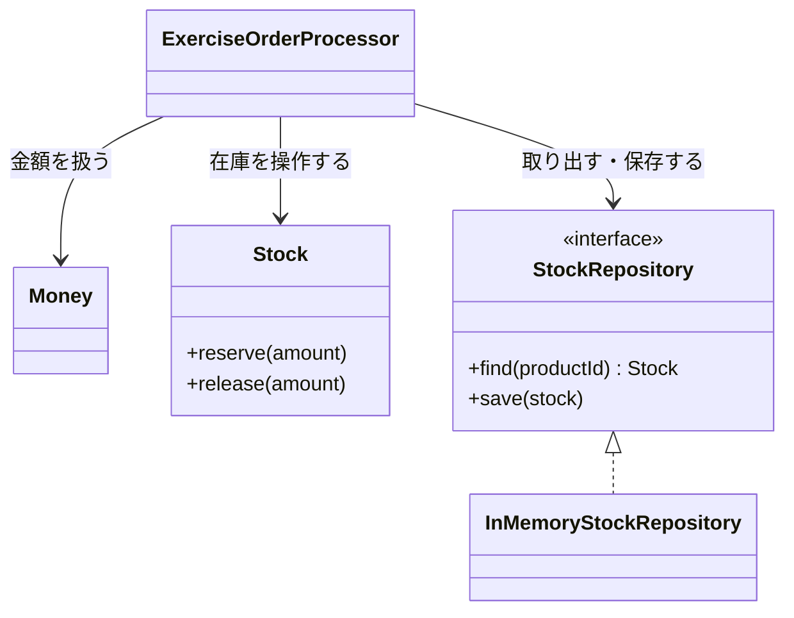

# 第9章: ドメインモデル（ルールを業務オブジェクトに持たせる）

> この章の軸: ②業務ロジックの置き方
>
> **この章は Part 2（条件が合えば使う設計）です。** 使うと嬉しい条件: 同じ業務ルールが、複数の処理に現れ始めたとき。第3章のトランザクションスクリプトで足りているなら、この章の設計は使わなくても構いません。

## この章のゴール

業務ルールを、第3章の「処理の流れの中」から「業務を表すオブジェクトの中」へ移します。移すべきタイミングを体験で理解します。あわせて、値オブジェクト（Value Object）とリポジトリ（Repository）の考え方に触れます。

## Why: なぜロジックの置き方を学ぶのか

第3章のトランザクションスクリプトは、小さな業務では最も素直な形です。しかし、ユースケースが増えると、同じルールが複数の手続きに現れ、ルールのコピーが増えます。この章は、そのときの選択肢です。

## 前提

[第3章](./03-transaction-script.md)と[第4章](./04-layered.md)を読み終えていること。第1章で学んだ「基本型への執着」という臭いを、この章で直します。

## 悪い実装を読む

次のファイルを開いてください。

- [TransactionScriptOrderProcessor.java](../src/main/java/com/example/orders/ch09_domain_model/before/TransactionScriptOrderProcessor.java)

このクラスは、第3章と同じトランザクションスクリプトです。**この形は悪い設計ではありません。** ただし、ユースケースが増える場面を想定すると、次の点が気になります。

- 「在庫が足りるか」という業務ルールを知っているのは、`process` メソッドだけです
- 金額は `int` です。負の値や、割引が小計を超える値を、型は止めてくれません
- 在庫は `Map<String, Integer>` を直接操作しています。保存先が変わると、業務ルールの周りまで書き換えます

次の変更要求が来たら、どうなるでしょうか。

- 注文キャンセルの処理を足したい（在庫を戻す）
- 返品の処理を足したい（在庫を戻し、返金する）
- 在庫を、Mapでなくデータベースに持ちたい

在庫を操作する点は、どちらの処理も同じです。在庫のルールのコピーが、処理の数だけ増えます。

## 考え方

### トランザクションスクリプトとの違い

トランザクションスクリプトの詳細は、[第3章](./03-transaction-script.md)にあります。ここでは、違いだけを確認します。

| 観点 | トランザクションスクリプト（第3章） | ドメインモデル（この章） |
| :--- | :--- | :--- |
| ルールの置き場所 | 処理の流れの中 | 業務オブジェクトの中（`Money`、`Stock`） |
| 向く規模 | ルールが少なく、ユースケースも少ない | ルールが複雑で、複数の処理から使われる |
| 短所 | ルールの重複が起きやすい | 設計に手間がかかる。小規模だと過剰になる |

### この章で作る部品

| 部品 | 種類 | 役割 |
| :--- | :--- | :--- |
| `Money` | 値オブジェクト | 金額を表す。不変で、金額が同じなら等しい。負の金額は作れない |
| `Stock` | エンティティ | 商品の在庫を表す。「足りるか」のルールを自分で持つ |
| `StockRepository` | リポジトリ | 在庫の保存先を隠す窓口。業務ルールは保存先を知らない |



### 値オブジェクトとエンティティ

| 種類 | 同じかどうかの基準 | 状態 | 例 |
| :--- | :--- | :--- | :--- |
| 値オブジェクト | 値が同じなら同じ | 不変 | 金額、住所、期間 |
| エンティティ | 識別子（ID）が同じなら同じ | 変化する | 在庫、注文、顧客 |

値オブジェクトは、**作った時点で正しい値であることを保証できます。** `Money` が負の値を拒否すれば、金額の検証をあちこちに書く必要がなくなります。

> **⚠️ よくある失敗・誤解**
> フィールドと `get` / `set` だけを持ち、ルールを何も持たないクラスは、ドメインモデルとは呼べません。実質的にはトランザクションスクリプトのままです。この状態は「貧血ドメインモデル」と呼ばれる、よくある失敗です。ルールを、オブジェクトの側へ移してください。

### 適用すると嬉しい状況・損をする状況

| 観点 | 内容 |
| :--- | :--- |
| 嬉しい状況 | 同じルールが複数の処理に現れる。ルールが複雑で、単体でテストしたい |
| 損をする状況 | ルールが少なく、処理も1〜2個。画面からデータベースへ、ほぼそのまま通すだけの処理 |
| 使わない選択肢 | 第3章のトランザクションスクリプトのまま。**同じルールが2カ所に現れた時点** で、移行を考える |

## 課題: 分解してみよう

課題用のクラスは [exercise パッケージ](../src/main/java/com/example/orders/ch09_domain_model/exercise/) にあります。

- `Money`, `Stock`, `InMemoryStockRepository`: 仕様だけが書かれた雛形。ここを実装します
- `StockRepository`: 窓口の型。形は変えません
- `ExerciseOrderProcessor`: トランザクションスクリプトのコピー。書き換えます

### ステップ1: 現状を確認する

```bash
mvn test
```

`DomainModelTest` の6件が失敗します。雛形が実装されていないためです。

### ステップ2: Money を実装する

雛形のJavadocに書かれた仕様で、`Money` を実装します。

- 不変にするには、フィールドとメソッドをどう書きますか
- 負の金額を、いつ拒否しますか。作る時ですか、使う時ですか
- `equals` と `hashCode` が必要なのは、なぜでしょうか

### ステップ3: Stock を実装する

在庫を引き当てるルールを、`Stock` の中に書きます。

- 在庫が足りないとき、どの例外を、どのメッセージで投げますか
- 例外が起きたとき、`Stock` の状態は変わってよいでしょうか

### ステップ4: リポジトリを実装する

`InMemoryStockRepository` で、Mapを保存先にします。存在しない商品は、在庫0として返します。

### ステップ5: 注文処理を書き換える

`ExerciseOrderProcessor` を、`Money`、`Stock`、`StockRepository` を使う形に書き換えます。

- 金額計算の `int` を、`Money` に置き換えます。決済の上限判定も同様です
- 在庫は `repository` から取り出し、`reserve` して、`save` します
- 複数の明細があり、2番目の商品で在庫が足りなかったとき、1番目の商品の在庫はどうなりますか。分解前は、在庫が減らない仕様でした

### ステップ6: 確認する

```bash
mvn test
```

> **🔍 確認・実験してみよう**
> 注文キャンセルの処理を書くとしたら、`Stock` のどのメソッドを使いますか。トランザクションスクリプトのままで書いた場合と比べて、在庫のルールを書く箇所は何カ所になるでしょうか。動かす前に予想してください。

## 動作確認

```bash
mvn test
```

## 解答例と解説

解答例の全文は [answers/ch09_domain_model/](../answers/ch09_domain_model/) にあります。自分で書き終えてから開いてください。

<details>
<summary>解答例の要点を見る</summary>

### Stock（ルールを自分で持つ）

```java
public void reserve(int amount) {
    // ★重要★ 「足りるか」のルールは、在庫自身が持つ
    if (amount > quantity) {
        throw new OutOfStockException("在庫が不足しています: " + productId);
    }
    quantity -= amount;
}
```

### Money（作った時点で正しい）

```java
private Money(int yen) {
    // ★重要★ 負の金額は作れない（不正な状態を、作った時点で防ぐ）
    if (yen < 0) {
        throw new IllegalArgumentException("金額は0円以上にしてください: " + yen);
    }
    this.yen = yen;
}
```

### 注文処理（薄い調整役）

```java
// ★重要★ 3. 在庫引当（足りるかの判断は Stock が行う。途中で足りなければ戻す）
List<OrderLine> reserved = new ArrayList<>();
try {
    for (OrderLine line : order.lines()) {
        Stock stock = repository.find(line.productId());
        stock.reserve(line.quantity());
        repository.save(stock);
        reserved.add(line);
    }
} catch (OutOfStockException e) {
    releaseAll(reserved);
    throw e;
}
```

### なぜこの切り方か

- 「在庫が足りるか」のルールを `Stock` に持たせたので、キャンセルや返品の処理でも、同じ `Stock` を使えます
- `Money` が不正な値を作らせないため、金額の検証が各所に散らばりません
- 保存先を `StockRepository` の裏に隠したので、データベースに替えるときは `InMemoryStockRepository` の代わりを書くだけです
- 注文処理は、取り出して、操作させて、保存するという「調整役」に徹しています。ルールの中身は知りません

</details>

## 他のパターンと比べる

| 比べる相手 | 違い |
| :--- | :--- |
| Layered（第4章） | この章は「ルールを何に持たせるか」。Layeredは「ルールを持つクラスを、どの層に置くか」。組み合わせて使う |
| Strategy（第12章） | Strategyは差し替える方式を切り出す。ドメインモデルは、概念ごとにルールを持たせる。両方を組み合わせる設計も多い |
| Hexagonal（第10章） | リポジトリは、Hexagonalの「ポート」の考え方につながる。業務ルールを保存先から独立させる点が共通している |

> **💼 現場Tip**
> 最初からドメインモデルで設計する必要はありません。まず第3章のトランザクションスクリプトで書き、**同じルールが2カ所に現れた時点で、そのルールだけをオブジェクトに移す** という進め方が、現実的で失敗しにくい方法です。

## もっと良くしてみよう

### 理解確認

1. 第3章の書き方からドメインモデルへ移すべき場面を、「同じルール」という言葉を使って説明してみましょう
1. 値オブジェクトとエンティティの違いを、「同じかどうかの基準」で説明してみましょう
1. 貧血ドメインモデルとは何ですか。なぜ問題になりますか

### 発展改善クイズ

1. 注文のほかに、割引ルールもドメインモデルに移すとしたら、どんなクラスになりそうでしょうか。第12章のStrategyとの関係も含めて、自分なりに考えてみましょう
1. 「注文」と「注文明細」は、常に一緒に保存・更新されるべきです。このように、一貫性を保つ単位を設計で扱うには、どうすればよいでしょうか。次の章へ進む前に考えてみましょう

---

| [← 第8章: 継承よりコンポジション](./08-composition.md) | [全章目次](./README.md) | [第10章: Hexagonal →](./10-hexagonal.md) |
| - | :-: | --: |
