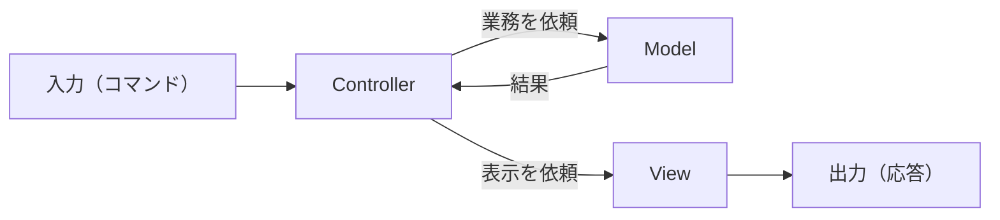

# 第9章: MVC（入力・表示・データの役割で分ける）とECBとの比較

> この章の軸: ③アプリ全体の分け方

## この章のゴール

アプリを Model・View・Controller の3つの役割に分けます。続いて、同じアプリをECB（Entity / Control / Boundary）の見方で捉え直し、2つの「役割で分ける」考え方の違いを理解します。

## Why: なぜMVCを学ぶのか

MVCは、多くのWebフレームワークが採用している分け方です。Springでも、Railsでも、Djangoでも、似た構造に出会います。フレームワークを使う前に、中身の考え方を手で作っておくと、フレームワークの挙動が読み取りやすくなります。

もう1つの理由は、**出力の形は頻繁に変わる** ことです。コンソール、Web画面、JSON、帳票と、同じ業務ルールに対して、見せ方だけが増えていきます。

## 前提

[第8章](./08-layered.md)を読み終えていること。第8章の注文アプリと同じ仕様を、別の切り口で分けます。

## 悪い実装を読む

次のファイルを開いてください。第8章と同じ神クラスです。

- [ConsoleOrderApp.java](../src/main/java/com/example/orders/ch09_mvc/before/ConsoleOrderApp.java)

今回は、**出力まわり** に注目します。`out.println("[NOTIFY]...")` や `return "OK " + ...` など、応答の文面が、業務ルールと同じ場所に書かれています。

次の変更要求が来たら、どこを触るか想像してください。

- 応答を、JSON形式に変えたい
- 同じ業務ルールを使って、Web画面からも注文できるようにしたい
- 応答の文言を、多言語対応にしたい

どれも、業務ルールのコードの中にある文字列を書き換えます。Web画面から使いたいときは、コンソール出力と業務ルールを切り離さないと、再利用できません。

## 考え方

### 何が変わりやすく、何が変わりにくいか

| 問い | この題材での答え |
| :--- | :--- |
| 変わりにくい部分は何か | 業務の状態とルール（注文、在庫、割引） |
| 変わりやすい部分は何か | 入力の受け付け方と、出力の見せ方 |

### 3つの役割

| 役割 | 責務 | 知ってよいこと |
| :--- | :--- | :--- |
| Model | データと業務ルールを持つ | 自分自身だけ。入出力の形は知らない |
| View | 結果を見せる形に整える | Modelのデータ（読み取りのみ） |
| Controller | 入力を解釈し、ModelとViewをつなぐ | Model、View |



最も大切なルールは、**ModelがViewとControllerを知らない** ことです。Modelが画面の文字列を作っていると、Web画面へ使い回せません。

> **⚠️ よくある失敗・誤解**
> Controllerが肥大化して、業務ルールまで書いてしまう失敗が定番です。Controllerの仕事は「仲介」であり、判断ではありません。割引や在庫のルールが出てきたら、Modelに移してください。

### ECB（Entity / Control / Boundary）との比較

ECBも、役割でクラスを分ける考え方です。MVCとは、**何を中心に考えるか** が違います。

| 観点 | MVC | ECB |
| :--- | :--- | :--- |
| 中心 | 画面（UI）の構造 | ユースケース（業務の流れ） |
| 起源 | GUIアプリの設計 | 要求分析から設計を導く手法 |
| 役割 | Model / View / Controller | Entity（業務概念）/ Control（ユースケースの流れ）/ Boundary（外部との接点） |

この章の解答例を、ECBの言葉で捉え直すと、次のようになります。

| MVCのクラス | ECBでの見方 | 理由 |
| :--- | :--- | :--- |
| `OrderView` | Boundary（出力） | 外の世界へ見せる接点 |
| `OrderController` の入力解釈 | Boundary（入力） | 外の世界から受け取る接点 |
| `OrderModel` の `place` の手順 | Control | 「注文する」という流れの制御 |
| `OrderModel` の在庫・注文の状態 | Entity | 業務の概念 |

MVCでは、Controllerが入力と仲介を、Modelが手順と状態をまとめて持ちます。ECBでは、入力の接点（Boundary）、手順（Control）、状態（Entity）を、さらに細かく分けます。ECBは、第10章のHexagonal（Clean Architectureの祖先でもあります）の見方につながります。

### 適用すると嬉しい状況・損をする状況

| 観点 | 内容 |
| :--- | :--- |
| 嬉しい状況 | 入出力の形が複数ある、または今後増える。表示のテストと業務のテストを分けたい |
| 損をする状況 | 出力が1種類で変わらない小さなツール。役割を分けるクラスが増えるだけになる場合 |
| 使わない選択肢 | 1クラスのままにする。Layeredで分ける（表示層の中身を分けない） |

## 課題: 分解してみよう

課題用のクラスは [exercise パッケージ](../src/main/java/com/example/orders/ch09_mvc/exercise/) にあります。`ExerciseOrderApp` が分解前のコピーです。

`exercise` の下に、`model`、`view`、`controller` の3つのパッケージを作ってください。

### ステップ1: 現状を確認する

```bash
mvn test
```

`MvcStructureTest` の5件が失敗します。

### ステップ2: 行を分類する

`ExerciseOrderApp` を上から読み、各行を次の3つに分類します。

- 入力の解釈（Controller）
- 業務ルールとデータ（Model）
- 出力と文面（View）

次の問いにも答えてください。

- エラー応答（`ERROR ...`）の文面は、どの役割が作りますか
- 通知（`[NOTIFY]`）の出力は、どの役割ですか。業務の一部でしょうか、それとも見せ方でしょうか

### ステップ3: Modelから切り出す

Modelは、出力を一切持ちません。`java.io` を使わず、結果は戻り値で返します。

### ステップ4: Viewを切り出す

Viewは、Modelの結果を受け取って、文字列を組み立てます。業務の判断はしません。

### ステップ5: Controllerを作る

Controllerは、入力を解釈し、Modelに依頼し、結果をViewに渡します。業務の判断をしていないか確認してください。

### ステップ6: 確認する

```bash
mvn test
```

> **🔍 確認・実験してみよう**
> 応答をJSON形式に変えるとしたら、どのクラスを書き換えますか。Modelを触る必要は、ありますか。動かす前に予想してから、実際にViewだけを書き換えて確かめてみましょう。

## 動作確認

```bash
mvn test
```

## 解答例と解説

解答例の全文は [answers/ch09_mvc/](../answers/ch09_mvc/) にあります。自分で書き終えてから開いてください。

<details>
<summary>解答例の要点を見る</summary>

### Controllerの仲介

```java
private String place(String[] parts) {
    // 入力を Model に渡し、結果を View に渡す（Controller は仲介だけをする）
    OrderRecord record = model.place(parsePlace(parts));
    view.notifyPlaced(record);
    return view.ok(record);
}
```

### Viewの責務

```java
public String ok(OrderRecord record) {
    return "OK " + record.orderId() + " total=" + record.total();
}

public String error(String message) {
    return "ERROR " + message;
}
```

### なぜこの切り方か

- Modelは、注文の状態とルールだけを持ち、`java.io` を使いません。Web画面から使うときも、そのまま再利用できます
- 応答の文面は、すべてViewに集めました。JSON対応では、Viewだけを書き換えます
- 通知の出力は「見せ方」としてViewに置きました。「成立した」という事実はModelが返し、知らせるかどうかはControllerが決め、どう知らせるかをViewが担います
- Controllerは、仲介に徹しています。割引や在庫の判断は、一切持ちません

</details>

## 他のパターンと比べる

| 比べる相手 | 違い |
| :--- | :--- |
| Layered（第8章） | Layeredは縦に積む層。MVCは、表示層の中身を役割で分ける考え方。組み合わせて使う |
| ECB | 前述のとおり、MVCはUI中心、ECBはユースケース中心 |
| Hexagonal（第10章） | MVCはUIの構造。Hexagonalは、業務ルールを中心に置き、UIを含む外部すべてを接続口として扱う |

> **💼 現場Tip**
> フレームワークのMVCでは、Controllerが肥大化しがちです。「Controllerのメソッドが何行を超えたら、Modelへ移すか」を、チームで決めておくと、レビューで揉めにくくなります。

## もっと良くしてみよう

### 理解確認

1. Modelが、ViewとControllerを知らないことで、何が嬉しいのですか
1. Controllerに業務ルールを書いてしまうと、どんな問題が起きますか
1. MVCとECBは、何を中心に考えるかがどう違いますか

### 発展改善クイズ

1. この解答例では、`OrderModel` が手順と状態の両方を持っています。ECBの見方でControlを独立させるとしたら、どんなクラス構成になりそうでしょうか。自分なりに考えてみましょう
1. Viewが、Modelの型（`OrderRecord`）を直接読んでいます。Modelの型が変わると、Viewも影響を受けます。これを避けるには、どうすればよいでしょうか。次の章へ進む前に考えてみましょう

---

| [← 第8章: Layered](./08-layered.md) | [全章目次](./README.md) | [第10章: Hexagonal →](./10-hexagonal.md) |
| - | :-: | --: |
