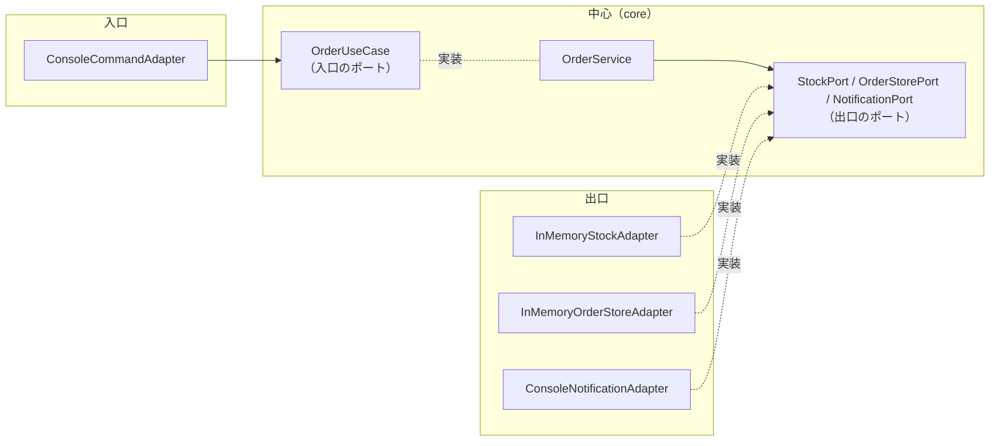
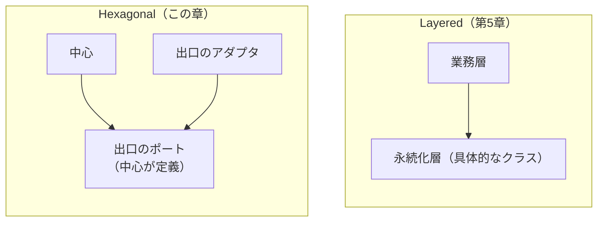
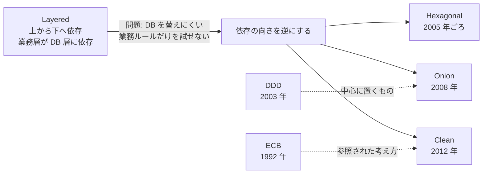
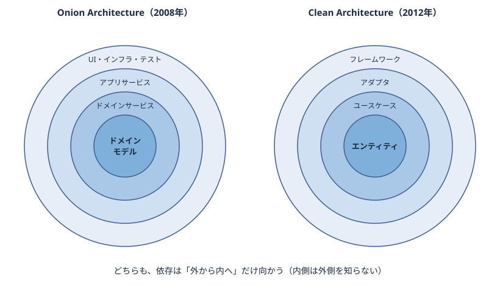
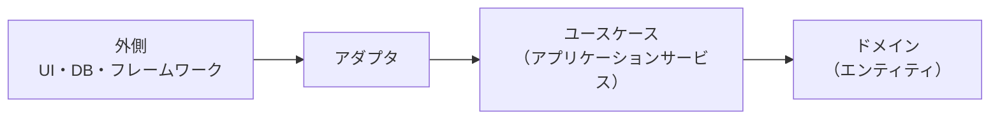
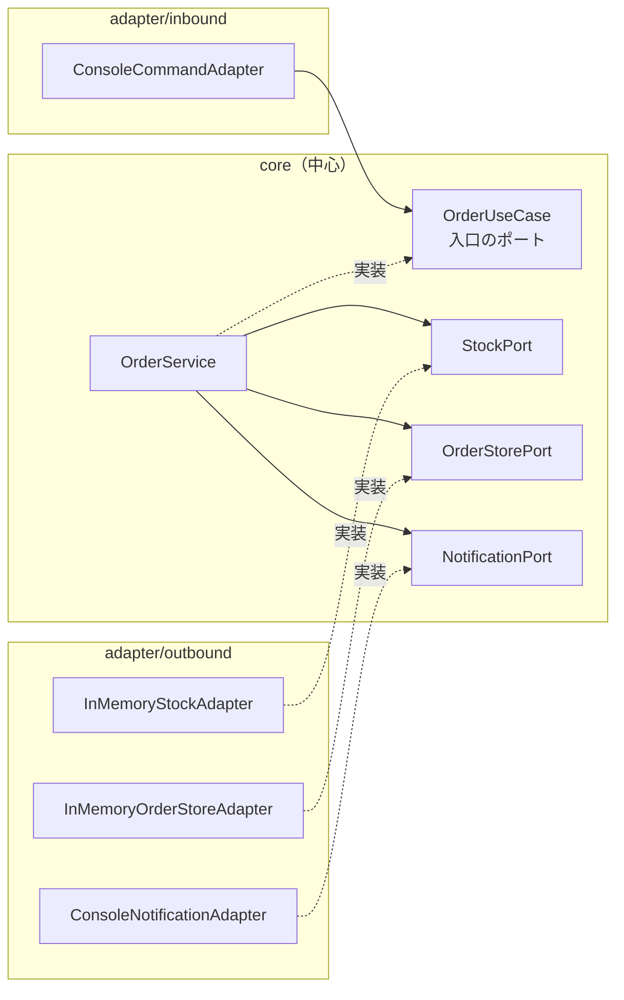
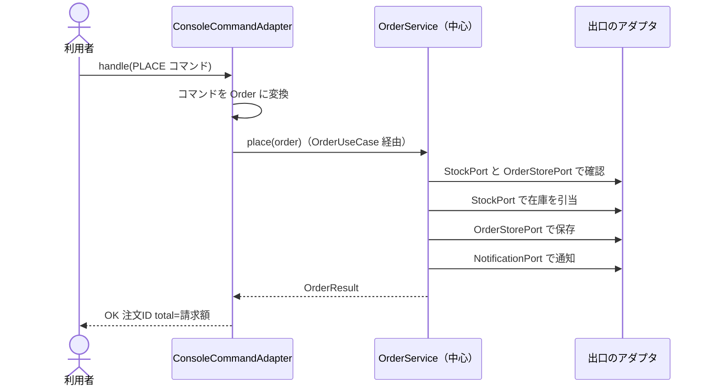

# 第10章: Hexagonal（業務ルールを中心に置き、外部を差し替え可能にする）

> この章の軸: ①アプリ全体の分け方
>
> **この章は Part 2（条件が合えば使う設計）です。** 使うと嬉しい条件: 外部サービスや保存先が多く、差し替えやテストがつらいとき。Part 1 の構成で足りているなら、この章の設計は使わなくても構いません。

## この章のゴール

業務ルールを中心に置き、外の世界（入力、保存、通知）とは「ポート」という窓口でつなぎます。具体的な接続は「アダプタ」に任せ、差し替えられる構造にします。依存の向きを逆転させる考え方を体験します。

## Why: なぜHexagonalを学ぶのか

[第5章](./05-layered.md)の解答例には、弱点がありました。業務層が、永続化層の具体的なクラスと、`PrintStream` に直接依存していたことです。

外の世界は、業務ルールよりずっと変わりやすいものです。保存先はMapからデータベースに、通知はコンソールからメールに、入力はコマンドからHTTPに替わります。そのたびに業務層まで影響を受ける構造では、安心して替えられません。

## 前提

[第5章](./05-layered.md)を読み終えていること。部品をコンストラクタで受け取る形（DI）を使います。

## 悪い実装を読む

次のファイルを開いてください。第5章、第7章と同じ神クラスです。

- [ConsoleOrderApp.java](../src/main/java/com/example/orders/ch10_hexagonal/before/ConsoleOrderApp.java)

今回は、**外の世界との接点** に注目します。

| 接点 | コード上の場所 |
| :--- | :--- |
| 入力 | `handle` の引数のコマンド文字列 |
| 在庫の保存 | `stock`（`Map`） |
| 注文の保存 | `orderTotal`、`history`（`Map`） |
| 通知 | `out.println("[NOTIFY]...")` |

次の変更要求が来たら、どこを触るか想像してください。

- 注文の保存先を、データベースに替えたい
- 通知を、メールに替えたい
- 業務ルールのテストを、データベースやメールなしで動かしたい

どれも、業務ルールのコードと、外の世界のコードが混ざっているため、業務ルールの周りを書き換えることになります。

## 考え方

### 何が変わりやすく、何が変わりにくいか

| 問い | この題材での答え |
| :--- | :--- |
| 変わりにくい部分は何か | 業務ルール（割引、在庫の確認、決済の上限、手順） |
| 変わりやすい部分は何か | 外の世界との接続（入力の形、保存先、通知の手段） |

Hexagonal（Ports and Adapters）は、**業務ルールを中心に置き、外の世界との接続を端に追い出す** 構造です。

### ポートとアダプタ

| 用語 | 意味 | この章での例 |
| :--- | :--- | :--- |
| 中心（core） | 業務ルールと手順。外の世界を知らない | `OrderService` |
| ポート | 中心が定義する、外の世界との窓口（インターフェース） | `OrderUseCase`、`StockPort`、`OrderStorePort`、`NotificationPort` |
| 入口のアダプタ | 外の世界の入力を、入口のポートに変換する | `ConsoleCommandAdapter` |
| 出口のアダプタ | 出口のポートを、具体的な技術で実装する | `InMemoryStockAdapter`、`ConsoleNotificationAdapter` |



### 依存の向きを逆転させる

LayeredとHexagonalの最大の違いは、**出口の依存の向き** です。



Layeredでは、業務層が永続化層の具体的なクラスを直接使います。Hexagonalでは、中心が「こういう窓口がほしい」とインターフェースを定義し、アダプタがそれを実装します。**ソースコード上の依存は、すべて中心に向かいます。** これがSOLID原則の「依存関係逆転（D）」です。

重要なのは、**ポートを定義する場所が、使う側（中心）である** ことです。アダプタ側に置いてしまうと、中心がアダプタに依存して、逆転になりません。

### Hexagonal、Onion、Clean、ECB は何が同じで何が違うのか

この章で学ぶ Hexagonal は、似た考え方の中で **最初に発表された** 設計です。そのあとに、Onion Architecture と Clean Architecture が続きました。名前と図は違いますが、解こうとした問題は同じです。

#### 歴史: どの順で生まれたか

| 年 | 名前 | 提唱者 | 要点 |
| :--- | :--- | :--- | :--- |
| 1992 | ECB（Boundary / Control / Entity） | Ivar Jacobson | ユースケースを中心に、クラスを役割で分ける |
| 2003 | ドメイン駆動設計（DDD） | Eric Evans | 業務の概念（ドメインモデル）を設計の中心に置く |
| 2005 年ごろ | Hexagonal（Ports and Adapters） | Alistair Cockburn | 外部との接続をポートとアダプタに追い出す |
| 2008 | Onion Architecture | Jeffrey Palermo | ドメインモデルを中心にした同心円の層。依存は内向きだけ |
| 2012 | Clean Architecture | Robert C. Martin | 同心円と「依存のルール」を整理。2017 年に書籍化 |

年は、代表的な発表を示しています。考え方そのものの議論は、これより前から続いていました。

**Onion のほうが古く、Clean のほうが新しい** という理解で合っています。さらに古いのは Hexagonal です。Clean Architecture の発表文では、Hexagonal や Onion、ECB（BCE）などを「目的が同じ考え方」として並べて紹介しています。つまり Clean は、先行する考え方を整理して、1つの図と1つのルールにまとめたものです。



#### 同じ問題: Layered の依存の向き

3つが解こうとした問題は、第5章の Layered に残る弱点です。Layered では、業務層が永続化層に依存します。このため、次の困りごとが起きます。

- データベースを替えると、業務層の周りも書き換える
- 業務ルールだけを試したいのに、データベースが要る
- フレームワークの都合が、業務ルールのコードに入り込む

3つとも、**依存の向きを逆にして、業務ルールを中心に置く** ことで、この問題に答えています。

#### 同心円で見る

Onion と Clean は、中心から外へ向かう層を、同心円で描きます。内側ほど安定した業務ルールで、外側ほど変わりやすい技術です。



> **補足**
> Mermaid には、円を描く図の種類がありません。そのため、この図は SVG 画像にしています。Mermaid で近い形を作るなら入れ子の四角（subgraph）になりますが、「内側ほど安定」という円の感覚は伝わりにくくなります。なお Hexagonal の六角形に意味はなく、ポートを複数並べて描きやすい形にしただけです。

#### 依存のルール

3つに共通して守る約束は、1つに言い表せます。**ソースコードの依存は、外側から内側へだけ向かう** ことです。Clean Architecture では、これを「依存のルール」と呼びます。



矢印は「知っている」関係です。内側のクラスは、外側のクラスの名前を `import` しません。内側が外側の力を借りたいときは、内側がインターフェース（ポート）を定義し、外側が実装します。これが、この章の「依存の向きを逆転させる」です。

#### 3つを並べて比べる

| 観点 | Hexagonal | Onion | Clean |
| :--- | :--- | :--- | :--- |
| 図の形 | 六角形（中心と、周りのポート） | 同心円 | 同心円（4層） |
| 中心に置くもの | 業務ルール全体 | ドメインモデル | エンティティ（最も一般的な業務ルール） |
| 内側の分け方 | 中心は分けない | ドメインモデル、ドメインサービス、アプリケーションサービス | エンティティ、ユースケース |
| 外側の呼び方 | アダプタ | UI、インフラ、テスト | アダプタ、フレームワーク |
| 強調する言葉 | ポートとアダプタ | 層を内向きに重ねる | 依存のルール |
| 特に向く場面 | 外部との接続が多い | ドメインモデルが厚い | ユースケースごとに整理したい |

#### それぞれが残した課題と、Clean が埋めた部分

3つは、欠陥を直し合った関係というより、**先行する考え方が示していない部分を、後発が補った** 関係です。

##### Hexagonal が示していない部分

| 課題 | 内容 |
| :--- | :--- |
| 中心の中身 | 「中心」は1つのかたまりで、中をどう分けるかを示していない。ルールと手順が混ざりやすい |
| ポートの粒度 | ポートを、ユースケースごとに作るか、技術ごとに作るかが決まっていない |
| 出力の返し方 | 入口と出口を同じ扱いにするため、結果を画面向けにどう整えるかの方針がない |

##### Onion が示していない部分

| 課題 | 内容 |
| :--- | :--- |
| ドメインモデルが前提 | ルールが薄いアプリでは、中心が空になる |
| 層の線引き | ドメインサービスとアプリケーションサービスの違い、リポジトリのインターフェースの置き場所が、解釈で揺れる |
| ユースケースの扱い | 「注文する」のような利用場面が、独立した部品として強調されない |
| 層をまたぐデータ | 境界で、データをどんな形で渡すかを決めていない |

##### Clean が補った部分

| 課題 | Clean の答え |
| :--- | :--- |
| 中心の中身 | エンティティ（企業全体のルール）と、ユースケース（アプリ固有の手順）に分けた |
| 依存の約束 | 「依存のルール」として、1つの言葉にまとめた |
| ユースケースの位置づけ | ユースケースを独立した層にし、入力と出力の境界（インターフェース）を定義した |
| 層をまたぐデータ | 境界を越えるデータは、単純なデータ構造にする。エンティティやDBの行を、そのまま渡さない |
| 出力の返し方 | 出力のインターフェースとプレゼンターで、画面向けの整形を内側から追い出した |

##### Clean でも残る課題

- **重さ**: 層をまたぐたびに、データの詰め替えとインターフェースが要ります。小さなアプリや、データを通すだけのアプリでは、手間に見合いません。この点は、Hexagonal と Onion も同じです
- **線引きの難しさ**: 「企業全体のルール」と「アプリ固有の手順」の違いは、現場では判断が分かれます
- **決めてくれないこと**: トランザクションの境界、検証の置き場所、イベントの扱いは、具体的には決めていません
- **層の数**: 4層は例で、必要に応じて増減してよいとされています。結局、現場で決めることが残ります

> **💼 現場Tip**
> 「Clean を採用した」と言っても、実際の層の数や名前は、プロジェクトごとに違います。名前を揃えることより、先ほどの3つの約束（依存は内向き、ポートは内側が定義、業務ルールは技術を知らない）が守られているかを、レビューで確かめます。

#### この章のクラスは、どこに当たるか

この章のクラスを、3つの名前で呼び分けると、次のようになります。

| この章のクラス | Hexagonal | Onion | Clean |
| :--- | :--- | :--- | :--- |
| `PlacedOrder` | 中心 | ドメインモデル | エンティティ |
| `OrderService` | 中心 | アプリケーションサービス | ユースケース |
| `OrderUseCase` | インバウンドポート | アプリケーションサービスの窓口 | 入力側のインターフェース |
| `StockPort`、`OrderStorePort`、`NotificationPort` | アウトバウンドポート | リポジトリなどのインターフェース | 出力側のインターフェース |
| `adapter` の各クラス | アダプタ | インフラ | インタフェースアダプタ、フレームワーク |

この章の `core` は、1つのまとまりです。Onion や Clean の形に近づけるなら、`core` を `domain`（`PlacedOrder`）と `application`（`OrderService` とポート）に分けるだけです。依存の向きは、`application` から `domain` へ向かう一方向になります。**層を細かく分けるほど、依存の向きを守る約束も増えます。** 規模に合わせて、粗さを選びます。

#### 現場での呼ばれ方

現場では、どの名前を名乗っても、実装はよく似ます。層の数や名前に、唯一の正解はありません。次の3つが守られていれば、3つのどれとも呼べます。

1. 業務ルールが、データベースや画面などの技術を知らない
1. ポートは、使う側（内側）が定義する
1. 依存は、外側から内側へだけ向かう

#### ECB との違い

ECB は、同心円ではなく、役割で分ける考え方です。Boundary が外との接点、Control が処理の流れ、Entity が業務の概念を担います。ECB の Control は、Clean のユースケースの考え方と近く、Clean Architecture が参照した考え方の1つです。ただし ECB は、依存の向きを内向きに揃える約束までは含みません。第6章の ECB に、この約束を足したものが、Hexagonal や Clean に近づいた形です。

> **⚠️ よくある失敗・誤解**
> ポートの形が、具体的な技術に引きずられることがあります。たとえば「SQLを渡すと結果を返す」ポートでは、中心がSQLを知ることになります。ポートは、中心の言葉（業務の言葉）で定義してください。アダプタの中に業務ルールが漏れるのも、同じく失敗です。

### 適用すると嬉しい状況・損をする状況

| 観点 | 内容 |
| :--- | :--- |
| 嬉しい状況 | 外部システムが多く、替わる可能性が高い。業務ルールを外部なしでテストしたい。長く保守する |
| 損をする状況 | 小規模で短命なアプリ。外部との接点が1つで替わらない。クラスの数が増える負担が見合わない |
| 使わない選択肢 | Layered（第5章）。フレームワークが決めた構造に従う |

## 課題: 分解してみよう

課題用のクラスは [exercise パッケージ](../src/main/java/com/example/orders/ch10_hexagonal/exercise/) にあります。

| 場所 | 状態 |
| :--- | :--- |
| `core/port/inbound/OrderUseCase`、`core/port/outbound/*Port`、`core/PlacedOrder` | 用意済み。形は変えません |
| `core/OrderService` | 空の雛形。ここに業務ルールを移します |
| `adapter/inbound`、`adapter/outbound` | 空。アダプタを作ります |
| `ExerciseOrderApp` | 分解前のコピー。組み立て役だけを残します |

### ステップ1: 現状を確認する

```bash
mvn test
```

`HexagonalStructureTest` と `CoreWithFakesTest` のあわせて6件が失敗します。

### ステップ2: ポートを読む

用意されたポートを読み、次の問いに答えてください。

- 各ポートを「呼ぶ側」はどこで、「実装する側」はどこですか
- ポートの名前や引数に、技術の名前（Map、コンソール）が出ていないことを確認してください

### ステップ3: 中心を作る

`OrderService` に、業務ルールと手順を移します。在庫、保存、通知は、コンストラクタで受け取ったポート越しに行います。中心の中に `Map` や `PrintStream` が出てきていないか確認してください。

### ステップ4: 出口のアダプタを作る

3つのポートを実装するアダプタを、`adapter/outbound` に作ります。`Map` と `PrintStream` は、ここにだけ登場します。

### ステップ5: 入口のアダプタを作る

`adapter/inbound` に、コマンド文字列を解釈して `OrderUseCase` を呼ぶアダプタを作ります。応答の文字列の組み立ても、ここで行います。

### ステップ6: 組み立て役を残す

`ExerciseOrderApp` には、アダプタを作り、中心に渡し、入口につなぐ処理だけを残します。

### ステップ7: 確認する

```bash
mvn test
```

> **🔍 確認・実験してみよう**
> `CoreWithFakesTest` を読んでください。コンソールもMapも使わずに、業務の中心が動いています。通知をメールに替えるとしたら、新しく作るファイルと変更するファイルは、それぞれ何でしょうか。動かす前に予想してください。

## 動作確認

```bash
mvn test
```

## 解答例と解説

解答例の全文は [answers/ch10_hexagonal/](../answers/ch10_hexagonal/) にあります。自分で書き終えてから開いてください。

<details>
<summary>解答例の要点を見る</summary>

### クラスの配置

| 場所 | クラス |
| :--- | :--- |
| `core` | `OrderService`、`PlacedOrder` |
| `core/port/inbound` | `OrderUseCase` |
| `core/port/outbound` | `StockPort`、`OrderStorePort`、`NotificationPort` |
| `adapter/inbound` | `ConsoleCommandAdapter` |
| `adapter/outbound` | `InMemoryStockAdapter`、`InMemoryOrderStoreAdapter`、`ConsoleNotificationAdapter` |

### 依存の向き（クラス図）

矢印は「使う」関係で、点線は「実装する」関係です。アダプタの矢印は、すべて中心（ポート）へ向かいます。



### PLACE の流れ（シーケンス図）



### 中心（外の世界を知らない）

```java
// ★重要★ 在庫の引当、保存、通知（すべてポート越し）
for (OrderLine line : order.lines()) {
    stocks.change(line.productId(), -line.quantity());
}
PlacedOrder placed = new PlacedOrder(order.id(), order.customer().id(), total);
store.save(placed);
notification.orderPlaced(placed);
```

### 組み立て役

```java
// ★重要★ 出口のアダプタを作り、中心に渡す
OrderService core = new OrderService(
        new InMemoryStockAdapter(stock),
        new InMemoryOrderStoreAdapter(),
        new ConsoleNotificationAdapter(out));
// ★重要★ 入口のアダプタに、中心を入口のポートとして渡す
this.inbound = new ConsoleCommandAdapter(core, today);
```

### なぜこの切り方か

- 中心は `java.io` と `Map` のどちらも使いません。業務ルールを、偽のポートだけでテストできます
- ポートは中心の側に置いています。アダプタが中心を向くため、ソースコード上の依存はすべて内側に向きます
- 通知をメールに替えるときは、`NotificationPort` を実装した新しいアダプタを書き、組み立て役で差し替えるだけです。中心は無傷です
- コマンドの解釈と応答の組み立ては、入口のアダプタの責務です。中心は、コマンドの形式を知りません

</details>

## 他のパターンと比べる

| 比べる相手 | 違い |
| :--- | :--- |
| Layered（第5章） | Layeredは上から下に依存する。Hexagonalは、すべての依存が中心に向かう |
| MVC（第7章） | MVCはUIの構造。Hexagonalは、UIも含めた外部すべてを、中心から見た接続口として扱う |
| CQRS（第11章） | Hexagonalは、中心と外部の関係を整理する。CQRSは、中心の内側の更新と参照を分ける。組み合わせられる |

> **💼 現場Tip**
> 外部サービス（決済、メール、外部API）との連携は、障害の原因になりやすい箇所です。アダプタに閉じ込めておくと、障害時の切り分けや、一時的な偽物への差し替えが簡単になります。

## もっと良くしてみよう

### 理解確認

1. ポートを、中心の側に定義するのはなぜですか
1. LayeredとHexagonalで、出口（保存）の依存の向きはどう違いますか
1. 通知をメールに替えるとき、変更するファイルと変更しないファイルを挙げてみましょう
1. Hexagonal、Onion、Clean の共通点と、図の違いを、「依存の向き」という言葉を使って説明してみましょう
1. Onion と Clean は、どちらが古いですか。それぞれが、Layered のどんな弱点に答えようとしたのかも説明してみましょう

### 発展改善クイズ

1. ポートとアダプタを導入すると、クラスの数が増えます。この題材の規模で、増えた分に見合う価値があるか、自分の考えを言葉にしてみましょう
1. 注文の保存が成功し、通知の送信が失敗したとき、ポート越しの設計では何が起きるでしょうか。次の章へ進む前に考えてみましょう

---

| [← 第9章: ドメインモデル](./09-domain-model.md) | [全章目次](./README.md) | [第11章: CQRS →](./11-cqrs.md) |
| - | :-: | --: |
