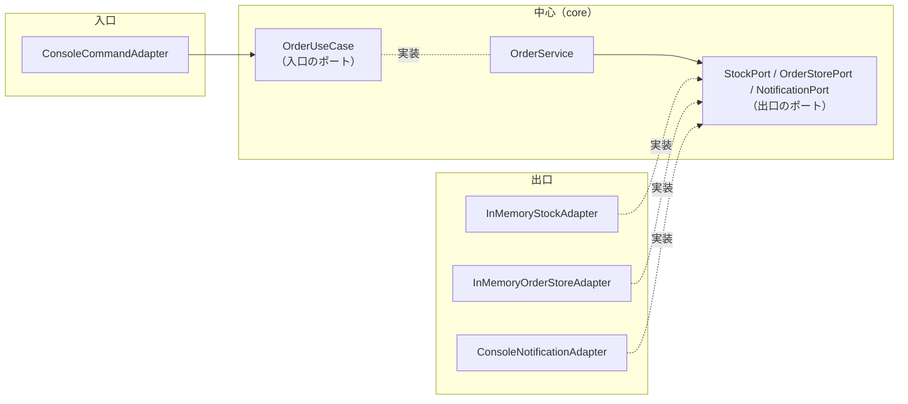
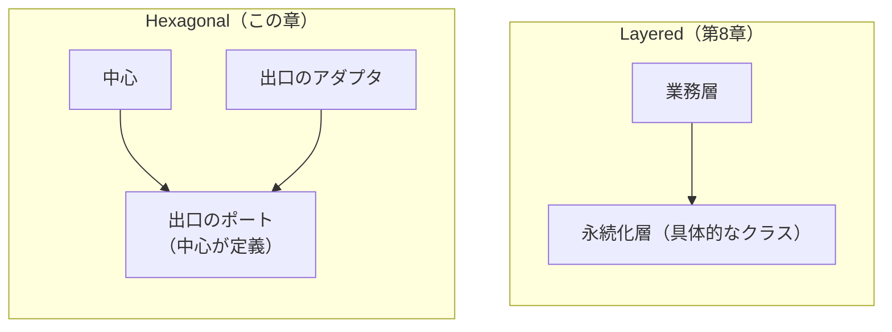

# 第10章: Hexagonal（業務ルールを中心に置き、外部を差し替え可能にする）

> この章の軸: ③アプリ全体の分け方

## この章のゴール

業務ルールを中心に置き、外の世界（入力、保存、通知）とは「ポート」という窓口でつなぎます。具体的な接続は「アダプタ」に任せ、差し替えられる構造にします。依存の向きを逆転させる考え方を体験します。

## Why: なぜHexagonalを学ぶのか

[第8章](./08-layered.md)の解答例には、弱点がありました。業務層が、永続化層の具体的なクラスと、`PrintStream` に直接依存していたことです。

外の世界は、業務ルールよりずっと変わりやすいものです。保存先はMapからデータベースに、通知はコンソールからメールに、入力はコマンドからHTTPに替わります。そのたびに業務層まで影響を受ける構造では、安心して替えられません。

## 前提

[第9章](./09-mvc.md)を読み終えていること。[第2章](./02-strategy.md)で学んだ、コンストラクタ注入（DI）の考え方を使います。

## 悪い実装を読む

次のファイルを開いてください。第8章、第9章と同じ神クラスです。

- [ConsoleOrderApp.java](../src/main/java/com/example/orders/ch10_hexagonal/before/ConsoleOrderApp.java)

今回は、**外の世界との接点** に注目します。

| 接点 | コード上の場所 |
| :--- | :--- |
| 入力 | `handle` の引数のコマンド文字列 |
| 在庫の保存 | `stock`（`Map`） |
| 注文の保存 | `orderTotal`、`history`（`Map`） |
| 通知 | `out.println("[NOTIFY]...")` |

次の変更要求が来たら、どこを触るか想像してください。

- 注文の保存先を、データベースに替えたい
- 通知を、メールに替えたい
- 業務ルールのテストを、データベースやメールなしで動かしたい

どれも、業務ルールのコードと、外の世界のコードが混ざっているため、業務ルールの周りを書き換えることになります。

## 考え方

### 何が変わりやすく、何が変わりにくいか

| 問い | この題材での答え |
| :--- | :--- |
| 変わりにくい部分は何か | 業務ルール（割引、在庫の確認、決済の上限、手順） |
| 変わりやすい部分は何か | 外の世界との接続（入力の形、保存先、通知の手段） |

Hexagonal（Ports and Adapters）は、**業務ルールを中心に置き、外の世界との接続を端に追い出す** 構造です。

### ポートとアダプタ

| 用語 | 意味 | この章での例 |
| :--- | :--- | :--- |
| 中心（core） | 業務ルールと手順。外の世界を知らない | `OrderService` |
| ポート | 中心が定義する、外の世界との窓口（インターフェース） | `OrderUseCase`、`StockPort`、`OrderStorePort`、`NotificationPort` |
| 入口のアダプタ | 外の世界の入力を、入口のポートに変換する | `ConsoleCommandAdapter` |
| 出口のアダプタ | 出口のポートを、具体的な技術で実装する | `InMemoryStockAdapter`、`ConsoleNotificationAdapter` |



### 依存の向きを逆転させる

LayeredとHexagonalの最大の違いは、**出口の依存の向き** です。



Layeredでは、業務層が永続化層の具体的なクラスを直接使います。Hexagonalでは、中心が「こういう窓口がほしい」とインターフェースを定義し、アダプタがそれを実装します。**ソースコード上の依存は、すべて中心に向かいます。** これがSOLID原則の「依存関係逆転（D）」です。

重要なのは、**ポートを定義する場所が、使う側（中心）である** ことです。アダプタ側に置いてしまうと、中心がアダプタに依存して、逆転になりません。

### Clean Architecture、Onion Architecture、ECBとの関係

| 名前 | 共通点 | 違い |
| :--- | :--- | :--- |
| Hexagonal | 依存を内側（業務ルール）へ向ける | 中心と外側（アダプタ）の2つに大別し、接続口をポートとして強調する |
| Onion / Clean | 同上 | 内側を、さらに同心円で細かく分ける（Entity、ユースケース、ゲートウェイなど） |
| ECB | 役割で分ける | Boundaryが外との接点、Controlがユースケース、Entityが業務概念。Clean Architectureの用語の元になった |

> **⚠️ よくある失敗・誤解**
> ポートの形が、具体的な技術に引きずられることがあります。たとえば「SQLを渡すと結果を返す」ポートでは、中心がSQLを知ることになります。ポートは、中心の言葉（業務の言葉）で定義してください。アダプタの中に業務ルールが漏れるのも、同じく失敗です。

### 適用すると嬉しい状況・損をする状況

| 観点 | 内容 |
| :--- | :--- |
| 嬉しい状況 | 外部システムが多く、替わる可能性が高い。業務ルールを外部なしでテストしたい。長く保守する |
| 損をする状況 | 小規模で短命なアプリ。外部との接点が1つで替わらない。クラスの数が増える負担が見合わない |
| 使わない選択肢 | Layered（第8章）。フレームワークが決めた構造に従う |

## 課題: 分解してみよう

課題用のクラスは [exercise パッケージ](../src/main/java/com/example/orders/ch10_hexagonal/exercise/) にあります。

| 場所 | 状態 |
| :--- | :--- |
| `core/port/inbound/OrderUseCase`、`core/port/outbound/*Port`、`core/PlacedOrder` | 用意済み。形は変えません |
| `core/OrderService` | 空の雛形。ここに業務ルールを移します |
| `adapter/inbound`、`adapter/outbound` | 空。アダプタを作ります |
| `ExerciseOrderApp` | 分解前のコピー。組み立て役だけを残します |

### ステップ1: 現状を確認する

```bash
mvn test
```

`HexagonalStructureTest` と `CoreWithFakesTest` のあわせて6件が失敗します。

### ステップ2: ポートを読む

用意されたポートを読み、次の問いに答えてください。

- 各ポートを「呼ぶ側」はどこで、「実装する側」はどこですか
- ポートの名前や引数に、技術の名前（Map、コンソール）が出ていないことを確認してください

### ステップ3: 中心を作る

`OrderService` に、業務ルールと手順を移します。在庫、保存、通知は、コンストラクタで受け取ったポート越しに行います。中心の中に `Map` や `PrintStream` が出てきていないか確認してください。

### ステップ4: 出口のアダプタを作る

3つのポートを実装するアダプタを、`adapter/outbound` に作ります。`Map` と `PrintStream` は、ここにだけ登場します。

### ステップ5: 入口のアダプタを作る

`adapter/inbound` に、コマンド文字列を解釈して `OrderUseCase` を呼ぶアダプタを作ります。応答の文字列の組み立ても、ここで行います。

### ステップ6: 組み立て役を残す

`ExerciseOrderApp` には、アダプタを作り、中心に渡し、入口につなぐ処理だけを残します。

### ステップ7: 確認する

```bash
mvn test
```

> **🔍 確認・実験してみよう**
> `CoreWithFakesTest` を読んでください。コンソールもMapも使わずに、業務の中心が動いています。通知をメールに替えるとしたら、新しく作るファイルと変更するファイルは、それぞれ何でしょうか。動かす前に予想してください。

## 動作確認

```bash
mvn test
```

## 解答例と解説

解答例の全文は [answers/ch10_hexagonal/](../answers/ch10_hexagonal/) にあります。自分で書き終えてから開いてください。

<details>
<summary>解答例の要点を見る</summary>

### クラスの配置

| 場所 | クラス |
| :--- | :--- |
| `core` | `OrderService`、`PlacedOrder` |
| `core/port/inbound` | `OrderUseCase` |
| `core/port/outbound` | `StockPort`、`OrderStorePort`、`NotificationPort` |
| `adapter/inbound` | `ConsoleCommandAdapter` |
| `adapter/outbound` | `InMemoryStockAdapter`、`InMemoryOrderStoreAdapter`、`ConsoleNotificationAdapter` |

### 中心（外の世界を知らない）

```java
// 在庫の引当、保存、通知（すべてポート越し）
for (OrderLine line : order.lines()) {
    stocks.change(line.productId(), -line.quantity());
}
PlacedOrder placed = new PlacedOrder(order.id(), order.customer().id(), total);
store.save(placed);
notification.orderPlaced(placed);
```

### 組み立て役

```java
// 出口のアダプタを作り、中心に渡す
OrderService core = new OrderService(
        new InMemoryStockAdapter(stock),
        new InMemoryOrderStoreAdapter(),
        new ConsoleNotificationAdapter(out));
// 入口のアダプタに、中心を入口のポートとして渡す
this.inbound = new ConsoleCommandAdapter(core, today);
```

### なぜこの切り方か

- 中心は `java.io` と `Map` のどちらも使いません。業務ルールを、偽のポートだけでテストできます
- ポートは中心の側に置いています。アダプタが中心を向くため、ソースコード上の依存はすべて内側に向きます
- 通知をメールに替えるときは、`NotificationPort` を実装した新しいアダプタを書き、組み立て役で差し替えるだけです。中心は無傷です
- コマンドの解釈と応答の組み立ては、入口のアダプタの責務です。中心は、コマンドの形式を知りません

</details>

## 他のパターンと比べる

| 比べる相手 | 違い |
| :--- | :--- |
| Layered（第8章） | Layeredは上から下に依存する。Hexagonalは、すべての依存が中心に向かう |
| MVC（第9章） | MVCはUIの構造。Hexagonalは、UIも含めた外部すべてを、中心から見た接続口として扱う |
| CQRS（第11章） | Hexagonalは、中心と外部の関係を整理する。CQRSは、中心の内側の更新と参照を分ける。組み合わせられる |

> **💼 現場Tip**
> 外部サービス（決済、メール、外部API）との連携は、障害の原因になりやすい箇所です。アダプタに閉じ込めておくと、障害時の切り分けや、一時的な偽物への差し替えが簡単になります。

## もっと良くしてみよう

### 理解確認

1. ポートを、中心の側に定義するのはなぜですか
1. LayeredとHexagonalで、出口（保存）の依存の向きはどう違いますか
1. 通知をメールに替えるとき、変更するファイルと変更しないファイルを挙げてみましょう

### 発展改善クイズ

1. ポートとアダプタを導入すると、クラスの数が増えます。この題材の規模で、増えた分に見合う価値があるか、自分の考えを言葉にしてみましょう
1. 注文の保存が成功し、通知の送信が失敗したとき、ポート越しの設計では何が起きるでしょうか。次の章へ進む前に考えてみましょう

---

| [← 第9章: MVC](./09-mvc.md) | [全章目次](./README.md) | [第11章: CQRS →](./11-cqrs.md) |
| - | :-: | --: |
