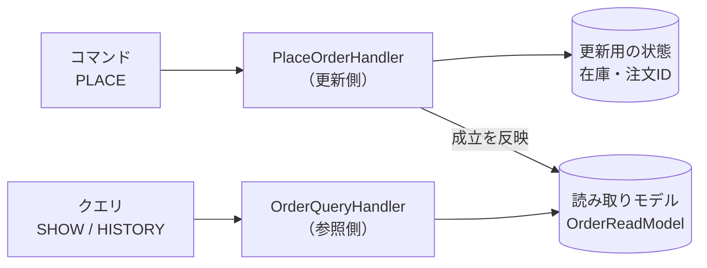

# 第11章: CQRS（更新と参照でモデルを分ける）

> この章の軸: ①アプリ全体の分け方
>
> **この章は Part 2（条件が合えば使う設計）です。** 使うと嬉しい条件: 参照の要求が、更新のモデルを歪め始めたとき。Part 1 の構成で足りているなら、この章の設計は使わなくても構いません。

## この章のゴール

注文を受け付ける「更新（コマンド）」と、注文を見る「参照（クエリ）」で、扱うモデルを分けます。更新側はルールの確認に集中し、参照側は見やすい形のデータだけを持つ構造にします。

## Why: なぜCQRSを学ぶのか

更新と参照では、求められることが違います。

| 観点 | 更新（注文する） | 参照（注文を見る） |
| :--- | :--- | :--- |
| 重視すること | ルールの正しさ、整合性 | 速さ、見やすさ |
| データの形 | 業務ルールに都合のよい形 | 画面や帳票に都合のよい形 |
| 呼ばれる頻度 | 少ない | 多い（更新の10倍以上のことも多い） |

1つのモデルで両方をまかなうと、参照の要望（集計、検索、並び替え）が更新側のモデルを歪めます。更新のルールを守りたいのに、参照用のデータの維持が邪魔をします。

## 前提

[第10章](./10-hexagonal.md)を読み終えていること。第10章では、ポートで外の世界と中心を分けました。この章では、中心の内側を「更新」と「参照」で分けます。

## 悪い実装を読む

次のファイルを開いてください。

- [ConsoleOrderApp.java](../src/main/java/com/example/orders/ch11_cqrs/before/ConsoleOrderApp.java)

`history`（顧客ごとの注文IDの一覧）に注目してください。このデータは、参照（`HISTORY` コマンド）のためだけに必要ですが、**注文を受け付ける処理の中で更新されています**。注文を受け付ける処理が、参照の事情を知っているのです。

次の変更要求が来たら、どこを触るか想像してください。

- 履歴に、注文の件数と合計金額も表示したい
- 参照だけが重いので、参照用のデータを別に持ちたい
- 「商品ごとの売れ行き」という、新しい参照を足したい

どれも、注文を受け付ける処理を書き換えることになります。参照を足すたびに、更新側のルールの確認が複雑になります。

## 考え方

### 何が変わりやすく、何が変わりにくいか

| 問い | この題材での答え |
| :--- | :--- |
| 変わりにくい部分は何か | 注文を受け付けるルール（割引、在庫、決済の上限） |
| 変わりやすい部分は何か | 参照の種類と、参照に必要なデータの形 |

### CQSとCQRS

| 名前 | 分ける単位 | 内容 |
| :--- | :--- | :--- |
| CQS | メソッド | 状態を変えるメソッドと、値を返すメソッドを分ける |
| CQRS | モデル（クラス・データ） | 更新用のモデルと、参照用のモデルを別々に持つ |

この章で扱うのは、CQRSです。

### 構造



| 側 | 責務 | してはいけないこと |
| :--- | :--- | :--- |
| 更新側（command） | ルールの確認、状態の更新 | 参照用のデータを持つ。参照側を知る |
| 参照側（query） | 読み取りモデルの検索 | 状態を変える。更新側を知る |
| 読み取りモデル | 参照しやすい形でデータを持つ | 業務ルールの判断をする |

### 読み取りモデルをどう更新するか

更新側で注文が成立したら、読み取りモデルにも反映する必要があります。この章の解答例では、組み立て役が更新後に `readModel.apply(...)` を直接呼びます。これは、最も単純な形です。

> **⚠️ よくある失敗・誤解**
> CQRSを「最初から導入するもの」と考えるのは失敗です。更新と参照の要求がほとんど同じ小規模なアプリでは、モデルが2つになるだけで、手間が増えます。参照の要求が更新のモデルを歪め始めた時点で、検討してください。

### 現場では「結果整合性」に注意する

読み取りモデルを別のデータベースに持つ本格的な構成では、更新から反映までに遅れが生じます。この遅れを許容する性質を「結果整合性」と呼びます。「注文した直後に参照しても、一覧に出ない」ことが起こり得ます。画面の作り方やユーザーへの説明が必要になります。この章の解答例は、同じプロセスの中で即時に反映するため、遅れは起きません。

### 適用すると嬉しい状況・損をする状況

| 観点 | 内容 |
| :--- | :--- |
| 嬉しい状況 | 参照の種類が多く、更新のモデルを歪めている。参照の負荷が高く、独立して拡張したい |
| 損をする状況 | 更新と参照が同じ形で、要求が単純。チームが小さく、モデルを2つ維持する余裕がない |
| 使わない選択肢 | 1つのモデルで両方を扱う（Layeredなど）。参照だけビューやキャッシュで補う |

## 課題: 分解してみよう

課題用のクラスは [exercise パッケージ](../src/main/java/com/example/orders/ch11_cqrs/exercise/) にあります。

| 場所 | 状態 |
| :--- | :--- |
| `query/OrderSummary`、`query/OrderReadModel`、`query/OrderQueryHandler` | 窓口と、空の雛形。参照側を実装します |
| `command` | 空。更新側を作ります |
| `ExerciseOrderApp` | 分解前のコピー。書き換えます |

### ステップ1: 現状を確認する

```bash
mvn test
```

`CqrsStructureTest` の3件と `QuerySideTest` の2件が失敗します。

### ステップ2: 更新と参照を分ける

`ExerciseOrderApp` の状態（`Map`）を、更新側が必要とするものと、参照側が必要とするものに分けます。

- `stock` は、どちら側のものですか
- `orderCustomer`、`orderTotal`、`history` は、どちら側のものですか
- 「注文IDが重複しています」の確認に、必要な最小限のデータは何ですか

### ステップ3: 参照側を実装する

`OrderReadModel` と `OrderQueryHandler` を実装します。参照側は、更新側のクラスを一切使いません。

### ステップ4: 更新側を作る

`command` パッケージに、注文を受け付けるハンドラを作ります。参照用のデータを持たず、通知も出力しません。

### ステップ5: 組み立てる

`ExerciseOrderApp` で、コマンドを更新側へ、クエリを参照側へ振り分けます。更新が成功したら、読み取りモデルへ反映します。

### ステップ6: 確認する

```bash
mvn test
```

> **🔍 確認・実験してみよう**
> 「履歴に件数と合計金額も表示する」変更を、想像してください。更新側のクラスを、書き換える必要がありますか。書き換えるのは、どのクラスですか。動かす前に予想してください。

## 動作確認

```bash
mvn test
```

## 解答例と解説

解答例の全文は [answers/ch11_cqrs/](../answers/ch11_cqrs/) にあります。自分で書き終えてから開いてください。

<details>
<summary>解答例の要点を見る</summary>

### クラスの配置

| 場所 | クラス | 役割 |
| :--- | :--- | :--- |
| `command` | `PlaceOrderHandler`、`PlacedOrder` | 注文の受け付け。在庫と注文IDだけを持つ |
| `query` | `OrderReadModel`、`OrderQueryHandler`、`OrderSummary` | 参照専用のデータと、その検索 |
| ルート | `ExerciseOrderApp` | 振り分けと、更新後の反映 |

### 組み立て役（更新後の反映）

```java
// ★重要★ 更新側で注文を処理する
PlacedOrder placed = commands.place(parsePlace(parts));
// ★重要★ 参照側のデータを更新する（今は、ここで直接つないでいる）
readModel.apply(placed.orderId(), placed.customerId(), placed.total());
```

### なぜこの切り方か

- 更新側は、在庫と注文IDだけを持ちます。参照用の `history` は持たないため、参照の要望が増えても影響を受けません
- 参照側は、読み取りモデルだけを使います。更新側を知らないため、読み取りモデルの置き場所を、後からデータベースなどに替えられます
- 履歴に件数や合計金額を足すときは、読み取りモデルと参照側だけを変更します
- 更新後の反映は、組み立て役がつないでいます。この「つなぎ」の置き場所は、次の章で見直します

</details>

## 他のパターンと比べる

| 比べる相手 | 違い |
| :--- | :--- |
| Layered（第4章） | Layeredは役割で縦に分ける。CQRSは、同じ層の中を、更新と参照で横に分ける。組み合わせて使う |
| Hexagonal（第10章） | Hexagonalは中心と外部の関係。CQRSは中心の内部の分け方。保存のポートを更新用と参照用に分けると、両者が重なる |
| Event-Driven（第7章） | この章の「更新後の反映」を、イベントを介した疎結合に替えられる。CQRSとEvent-Drivenは、よく組み合わされる |

> **💼 現場Tip**
> 一覧画面の表示が遅いとき、更新のロジックには手を入れず、参照用のテーブルやキャッシュだけを追加する対応は、実務で頻繁に行われます。これは、CQRSの考え方を部分的に取り入れた対応です。

## もっと良くしてみよう

### 理解確認

1. 更新側と参照側で、モデルを分けると何が嬉しいのですか
1. CQSとCQRSの違いを説明してみましょう
1. 結果整合性とは何ですか。どんな問題を起こし得ますか

### 発展改善クイズ

1. 現在の解答例では、組み立て役が更新後に `readModel.apply(...)` を呼んでいます。更新側に新しい反映先（たとえば売上集計）が増えるたびに、組み立て役を書き換えることになります。どう解決できそうでしょうか。自分なりに考えてみましょう
1. 読み取りモデルの更新が失敗したとき、更新側の状態との食い違いはどう扱うべきでしょうか。次の章へ進む前に考えてみましょう

---

| [← 第10章: Hexagonal](./10-hexagonal.md) | [全章目次](./README.md) | [第12章: Strategy →](./12-strategy.md) |
| - | :-: | --: |
