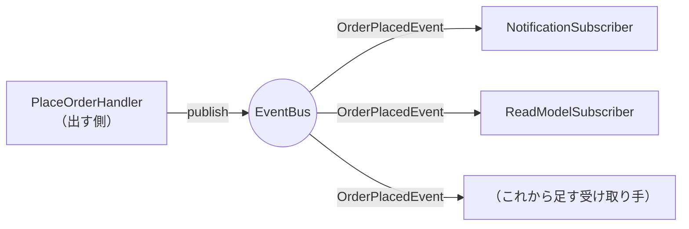

# 第12章: Event-Driven（イベントを介して後続処理を疎結合にする）

> この章の軸: ③アプリ全体の分け方

## この章のゴール

注文が成立した後に続く処理（通知、参照データの更新）を、「イベント」を介してつなぎます。イベントを出す側は、誰が受け取るのかを知らない構造にします。

## Why: なぜEvent-Drivenを学ぶのか

[第11章](./11-cqrs.md)の最後に、課題が残りました。注文が成立した後に反映したい先（読み取りモデル、売上集計、通知）が増えるたびに、組み立て役を書き換えることです。

SaaSでは、この種の「Aが起きたら、B、C、Dを実行したい」という要望が次々に出ます。しかも、それぞれの担当は別のチームであることが多くあります。1つの処理が全員の事情を知っている構造では、チームの数だけ衝突が起きます。

## 前提

[第11章](./11-cqrs.md)を読み終えていること。[第3章](./03-observer.md)のObserverも読み返しておくと、違いがわかりやすくなります。

## 悪い実装を読む

次のファイルを開いてください。

- [ConsoleOrderApp.java](../src/main/java/com/example/orders/ch12_event_driven/before/ConsoleOrderApp.java)

注文が成立した直後の部分に注目してください。次の2つを、続けて直接実行しています。

1. 履歴の更新（`history.computeIfAbsent(...)`）
1. 通知の出力（`out.println("[NOTIFY]...")`）

注文を処理するコードが、後続のすべての処理を知っています。次の変更要求が来たら、どうなるでしょうか。

- 注文成立時に、売上の集計も更新したい
- 高額注文のときだけ、管理者にも通知したい
- 通知が失敗しても、注文は成功のままにしたい

どれも、注文を処理するコードを書き換えます。別のチームの担当の処理でも、このコードを触る必要があります。

## 考え方

### 何が変わりやすく、何が変わりにくいか

| 問い | この題材での答え |
| :--- | :--- |
| 変わりにくい部分は何か | 「注文が成立した」という事実 |
| 変わりやすい部分は何か | その事実に反応する処理の数と内容 |

### 構造



| 用語 | 意味 | この章の例 |
| :--- | :--- | :--- |
| イベント | 過去に起きた事実。不変 | `OrderPlacedEvent` |
| 出す側（Publisher） | 事実が起きたことを知らせる | `PlaceOrderHandler` |
| 受け取る側（Subscriber） | 関心のあるイベントに反応する | `NotificationSubscriber` |
| バス | 出す側と受け取る側を仲介する | `EventBus` |

出す側と受け取る側は、**お互いを知りません**。両者が共有するのは、イベントの型だけです。

### コマンドとイベントの違い

| 観点 | コマンド | イベント |
| :--- | :--- | :--- |
| 意味 | してほしい依頼（命令） | 起きた事実 |
| 名前 | 命令形（`PLACE`） | 過去形（`OrderPlaced`） |
| 受け手 | 1つ（依頼先が決まっている） | 0以上（誰が受け取るかは決まっていない） |
| 拒否 | できる | できない（もう起きたこと） |

### Observer（第3章）との違い

| 観点 | Observer（第3章） | Event-Driven（この章） |
| :--- | :--- | :--- |
| 登録の仕方 | 本体が、リスナーのリストを直接持つ | バスが仲介し、出す側は受け取り手のリストも持たない |
| 規模 | 1つのクラスの中の仕組み | モジュールやチームをまたぐ構造 |
| 発展 | 同期の呼び出し | 非同期のメッセージ基盤にも発展できる |

> **⚠️ よくある失敗・誤解**
> イベント駆動では、**処理の流れがコードから追いにくくなります**。「`publish` の後に何が起きるのか」を知るには、受け取り手を探す必要があります。どのイベントに誰が反応するかを、一覧にして管理する工夫が必要です。また、イベントに何でも載せると、受け取り手が出す側の内部に依存してしまいます。

### 同期と非同期

この章のバスは、同じプロセスの中で、登録順に同期で呼び出します。実際のシステムでは、メッセージ基盤を使って非同期にすることが多くあります。非同期にすると、次の問題を考える必要があります。

- 順序: イベントが届く順番は、保証されるか
- 重複: 同じイベントが2回届いても、問題ないか（冪等性）
- 失敗: 受け取り手が失敗したとき、再送するか

### 適用すると嬉しい状況・損をする状況

| 観点 | 内容 |
| :--- | :--- |
| 嬉しい状況 | 1つの事実に、複数の後続処理が反応する。後続処理が別のチームの担当で、増えていく |
| 損をする状況 | 後続処理が1つで、増えない。処理の順序が厳密に決まっている。流れを追いやすさが重要な小規模なアプリ |
| 使わない選択肢 | 直接呼び出す。Observer（第3章）で十分な場合も多い |

## 課題: 分解してみよう

課題用のクラスは [exercise パッケージ](../src/main/java/com/example/orders/ch12_event_driven/exercise/) にあります。

| 場所 | 状態 |
| :--- | :--- |
| `event/EventBus`、`event/OrderPlacedEvent` | 用意済み。形は変えません |
| `query` | 第11章の参照側。完成品を、そのまま使います |
| `order`、`subscriber` | 空。作ります |
| `event/SimpleEventBus` | まだない。作ります |
| `ExerciseOrderApp` | 分解前のコピー。書き換えます |

### ステップ1: 現状を確認する

```bash
mvn test
```

`EventDrivenStructureTest` の4件と `EventBusTest` の1件が失敗します。

### ステップ2: バスを作る

`event` パッケージに、`EventBus` を実装した `SimpleEventBus` を作ります。

- 登録された処理は、どう保持しますか
- 登録されていない種類のイベントが出されたら、どうなりますか

### ステップ3: 出す側を作る

`order` パッケージに、注文を受け付けて、成立したらイベントを出すクラスを作ります。

- 通知や履歴の更新は、書いてよいでしょうか
- イベントを出すのは、処理のどの時点ですか。失敗した注文では、どうなりますか
- イベントには、何を載せますか。載せすぎないよう注意してください

### ステップ4: 受け取る側を作る

`subscriber` パッケージに、2つの受け取り手を作ります。

- 通知を出力するもの
- 読み取りモデルを更新するもの

受け取り手は、出す側のクラスを知ってはいけません。

### ステップ5: 組み立てる

`ExerciseOrderApp` の4引数のコンストラクタで、受け取り手をバスに登録し、出す側にバスを渡します。3引数のコンストラクタは、標準のバスを渡す形にします。

### ステップ6: 確認する

```bash
mvn test
```

> **🔍 確認・実験してみよう**
> `EventBusTest` の最初のテストを読んでください。売上の集計のような新しい受け取り手を足すとき、新しく作るファイルと、変更するファイルを数えてみましょう。動かす前に予想してください。

## 動作確認

```bash
mvn test
```

## 解答例と解説

解答例の全文は [answers/ch12_event_driven/](../answers/ch12_event_driven/) にあります。自分で書き終えてから開いてください。

<details>
<summary>解答例の要点を見る</summary>

### クラスの配置

| 場所 | クラス |
| :--- | :--- |
| `event` | `EventBus`、`OrderPlacedEvent`、`SimpleEventBus` |
| `order` | `PlaceOrderHandler`（出す側） |
| `subscriber` | `NotificationSubscriber`、`ReadModelSubscriber`（受け取る側） |
| `query` | 第11章と同じ参照側 |

### 出す側

```java
// 「成立した」という事実を知らせる（誰が受け取るかは知らない）
bus.publish(new OrderPlacedEvent(order.id(), order.customer().id(), total));
```

### 受け取る側

```java
public void register(EventBus bus) {
    bus.subscribe(OrderPlacedEvent.class, this::on);
}

private void on(OrderPlacedEvent event) {
    readModel.apply(event.orderId(), event.customerId(), event.total());
}
```

### 組み立て役

```java
// 受け取る側を、バスに登録する（出す側は、これらを知らない）
new NotificationSubscriber(out).register(bus);
new ReadModelSubscriber(readModel).register(bus);
this.commands = new PlaceOrderHandler(stock, bus);
```

### なぜこの切り方か

- 出す側は、`java.io` と読み取りモデルのどちらも知りません。受け取り手を足しても、出す側は変わりません
- 受け取り手は、自分でバスに登録します。何に関心があるかを、受け取り手自身が宣言する形です
- イベントには、注文ID、顧客ID、請求額だけを載せました。受け取り手が必要とする最小限の事実です
- 失敗した注文では、イベントを出しません。「成立した」という事実が、起きていないからです

</details>

## 他のパターンと比べる

| 比べる相手 | 違い |
| :--- | :--- |
| Observer（第3章） | Observerは本体がリスナーを直接持つ。Event-Drivenはバスが仲介し、出す側は受け取り手を持たない |
| CQRS（第11章） | CQRSの「更新後の反映」を、イベントで疎結合にできる。両者はよく組み合わされる |
| Hexagonal（第10章） | 通知を出口のポートとして扱うか、イベントとして扱うかは、設計上の選択。アダプタがイベントを受け取る形にもできる |

> **💼 現場Tip**
> イベント駆動の障害調査では、「どのイベントが、いつ出て、誰が受け取って、何をしたか」を追える必要があります。イベントに一意なIDを付け、受け取り手のログに必ず残す設計を、最初から入れておくと助かります。

## もっと良くしてみよう

### 理解確認

1. イベントを「過去形」で名付ける理由は何ですか
1. 出す側が、受け取り手を知らないことの利点と欠点を挙げてみましょう
1. ObserverとEvent-Drivenは、何が違いますか

### 発展改善クイズ

1. 受け取り手の1つが例外を投げたとき、後ろに登録された受け取り手は呼ばれるでしょうか。実際に確かめ、どう直すとよいか考えてみましょう
1. 非同期にすると、「注文した直後に参照しても出てこない」ことがあります。画面でユーザーにどう見せるとよいでしょうか。第13章へ進む前に考えてみましょう

---

| [← 第11章: CQRS](./11-cqrs.md) | [全章目次](./README.md) | [第13章: パターンを選ぶ基準 →](./13-choosing.md) |
| - | :-: | --: |
