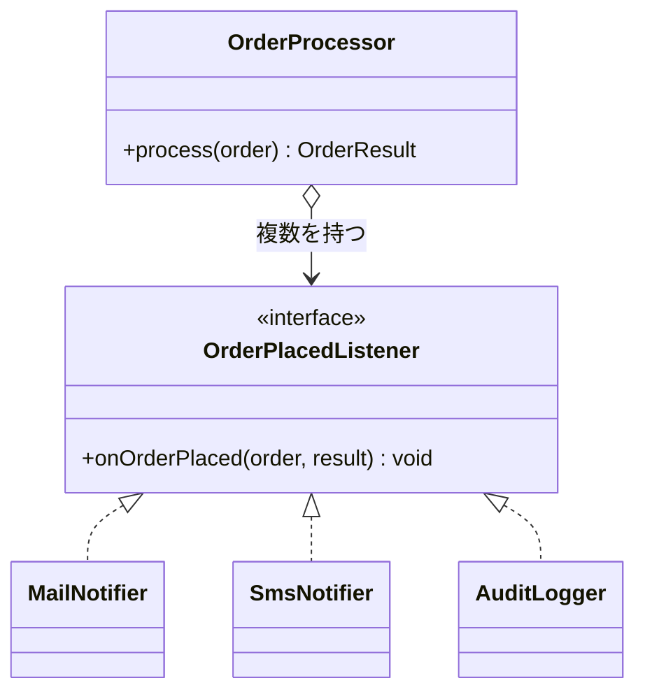

# 第13章: Observer（注文後の通知を本体から切り離す）

> この章の軸: ③クラスの作り方
>
> **この章は Part 2（条件が合えば使う設計）です。** 使うと嬉しい条件: 本業の処理の後に、反応する処理が増えるとき。Part 1 の構成で足りているなら、この章の設計は使わなくても構いません。

## この章のゴール

注文が成立したあとの通知（メール、SMS）と監査ログを、注文処理の本体から切り離します。通知先を足しても本体を書き換えない構造を目指します。単一責任（S）を体験する章です。

## Why: なぜObserverを学ぶのか

通知手段は、後から増えます。メールとSMSの次に、チャットツール、社内の管理画面、外部システムへの連携が足されます。監査ログの書式も、監査の要件が変わるたびに変わります。

通知を足すたびに、金額計算や決済のメソッドを書き換えるのは危険です。通知の修正のせいで、請求額まで壊れる恐れがあります。「本業のロジック」と「その結果に反応する処理」は、別々に変更できるほうが安全です。

## 前提

[第12章](./12-strategy.md)を読み終えていること。第2章と第12章で学んだ、コンストラクタで部品を受け取る形（DI）を、この章でも使います。

## 悪い実装を読む

次のファイルを開いてください。この章では「5. 通知」と「6. 監査ログ」の段落に注目します。

- [NotificationInlineOrderProcessor.java](../src/main/java/com/example/orders/ch13_observer/before/NotificationInlineOrderProcessor.java)

次の変更要求が来たら、どこを触るか想像してください。

- 通知にチャットツールを足したい
- 監査ログを、ファイルにも書きたい
- 高額注文のときだけ、管理者にも知らせたい

どれも `process` メソッドの末尾を書き換えます。しかも、通知の段落が増えるほど、金額計算や決済のコードと同じメソッドの中で混ざります。第1章で学んだ「発散的変更」の典型です。

## 考え方

### 何が変わりやすく、何が変わりにくいか

| 問い | この題材での答え |
| :--- | :--- |
| 変わりにくい部分は何か | 「注文が成立した」という事実 |
| 変わりやすい部分は何か | その事実に対して、何をするか（通知、記録、連携） |

Observerは、事実を知らせる側と、事実に反応する側を分けます。知らせる側は「起きました」と、登録された全員に伝えるだけです。誰が登録されていて、何をするのかは知りません。

### 構造



### Strategyとの違い

構造はStrategyとよく似ています。違いは「結果を使うか」と「何人いるか」です。

| 観点 | Strategy（第12章） | Observer（この章） |
| :--- | :--- | :--- |
| 部品の役目 | 値を計算して返す | 起きたことへ反応する |
| 戻り値 | あり（割引額）。呼び出し側が使う | なし。呼び出し側は結果を気にしない |
| 数 | 1つの方式を選ぶ、または合算する | 登録された全員に知らせる |

### 適用すると嬉しい状況・損をする状況

| 観点 | 内容 |
| :--- | :--- |
| 嬉しい状況 | 反応する処理が今後も増える。反応する処理の失敗が、本業の処理に影響してほしくない |
| 損をする状況 | 反応する処理が1つで、今後も増えない。処理の順序が厳密に決まっている（登録順に依存すると壊れやすい） |
| 使わない選択肢 | 本体から直接呼ぶ。メッセージ基盤を使った非同期の連携（第7章のイベント駆動） |

> **⚠️ よくある失敗・誤解**
> 通知先の中で例外が起きたとき、本体の処理まで失敗にしてよいのか、設計で決めておく必要があります。この章では最小の形にとどめますが、現場では「通知の失敗は記録するだけで、注文は成功のままにする」ことが多くあります。

## 課題: 分解してみよう

課題用のクラスは [exercise パッケージ](../src/main/java/com/example/orders/ch13_observer/exercise/) にあります。

- `ExerciseOrderProcessor`: 分解前のコピー。ここを書き換えます
- `OrderPlacedListener`: 窓口の型。テストが前提にしているため、形は変えません

### ステップ1: 現状を確認する

```bash
mvn test
```

この章の `OrderPlacedListenerExtensionTest` のうち、2件が失敗します。この2件を green にするのが、この章のゴールです。

### ステップ2: 通知先を1つずつ切り出す

「5. 通知」と「6. 監査ログ」の段落を、`OrderPlacedListener` の実装クラスに分けてください。次の問いに答えてください。

- 通知先は、いくつに分けられますか
- メールとSMSの「送る条件」（メールアドレスの有無、1万円以上）は、通知先と本体のどちらが持つべきですか
- 通知先は、どんな情報を受け取れば十分ですか。受け取る情報は、窓口の型で決まっています

### ステップ3: 本体から通知先を呼ぶ

3引数のコンストラクタで受け取った通知先を、**決済が成功した後** で順番に呼び出します。次の点を考えてください。

- 決済のログ（`[PAYMENT]`）は、通知でしょうか。それとも決済の一部でしょうか
- 在庫不足や決済拒否のとき、通知先は呼ばれるべきでしょうか

### ステップ4: 標準の組み立てを用意する

2引数のコンストラクタは、分解前と同じ出力になるよう、標準の通知先一式を渡す形にします。出力の順序（メール、SMS、監査ログ）が変わらないように注意してください。

### ステップ5: 確認する

```bash
mvn test
```

全件 green になれば完了です。契約テストを書き換えずに通ったことは、第12章と同じく、振る舞いを変えていない証拠です。

> **🔍 確認・実験してみよう**
> 拡張テストを読み、「通知先が空のときは何も出力されない」ことを確認してください。そのうえで、チャットツールへの通知を足すとき、新しく作るファイルと変更するファイルをそれぞれ数えてみましょう。動かす前に予想してください。

## 動作確認

```bash
mvn test
```

## 解答例と解説

解答例の全文は [answers/ch13_observer/](../answers/ch13_observer/) にあります。自分で書き終えてから開いてください。

<details>
<summary>解答例の要点を見る</summary>

### 通知先のクラス（例: SMS）

```java
/**
 * 注文成立をSMSで通知します（電話番号があり、請求額が1万円以上の場合だけ）。
 */
public class SmsNotifier implements OrderPlacedListener {
    private final PrintStream out;

    public SmsNotifier(PrintStream out) {
        this.out = out;
    }

    @Override
    public void onOrderPlaced(Order order, OrderResult result) {
        // 電話番号がない、または1万円未満なら何もしない
        if (order.customer().phone() == null || result.total() < 10000) {
            return;
        }
        out.println("[SMS] to=" + order.customer().phone()
                + " order=" + order.id());
    }
}
```

### 本体側

```java
// 注文が成立したことを、登録されたすべての通知先に知らせる（誰がいるかは知らない）
OrderResult result = new OrderResult(order.id(), subtotal, discount, total);
for (OrderPlacedListener listener : listeners) {
    listener.onOrderPlaced(order, result);
}
return result;
```

### なぜこの切り方か

- 「送る条件」は、通知先ごとのルールです。メールとSMSで条件が違うため、通知先の側に持たせます
- 決済のログは、通知先ではなく本体に残します。決済は注文の成立に必須の処理であり、「成立した後に反応する処理」ではないからです
- 通知先を呼ぶのは決済の後です。失敗した注文について、通知や監査ログを出さないためです
- 通知先に渡す情報は、注文と結果だけです。通知先が本体の内部状態を知らなくても動きます

</details>

## 他のパターンと比べる

| 比べる相手 | 違い |
| :--- | :--- |
| Strategy（第12章） | Strategyは値を返して本体が使う。Observerは戻り値を使わず、起きたことに反応する |
| Decorator（第14章） | Decoratorは本体の前後に処理を重ねる。Observerは本体が終わった後の反応を、複数登録する |
| イベント駆動（第7章） | 同じ考え方を、アプリ全体の構造に広げたもの。送り手と受け手を、イベントという間接的な窓口でつなぐ |

> **💼 現場Tip**
> 通知や外部連携は、障害の多い箇所です。本体のロジックと切り離しておくと、「通知だけ止める」「通知だけ再送する」といった運用の対応がしやすくなります。

## もっと良くしてみよう

### 理解確認

1. 「事実」と「反応」を分けると、何が良くなりますか。この章の題材に当てはめて説明してみましょう
1. StrategyとObserverは、何が違いますか。戻り値の有無に注目して説明してみましょう
1. 通知先が例外を投げたとき、後ろに登録された通知先は呼ばれるでしょうか。今の実装で確かめてみましょう

### 発展改善クイズ

1. 通知先の失敗が注文の成功へ影響しないようにするには、どこをどう直すとよいでしょうか。自分なりに考えてみましょう
1. 通知の送信に数秒かかるとしたら、注文処理の応答時間に影響します。これを避ける方法を、次の章へ進む前に考えてみましょう

---

| [← 第12章: Strategy](./12-strategy.md) | [全章目次](./README.md) | [第14章: Decorator →](./14-decorator.md) |
| - | :-: | --: |
