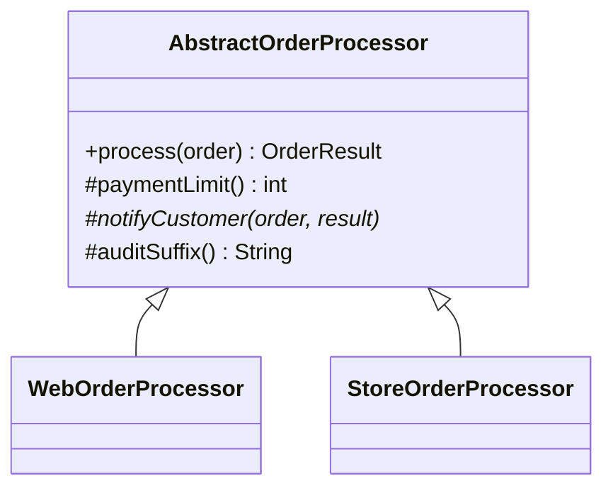

# 第16章: Template Method（手順は同じで中身だけ違う処理を分ける）

> この章の軸: ③クラスの作り方
>
> **この章は Part 2（条件が合えば使う設計）です。** 使うと嬉しい条件: 手順は同じで中身だけ違う処理が、コピーで増えるとき。Part 1 の構成で足りているなら、この章の設計は使わなくても構いません。

## この章のゴール

Web注文と店頭注文という、ほぼ同じ内容のコピー2つを、手順（骨格）と差分に分けます。共通の手順を1カ所に集め、子クラスにはチャネルごとの違いだけを残します。

## Why: なぜTemplate Methodを学ぶのか

「ほぼ同じだけど、少しだけ違う」処理は、現場で頻繁に出会います。Web版と管理画面版、国内向けと海外向け、通常版と法人版などです。

手っ取り早い方法は、既存のクラスをコピーして、違う部分だけ書き換えることです。しかし、コピーは時間とともに差が広がります。片方の不具合を直しても、もう片方の修正を忘れます。これは第1章で学んだ「変更の散弾」の典型です。

## 前提

[第8章](./08-composition.md)を読み終えていること。第8章では、基本は継承より委譲を選ぶと学びました。この章は、継承が適切になる場面と、その限界を扱います。

## 悪い実装を読む

次の2つのファイルを開いてください。

- [WebOrderProcessor.java](../src/main/java/com/example/orders/ch16_template/before/WebOrderProcessor.java)
- [StoreOrderProcessor.java](../src/main/java/com/example/orders/ch16_template/before/StoreOrderProcessor.java)

2つの違いを、目で探すのは大変です。ターミナルで比べてみましょう。

```bash
diff src/main/java/com/example/orders/ch16_template/before/WebOrderProcessor.java \
     src/main/java/com/example/orders/ch16_template/before/StoreOrderProcessor.java
```

違いは、ごくわずかです。決済の上限額、通知の有無、監査ログの末尾の3つだけです。残りの数十行は、完全に同じです。

次の変更要求が来たら、どこを触るか想像してください。

- 数量の検証ルールを変えたい（すべてのチャネルに共通）
- 電話注文という3つ目のチャネルを足したい

前者は2カ所を同じように直す必要があり、後者は3つ目のコピーを作ることになります。

## 考え方

### 何が変わりやすく、何が変わりにくいか

| 問い | この題材での答え |
| :--- | :--- |
| 変わりにくい部分は何か | 処理の手順（検証、金額計算、在庫、決済、通知、監査ログ）の順番 |
| 変わりやすい部分は何か | 一部の手順の中身（上限額、通知方法、監査ログの末尾） |

Template Methodは、**手順を親クラスに書いて固定し、中身が違う部分だけを子クラスに任せます**。親が手順の流れを握り、子は呼ばれる側になります。

### 構造



`process` が手順を定める「テンプレートメソッド」です。`final` を付けて、子クラスが手順を壊せないようにします。

### 差分の2種類

| 種類 | 意味 | この題材での例 |
| :--- | :--- | :--- |
| 抽象メソッド | 子クラスが必ず決める | 通知の方法（`notifyCustomer`） |
| フックメソッド | 既定の動作があり、必要な子クラスだけが上書きする | 上限額（`paymentLimit`）、監査ログの末尾（`auditSuffix`） |

「全員が必ず違う」部分は抽象メソッドに、「たいていは同じで、一部だけ違う」部分はフックメソッドにします。こうすると、子クラスに書く量が減ります。

### 適用すると嬉しい状況・損をする状況

| 観点 | 内容 |
| :--- | :--- |
| 嬉しい状況 | 手順が共通で、一部の工程だけ違う。派生が今後も増える |
| 損をする状況 | 差分が多く、手順そのものが派生ごとに違う。継承の階層が深くなりそう |
| 使わない選択肢 | Strategyで差分だけを委譲する。ラムダ式を引数で渡す |

### Strategyとの違い

| 観点 | Template Method（この章） | Strategy（第12章） |
| :--- | :--- | :--- |
| 仕組み | 継承 | 委譲 |
| 手順の持ち主 | 親クラス | 呼び出し側 |
| 差分の決まる時期 | クラスを書く時（コンパイル時） | 部品を渡す時（実行時） |
| 弱点 | 親の変更が子へ波及しやすい | 部品が増えて組み立てが複雑になる |

> **⚠️ よくある失敗・誤解**
> 継承は強い結びつきです。親クラスを変更すると、すべての子クラスに影響します。「コードを再利用したいだけ」で継承を使うと、後で身動きが取れなくなります。手順が共通であるという関係がはっきりしているときに限って使ってください。

## 課題: 分解してみよう

課題用のクラスは [exercise パッケージ](../src/main/java/com/example/orders/ch16_template/exercise/) にあります。

- `WebOrderProcessor`, `StoreOrderProcessor`: 分解前のコピー。これらを書き換えます
- `AbstractOrderProcessor`: 中身が空の雛形。ここに手順を移します

### ステップ1: 現状を確認する

```bash
mvn test
```

`TemplateMethodStructureTest` の3件が失敗します。子クラスが親を継承しておらず、`process` が子に残っているためです。

### ステップ2: 差分を書き出す

分解前の2つのファイルを比べ、違いをすべて書き出してください。そのうえで、それぞれを分類します。

- 違いは、いくつありますか
- 各違いは、「必ず違う」ものですか。それとも「たいていは同じ」ものですか
- 親クラスから子クラスに渡すべき情報（フィールド）は何ですか

### ステップ3: 親クラスに手順を移す

`AbstractOrderProcessor` に `process` を `final` で書いてください。差分の部分は、抽象メソッドかフックメソッドの呼び出しに置き換えます。

- 抽象メソッドとフックメソッドを、どう使い分けますか
- メソッドの可視性（`public`、`protected`）は、何にしますか

### ステップ4: 子クラスを書き換える

`WebOrderProcessor` と `StoreOrderProcessor` に `extends AbstractOrderProcessor` を付け、`process` を取り除きます。残すのは差分のメソッドだけです。

### ステップ5: 確認する

```bash
mvn test
```

> **🔍 確認・実験してみよう**
> 電話注文という3つ目のチャネルを足してみてください。新しく作るファイルと、変更するファイルを数えます。分解前に同じことをしたら、何行をコピーすることになったか、予想してから比べてください。

## 動作確認

```bash
mvn test
```

## 解答例と解説

解答例の全文は [answers/ch16_template/](../answers/ch16_template/) にあります。自分で書き終えてから開いてください。

<details>
<summary>解答例の要点を見る</summary>

### 親クラス（抜粋）

```java
/**
 * 決済を受け付ける上限額です。既定は50万円で、必要なら子クラスが上書きします（フックメソッド）。
 */
protected int paymentLimit() {
    return 500000;
}

/**
 * 注文成立後に、顧客へ通知します。チャネルごとに必ず決める部分です（抽象メソッド）。
 */
protected abstract void notifyCustomer(Order order, OrderResult result);

@Override
public final OrderResult process(Order order) {
    // 1〜3 は共通の手順（検証、金額計算、在庫引当）
    // 4. 決済では、子クラスが決める上限額を使う
    if (total > paymentLimit()) {
        // 在庫を戻して、決済拒否の例外を投げる
    }
    // 5. 通知は、子クラスに任せる
    OrderResult result = new OrderResult(order.id(), subtotal, discount, total);
    notifyCustomer(order, result);
    // 6. 監査ログの末尾は、子クラスが決める
    out.println("[AUDIT] ... total=" + total + auditSuffix());
    return result;
}
```

### 子クラス（店頭）

```java
public class StoreOrderProcessor extends AbstractOrderProcessor {
    @Override
    protected int paymentLimit() {
        // 店頭は100万円まで受け付ける
        return 1000000;
    }

    @Override
    protected void notifyCustomer(Order order, OrderResult result) {
        // ★重要★ 店頭では、その場で伝えるため何もしない
    }

    @Override
    protected String auditSuffix() {
        return " channel=STORE";
    }
}
```

### なぜこの切り方か

- 手順の順番は、チャネルが変わっても変わらないため、親に置きます。`final` で、子による手順の変更を防ぎます
- 通知は「チャネルごとに必ず決める」ため抽象メソッドにします。決め忘れると、コンパイルエラーになります
- 上限額と監査ログの末尾は「たいていは同じ」ため、既定値のあるフックメソッドにします
- 子クラスには、差分のメソッドだけが残ります。新しいチャネルを足すときは、子クラスを1つ書くだけです

</details>

## 他のパターンと比べる

| 比べる相手 | 違い |
| :--- | :--- |
| Strategy（第12章） | 同じ「差し替え」でも、継承か委譲かが違う。実行時に切り替えたいならStrategy、チャネルのように固定ならTemplate Method |
| Decorator（第14章） | Decoratorは、同じ窓口のまま外から重ねる。Template Methodは、手順の内側の特定の工程を差し替える |
| Factory（第15章） | 手順の中で使う部品の選択は、Factoryに任せる組み合わせもできる |

> **💼 現場Tip**
> 継承を使う設計は、親クラスのドキュメントが重要です。どのメソッドを上書きしてよいか、どの順番で呼ばれるかを、Javadocに必ず書いてください。書かないと、後から入った人が手順を壊します。

## もっと良くしてみよう

### 理解確認

1. テンプレートメソッドに `final` を付ける理由を説明してみましょう
1. 抽象メソッドとフックメソッドは、どう使い分けますか
1. コピーで派生を作る方法と比べて、Template Methodは何が安全ですか

### 発展改善クイズ

1. チャネルが5つになり、「通知の方法」と「上限額」の組み合わせがバラバラになると、継承の構造はどうなりますか。Strategyで書き直した場合も、自分なりに考えてみましょう
1. 親クラスの `process` に新しい手順（たとえばポイント付与）を足すと、すべての子クラスに影響します。この影響を小さくするには、どんな工夫がありそうでしょうか

---

| [← 第15章: Factory](./15-factory.md) | [全章目次](./README.md) | [第17章: クラスの種類 →](./17-class-kinds.md) |
| - | :-: | --: |
