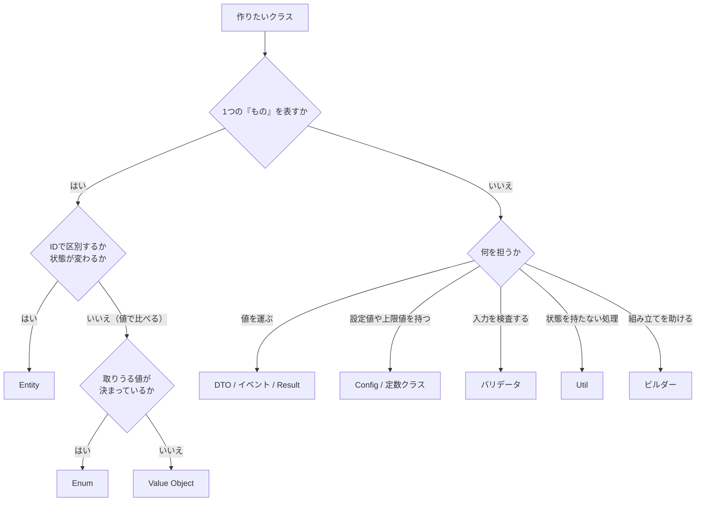

# 第17章: クラスの種類（DTO・Value Object・Entity など）

> この章の軸: すべての軸に共通（アーキテクチャにかかわらず使うクラスの種類）

## この章のゴール

アーキテクチャやデザインパターンとは別に、クラスには「持っている性質」による種類があります。この章では、11種類の違いと実装例を見て、新しいクラスを作るとき、どの種類にするかを自分で決められるようになります。

## Why: なぜクラスの種類を知るのか

第2章では、クラスを役割（入口、業務ロジック、基盤寄りの処理、DTO）で仕分けました。しかし、現場のコードには、役割とは別の軸で呼ばれるクラスが数多くあります。

- コードレビューで「これは DTO ではなく、Value Object にしませんか」と言われる
- 「Entity にルールを持たせて」と頼まれる
- 設計書に、Enum、Config、バリデータといった言葉が並ぶ

これらの言葉は、アーキテクチャが何であっても使います。Layered でも ECB でも Hexagonal でも、DTO は DTO、Entity は Entity です。種類の違いを知っておくと、レビューや設計の会話が、短い言葉で済みます。

## 前提

[第2章](./02-roles.md)を読み終えていること。この章では、コードを書く課題はありません。実装例を読み、テストで違いを確かめます。

実装例は、[ch17_class_kinds パッケージ](../src/main/java/com/example/orders/ch17_class_kinds/)にあります。どれも小さなクラスで、1つの種類を1つのクラスで見せています。

## 11種類の早見表

| 種類 | 一言で言うと | 同じかどうかの基準 | 状態の変化 | ルールを持つか |
| :--- | :--- | :--- | :--- | :--- |
| DTO | 値を運ぶ入れ物 | 比べない | 変えない | 業務ルールは持たない（形式の検査は持てる） |
| Value Object | 値そのもの | 値が同じなら同じ | 変えない | 自分の正しさを守る |
| Entity | ID で区別できるもの | ID が同じなら同じ | 変わる | 自分の状態のルールを持つ |
| Enum | 取りうる値が決まった区分 | 同じ定数かどうか | 変えない | 値ごとの振る舞いを持てる |
| イベント / メッセージ | 起きた事実 | 比べない | 変えない | 持たない |
| Result | 成功か失敗かの結果 | 比べない | 変えない | 成否の確認を促す |
| 設定クラス（Config） | 起動時に決まる設定値 | 比べない | 変えない | 範囲を検査する |
| バリデータ | 入力を検査する役 | 比べない | 持たない | 検査のルールを持つ |
| ユーティリティ（Util） | 状態を持たない便利な関数 | なし（作らない） | 持たない | 持たない |
| 定数クラス | 名前の付いた変わらない値 | なし（作らない） | 変わらない | 持たない |
| ビルダー | 組み立ての補助役 | 比べない | 組み立て中だけ変わる | 必須項目を検査する |

## どこまでやらせるか（責務の範囲）

種類を決めたら、次に決めるのは「そのクラスに、どこまでやらせるか」です。やらせすぎると別の種類のクラスに近づき、やらせなさすぎると別の場所に処理が散らばります。

| 種類 | やらせること | やらせないこと | 越えたときのサイン |
| :--- | :--- | :--- | :--- |
| DTO | 値を運ぶ。必須や形式など、**形の検査** | 業務ルール、計算、DB アクセス | 計算や判断のメソッドが増えたら、Entity か Value Object にする |
| Value Object | 自分の値の正しさ、正規化、値に関する計算 | ID、状態の変更、保存、他の概念への依存 | 識別子や状態の変更が必要なら、Entity にする |
| Entity | 自分の状態の遷移と、その不変条件 | 保存、画面の表示、複数の Entity をまたぐ調整、通知 | 複数の Entity をまたぐなら、業務ロジック（Service）に置く |
| Enum | 区分、表示名、DB の値との変換、区分ごとの単純な判定 | 外部呼び出し、重い業務ロジック | 区分ごとの処理が重くなったら、Strategy（第12章）にする |
| イベント | 起きた事実（何が、いつ、誰の要求で）とイベントID | 振る舞い、後からの変更、大きなデータ | 巨大になったら、IDだけを持たせ、詳細は取りに行く |
| Result | 成否と、値か理由を運ぶ | 想定外の異常の包み隠し、ログ出力 | 異常まで包み始めたら、例外にする |
| Config | 設定値の保持と、範囲の検査 | 読み込み元の詳細、業務ロジック、実行中の変更 | 読み込み処理が入ったら、読み込み専用のクラスに分ける |
| バリデータ | 入力の形式と範囲の検査。全エラーの収集 | DB を見ないと分からない判断、入力の変換、保存 | DB 参照が必要なら、業務ロジックに置く |
| Util | 業務を知らない、状態のない処理 | 状態、業務ルール、DB や外部の呼び出し | 業務の言葉が出てきたら、Entity や Service に移す |
| 定数クラス | 変わらない値に名前を付ける | 環境で変わる値、区分 | 環境で変わるなら Config、区分なら Enum にする |
| ビルダー | 項目の組み立てと、必須項目の検査 | 業務処理、送信などの副作用 | 組み立て以外の処理が入ったら、別のクラスに出す |

「越えたときのサイン」は、そのクラスが別の種類に変わりたがっている合図です。サインが出たら、種類を見直します。

## 判断フロー

新しいクラスを作るとき、次の順で問います。



## 種類ごとの違いと実装例

### 1. DTO（Data Transfer Object）

層や部品の間で、値を運ぶためのクラスです。**業務ルールは持ちません。** この実装例は最も単純な形で、値の検証もせず、負の金額でもそのまま運びます。検査を持たせる場合は、後の「コンストラクタで検証する DTO」で説明します。

```java
public OrderSummaryDto(String orderId, String customerId, int total) {
    // ★重要★ 受け取った値を、検証せずそのまま保存する（DTO はルールを持たない）
    this.orderId = orderId;
    this.customerId = customerId;
    this.total = total;
}
```

使う場面は、層をまたぐときです。Controller と Service の間で、永続化層の型をそのまま渡さず、DTO に詰め直して渡します（第4章）。

#### コンストラクタで検証する DTO

必須項目や形式を、DTO のコンストラクタで検査する書き方も、実務では広く使われます。これは間違いではありません。「作れたものは必ず正しい」という保証が得られます。

ただし、検査の場所によって、向き不向きがあります。

| 場面 | コンストラクタでの検証 |
| :--- | :--- |
| すでに検証済みのデータを、内部で運ぶ DTO | 向く。最後の砦として、形の検査を入れておける |
| 画面や API からの入力を、直接受ける DTO | 注意が要る。最初のエラーで例外になり、利用者へ「直す箇所のすべて」を示せない |

入力を直接受ける場面では、バリデータで全エラーを集めてから、検証済みの DTO を作る形が向きます。検査の範囲は、**形の検査**（必須、形式、範囲）までにとどめます。計算や、DB を見ないと分からない判断は、DTO に入れません。

### 2. Value Object（値オブジェクト）

メールアドレス、金額、住所のように、**値そのもの** を表します。不変で、値が同じなら等しく、作った時点で正しいことが保証されます。

```java
public static EmailAddress of(String text) {
    String normalized = text.trim().toLowerCase();
    int at = normalized.indexOf('@');
    if (at <= 0 || at == normalized.length() - 1) {
        // ★重要★ 不正な値は、作る時点で拒否する（作れたものは必ず正しい）
        throw new OrderValidationException("メールアドレスの形式が不正です: " + text);
    }
    return new EmailAddress(normalized);
}

@Override
public boolean equals(Object o) {
    // ★重要★ 値が同じなら等しい（Value Object は値で比べる）
    return o instanceof EmailAddress && ((EmailAddress) o).value.equals(value);
}
```

`Taro@Example.com` と ` taro@example.com ` は、正規化されて等しくなります。コンストラクタを `private` にして、検証する `of` からだけ作らせるのが定石です。第9章の `Money` も、同じ種類です。

### 3. Entity（エンティティ）

注文、在庫、顧客のように、**ID で区別され、状態が変わる** ものです。自分の状態に関するルールを、自分で持ちます。

```java
public void reserve(int amount) {
    if (amount > quantity) {
        // ★重要★ 「足りるか」のルールは、この Entity が自分で持つ
        throw new OutOfStockException("在庫が不足しています: " + productId);
    }
    // ★重要★ 在庫の数を減らす（Entity は、状態が変わる）
    quantity -= amount;
}

@Override
public boolean equals(Object o) {
    // ★重要★ 商品IDが同じなら同じもの（Entity は ID で比べる）
    return o instanceof InventoryItem && ((InventoryItem) o).productId.equals(productId);
}
```

数量が違っても、商品IDが同じなら同じ在庫です。ここが Value Object との最大の違いです。第5章の `Stock` や第9章の `Stock` も、同じ種類です。

### 4. Enum（列挙型）

注文の状態や会員ランクのように、**取りうる値が決まっている区分** を表します。値ごとの振る舞いも、持たせられます。

```java
public enum OrderStatus {
    PLACED(1, "受付済み", true),
    SHIPPED(2, "出荷済み", false),
    CANCELLED(9, "取消済み", false);

    public boolean canCancel() { return cancellable; }
}
```

文字列や数値で状態を表すと、`"SHIPED"` のような打ち間違いを、コンパイラが見つけてくれません。Enum なら、間違った値は書けません。この教材の `MemberRank` も、同じ種類です。

#### DB の値との変換

実務では、DB や外部システムの値と、Enum を相互に変換する場面が頻繁にあります。変換は、Enum 自身に持たせます。

| 変換 | 方法 | 例 |
| :--- | :--- | :--- |
| Enum から文字列 | `name()` | `SHIPPED` から `"SHIPPED"` |
| 文字列から Enum | `valueOf`（またはそれを包んだ `fromName`） | `" shipped "` から `SHIPPED` |
| Enum から数値 | 専用のコードのフィールド | `CANCELLED` から `9` |
| 数値から Enum | コードから引く表を使った `fromCode` | `9` から `CANCELLED` |

```java
private static final Map<Integer, OrderStatus> BY_CODE = new HashMap<>();

static {
    // ★重要★ クラスの読み込み時に1回だけ実行して、コードから Enum を引く表を作る
    for (OrderStatus status : values()) {
        BY_CODE.put(status.code, status);
    }
}

public static OrderStatus fromCode(int code) {
    OrderStatus status = BY_CODE.get(code);
    if (status == null) {
        // ★重要★ 未知のコードは、黙って別の値にせず、例外で知らせる
        throw new IllegalArgumentException("未知の状態コードです: " + code);
    }
    return status;
}
```

変換で、よくある失敗が3つあります。

- **`ordinal()`（宣言順）を DB に保存する**: 値の並び替えや途中への追加で、保存済みのデータの意味が変わります。DB には、専用のコード（`code`）を保存します。実装例では、`CANCELLED` の `ordinal()` は 2 で、`code` は 9 です
- **未知の値を黙って別の値にする**: 新しい状態を足したのに、古いプログラムが `PLACED` として扱うような事故につながります。未知の値は、例外で知らせます。あえて受け入れるなら、`UNKNOWN` という値を明示的に用意します
- **`valueOf` をそのまま使う**: 大文字小文字や空白の違いで失敗し、`null` では別の例外になります。`fromName` のように包んで、失敗の形をそろえます

### 5. イベント / メッセージ

「注文が出荷された」のように、**起きた事実** を表す不変のデータです。名前は過去形にし、事実だけを持たせます。

実務では、事実のほかに、次の3つを持たせます。

| 項目 | 役割 |
| :--- | :--- |
| イベントID | 重複して届いたイベントを見分ける鍵（第7章の冪等性）。受け取り側は、処理済みのIDを記録しておけば、二重に処理せずに済む |
| 発生時刻 | いつ起きたか。順序の判断や、調査に使う |
| 要求元 | 誰（またはどの仕組み）の要求で起きたか。追跡に使う |

イベントIDと発生時刻は、**新しく作るときだけ決めます**。保存済みのイベントを読み戻すときに、また新しいIDを作ると、別のイベントになってしまうためです。そこで、作り方を2つに分けます。

```java
public static OrderShippedEvent occur(String orderId, LocalDate shippedOn, String requestedBy,
        Supplier<String> idGenerator, Clock clock) {
    // ★重要★ イベントIDと発生時刻は、新しく作るこの場面でだけ決める
    return new OrderShippedEvent(idGenerator.get(), clock.instant(), requestedBy, orderId, shippedOn);
}

public static OrderShippedEvent restore(String eventId, Instant occurredAt, String requestedBy,
        String orderId, LocalDate shippedOn) {
    // ★重要★ 復元では、保存されていたIDと時刻をそのまま使う（新しく生成しない）
    return new OrderShippedEvent(eventId, occurredAt, requestedBy, orderId, shippedOn);
}

@Override
public boolean equals(Object o) {
    // ★重要★ イベントIDが同じなら同じイベント（重複して届いても見分けられる）
    return o instanceof OrderShippedEvent && ((OrderShippedEvent) o).eventId.equals(eventId);
}
```

IDの生成方法（`Supplier`）と時計（`Clock`）を、外から渡せる形にしてあります。テストでは、固定のIDと時刻を渡せば、結果を決め打ちで確かめられます。普段は、IDの生成方法と時計を省いた `occur` が、UUID と現在時刻を使います。

DTO と形は似ています。違いは意図です。DTO は「運ぶための入れ物」で、イベントは「起きたことの記録」です。第7章の `OrderPlacedEvent` が、実際の使い方です。

### 6. Result（結果）

処理の結果を、**成功した値か、失敗の理由のどちらか** として、戻り値で返します。

```java
public static <T> Result<T> ok(T value) {
    // ★重要★ 成功の結果を返す（失敗の理由は null）
    return new Result<>(value, null);
}

public T value() {
    if (!isOk()) {
        throw new IllegalStateException("失敗の結果から値は取り出せません: " + error);
    }
    return value;
}
```

例外との使い分けが大切です。ありえる失敗（入力の誤りなど）は Result、ありえない異常（プログラムの誤りなど）は例外が向きます。この教材の `OrderResult` は、金額の内訳を返す別のクラスで、成功と失敗を表す Result とは違います。

### 7. 設定クラス（Config）

起動時に決まる設定値を、まとめて持ちます。決済の上限や割引率など、**コードに直接書くと変更しにくい値** の置き場です。

```java
public static ShopConfig fromMap(Map<String, String> props) {
    ShopConfig base = defaults();
    int limit = parse(props.get("payment.limit"), base.paymentLimit);
    int rate = parse(props.get("seasonal.rate"), base.seasonalRatePercent);
    // ★重要★ 設定値が範囲外のとき（起動時に不正な設定を見つける）
    if (limit < 0 || rate < 0 || rate > 100) {
        throw new OrderValidationException("設定値が範囲外です");
    }
    return new ShopConfig(limit, rate);
}
```

設定の読み込み元（ファイル、環境変数）を知らずに済むよう、`Map` から作る形にしています。指定のない項目は、標準値になります。

### 8. バリデータ

入力の形式や範囲を検査する専用のクラスです。**最初のエラーで止めず、すべてのエラーを集めて返す** のが、Value Object の検証との違いです。

エラーは、文字列ではなく、**エラーコードとメッセージをセットにした Enum** で返します。

```java
public enum ValidationError {
    ORDER_ID_REQUIRED("E001", "注文IDは必須です"),
    CUSTOMER_ID_REQUIRED("E002", "顧客IDは必須です"),
    QUANTITY_OUT_OF_RANGE("E003", "数量は1以上" + OrderLimits.MAX_QUANTITY_PER_LINE + "以下にしてください");
}
```

```java
public List<ValidationError> validate(String orderId, String customerId, int quantity) {
    // ★重要★ エラーを集める入れ物を作る（例外で止めず、全部集めて返す）
    List<ValidationError> errors = new ArrayList<>();
    if (orderId == null || orderId.isBlank()) {
        errors.add(ValidationError.ORDER_ID_REQUIRED);
    }
    // 以下、顧客IDと数量も同様に検査する
    return errors;
}
```

Enum にする利点は3つあります。

- コードで分岐や集計ができます（ログの検索、API のエラー応答、監視）
- メッセージを後から変えても、コードは変わりません
- 画面ごとの翻訳や、利用者向けの文言の切り替えが、コードを軸にしてできます

画面の入力フォームのように、利用者へ「直すべき箇所をすべて」示したい場面に向きます。**バリデータが検査するのは、入力そのものの形式と範囲まで** です。注文IDの重複のように、DB を見ないと分からない判断は、業務ロジックの役割です。

### 9. ユーティリティ（Util / Helper）

**状態を持たない** 便利な静的メソッドの集まりです。インスタンスは作らず、クラス名から直接呼びます。

```java
public final class YenFormat {
    private YenFormat() {
    }

    public static String format(int yen) {
        return String.format("%,d円", yen);
    }
}
```

便利ですが、使いすぎに注意します。業務のルールを Util に書くと、どのクラスの責務か分からなくなります。Util には、業務を知らない処理だけを置きます。

### 10. 定数クラス

変わらない値に、**名前を付けてまとめます**。値の意味が名前で伝わり、同じ数値が複数の場所に散らばるのを防ぎます。

```java
public final class OrderLimits {
    public static final int MAX_QUANTITY_PER_LINE = 99;
    public static final int MAX_LINES_PER_ORDER = 20;
}
```

Enum や Config との違いは、次の節で説明します。

### 11. ビルダー

項目が多く、省略できる項目もあるオブジェクトを、**段階的に組み立てます**。引数の多いコンストラクタを避け、どの値がどの項目かを、呼び出し側で読めるようにします。

```java
MailMessage mail = MailMessage.builder()
        .to("taro@example.com")
        .subject("ご注文ありがとうございます")
        .cc("boss@example.com")
        .build();
```

```java
public MailMessage build() {
    // ★重要★ 必須の宛先が、設定されていないとき（必須項目の検査は build で行う）
    if (to == null || to.isBlank()) {
        throw new OrderValidationException("宛先は必須です");
    }
    return new MailMessage(this);
}
```

ビルダーは、デザインパターンの1つとして扱われることもあります。この章では、クラスの種類として、組み立ての補助役と捉えます。

## 混同しやすい組み合わせ

| 組み合わせ | 違い |
| :--- | :--- |
| DTO と Value Object | DTO は、複数の項目を運ぶ入れ物で、検査は形までにとどめる。Value Object は、1つの概念を表し、作った時点で正しいことを保証して、値で比べられる |
| Value Object と Entity | 比べる基準が違う。値が同じなら同じものが Value Object、ID が同じなら同じものが Entity |
| DTO とイベント | 形は似ている。運ぶための入れ物が DTO で、起きた事実の記録がイベント |
| Enum と定数クラス | Enum は、同じ種類の値の集まりで、型として扱える。定数クラスは、種類の違う変わらない値の置き場 |
| 定数クラスと Config | 定数は、コードに固定した値で、変えるにはビルドが要る。Config は、起動時に外から変えられる値 |
| バリデータと Value Object の検証 | バリデータは、全エラーを集めて返す。Value Object は、不正な値を作らせず、最初の誤りで止める |
| Result と例外 | Result は、ありえる失敗を戻り値で返す。例外は、通常の流れから外れた異常を知らせる |
| Util と Entity のメソッド | 業務のルールは Entity に置く。Util には、業務を知らない処理だけを置く |

> **⚠️ よくある失敗・誤解**
> 「貧血ドメインモデル」の逆に、Util や Service に何でも入れる失敗があります。ルールを持たない Entity と、ルールだらけの Util の組み合わせは、第9章で見た貧血ドメインモデルそのものです。ルールは、そのルールを一番よく知る種類のクラスに置きます。

## アーキテクチャとの関係

これらの種類は、アーキテクチャの層や役割の中で、よく置かれる場所があります。

| 場所 | よく置かれる種類 |
| :--- | :--- |
| 入口（Controller / Boundary） | DTO（入力と応答）、バリデータ、Result |
| 業務ロジック（Service / Control） | Entity、Value Object、Enum、イベント、Result |
| 基盤寄りの処理（Repository など） | DTO（保存用の記録）、Config |
| どこからでも | Util、定数クラス、ビルダー、Enum |

置き場所に決まりはなく、あくまで傾向です。たとえば Hexagonal（第10章）のポートは、引数や戻り値に DTO や Value Object を使います。CQRS（第11章）の参照側でも、DTO が重要な役割を担います。

## 動作確認

```bash
mvn test -Dtest=ClassKindsTest
```

この章のテストは、最初から全て green です。違いを読み取るための見本として、[ClassKindsTest](../src/test/java/com/example/orders/ch17_class_kinds/ClassKindsTest.java)を読んでください。次の点が確かめられます。

- DTO は不正な値でも拒否せず、Value Object は不正な値を作らせない
- Entity は、数量が変わっても ID が同じなら等しい
- Result は、失敗の結果から値を取り出せない
- バリデータは、すべてのエラーを集めて返す

> **🔍 確認・実験してみよう**
> `EmailAddress` の `equals` を、`value` ではなく、オブジェクトの同一性（`==`）で比べる形に変えてみてください。どのテストが失敗しますか。動かす前に予想してから、確認します。

## もっと良くしてみよう

### 理解確認

1. DTO、Value Object、Entity の3つを、「同じかどうかの基準」と「ルールを持つか」で比べて説明してみましょう
1. 例外と Result は、どんな失敗でそれぞれ使い分けますか
1. Enum、定数クラス、Config は、どう使い分けますか

### 発展改善クイズ

1. 第5章の `PlacedOrder` は、Entity と Value Object のどちらでしょうか。理由も考えてみましょう
1. 第2章の `OrderService` が、`int` の請求額や `String` の顧客IDを受け渡しています。どの種類のクラスにすると、どんな間違いを防げるでしょうか
1. 自分のプロジェクトのクラスを3つ選び、この章の「越えたときのサイン」に当てはまるものがないか、確かめてみましょう

---

| [← 第16章: Template Method](./16-template-method.md) | [全章目次](./README.md) | [第18章: パターンを選ぶ基準 →](./18-choosing.md) |
| - | :-: | --: |
