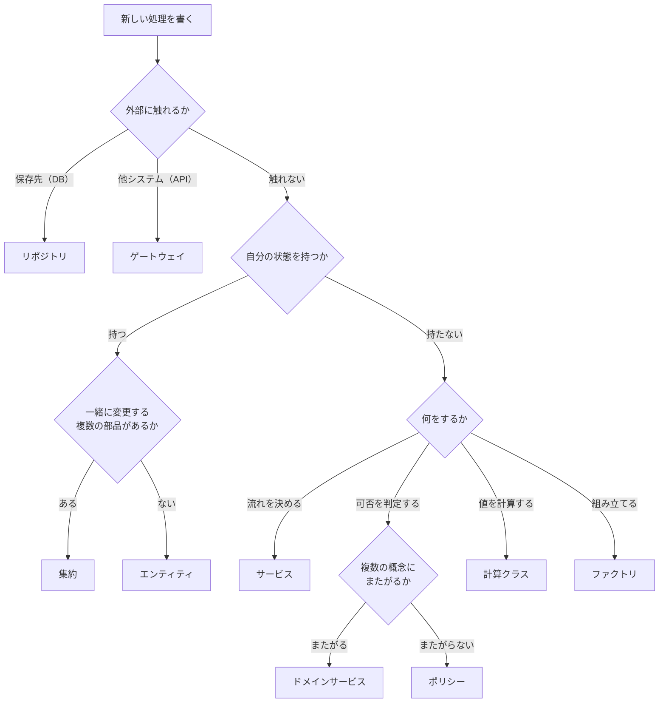
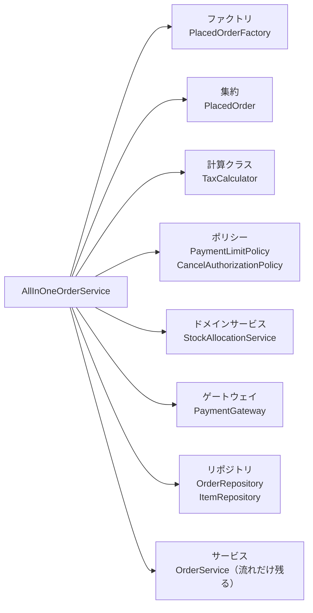
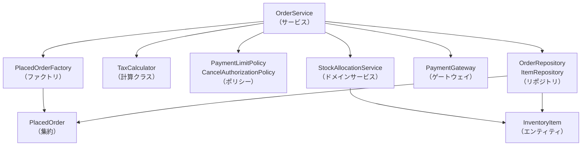
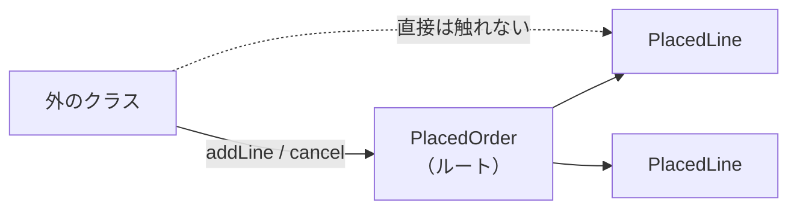

# 第18章: 業務ロジックを担うクラスの種類（サービス・集約・ポリシーなど）

> この章の軸: すべての軸に共通（アーキテクチャにかかわらず使う、業務の処理を担うクラスの種類）

## この章のゴール

第17章は、データや部品の「形」による種類でした。この章は、業務の処理を **誰が持つか** による種類です。9種類の違いと実装例を見て、新しい処理を書くとき「どのクラスに置くか」を自分で決められるようになります。

## Why: なぜ業務ロジックの置き場所に種類があるのか

業務ロジックを書くとき、迷う場面が必ず来ます。

- 税率の変更は、どのクラスを直せばよいのか
- 「この人はキャンセルしてよいか」の判断は、どこに書くのか
- 「顧客ごとに上限が違う」は、顧客ごとにクラスを作るのか
- 外部の決済サービスの呼び出しは、業務ロジックの中に書いてよいのか

答えは、業務によって違います。しかし、**処理の性質** で見ると、共通の型があります。「流れを決める」「判断する」「計算する」「保存する」「外と話す」のように、性質の違う処理は、別のクラスに分けます。この型の名前を知っておくと、レビューや設計の会話が短い言葉で済みます。

## 前提

[第17章](./17-class-kinds.md)と、[第3章](./03-transaction-script.md)または[第9章](./09-domain-model.md)を読み終えていること。この章では、コードを書く課題はありません。実装例を読み、テストで違いを確かめます。

実装例は、[ch18_business_classes パッケージ](../src/main/java/com/example/orders/ch18_business_classes/)にあります。名前は、現場によって違うことがあります。たとえばドメインサービスとサービス、ポリシーと仕様は、**使い分けが揺れやすい** 組み合わせです。この章は「こう呼ぶ現場が多い」という整理であり、唯一の正解ではありません。

## 9種類の早見表

| 種類 | 一言で言うと | 自分の状態 | 外部に触れるか | 注文処理での例 |
| :--- | :--- | :--- | :--- | :--- |
| サービス（ユースケース） | 処理の流れを決める役 | 持たない | 部品を通して触れる | 注文する、キャンセルする |
| エンティティ | 自分の状態とルールを持つもの | 持つ | 触れない | 在庫 |
| 集約（Aggregate） | 一緒に変更するものの、ひとまとまり | 持つ | 触れない | 注文と明細 |
| ドメインサービス | 複数の概念にまたがるルール | 持たない | 触れない | 全明細の在庫引当 |
| ポリシー（ルール） | 判定だけをして、可否と理由を返す | 持たない | 触れない | 決済額の上限、キャンセルの権限 |
| 計算クラス | 値を受け取り、値を返す | 持たない | 触れない | 消費税の計算 |
| リポジトリ | 業務オブジェクトの保存と取得の窓口 | 持たない | 保存先に触れる | 注文の保存 |
| ゲートウェイ | 外部システムとの窓口 | 持たない | 外部に触れる | 決済サービスの呼び出し |
| ファクトリ | 作り方が複雑なものを組み立てる | 持たない | 触れない | 入力から注文を組み立てる |

## 区別する4つの問い

種類に迷ったら、次の4つを順に問います。業務の内容に関係なく使えます。

1. **自分の状態を持ち、時間とともに変わるか**。変わるなら、エンティティか集約です
1. **外部（データベース、他システム）に触れるか**。触れるなら、リポジトリかゲートウェイです
1. **入力だけで結果が決まり、副作用がないか**。そうなら、計算クラスかポリシーです
1. **業務の判断をするか、流れを決めるだけか**。判断をするなら、ポリシーかドメインサービスです。流れだけなら、サービスです

## どこまでやらせるか（責務の範囲）

| 種類 | やらせること | やらせないこと | 越えたときのサイン |
| :--- | :--- | :--- | :--- |
| サービス | 部品を呼ぶ順番を決める。保存のタイミングを決める | 税率や上限などのルールの中身、計算 | 数字や条件式が増えたら、ポリシーや計算クラスに出す |
| エンティティ | 自分の状態の遷移と、その不変条件 | 保存、外部の呼び出し、他のエンティティの操作 | 複数のエンティティが出てきたら、ドメインサービスか集約にする |
| 集約 | 中身をまとめて守る不変条件。変更の入口になること | 保存先の知識、外部の呼び出し、巨大化 | 何でも入れて巨大になったら、集約を分ける |
| ドメインサービス | 複数の概念にまたがる業務ルール | 自分の状態、保存、外部の呼び出し | 1つの概念に収まるなら、そのエンティティに移す |
| ポリシー | 判定と、理由の返却 | 状態の変更、例外で流れを決めること、保存 | 判定のたびに値が変わるなら、状態を持つ別の概念にする |
| 計算クラス | 入力から結果を求める計算 | 状態、判定の結果に応じた処理、保存 | 副作用が入ったら、サービスに移す |
| リポジトリ | 保存と取得。集約の単位で扱う | 業務ルール、画面向けの整形 | 業務の条件分岐が入ったら、ポリシーやサービスに出す |
| ゲートウェイ | 通信の細部を隠し、業務の言葉で返す | 業務の判断、結果に応じた流れの制御 | 判断が入ったら、サービスやポリシーに出す |
| ファクトリ | 組み立ての手順と、新規作成時の検査 | 保存、業務処理の実行 | 作ったあとの処理が入ったら、サービスに移す |

## 判断フロー



## 悪い実装を読む

次のファイルを開いてください。

- [AllInOneOrderService.java](../src/main/java/com/example/orders/ch18_business_classes/before/AllInOneOrderService.java)

「注文する」と「キャンセルする」の中に、流れ、ルール、計算、保存、外部の呼び出しが、すべて入っています。動作は正しく、テストも通ります。しかし、変更要求が来たときの入れ先が分かりません。

- 税率が変わった。`place` の中の `8 : 10` を探して直す
- 顧客ごとに決済の上限を変えたい。`300000` が埋まっている行を、条件分岐に変える
- 権限に「店長」を足したい。`cancel` の条件式を、読み解いて直す
- 保存先をデータベースに替えたい。3つの `Map` を直接触る行を、すべて直す

ソースコードのコメントに `【…の仕事】` と書いてあります。**1つのクラスに、9種類のうち、ほぼすべての仕事が混ざっています。** これを種類ごとに分けたものが、この章の実装例です。



分けたあとの呼び出しの関係は、次のとおりです。サービスは、すべての部品を呼びますが、ルールの中身は知りません。



## 種類ごとの違いと実装例

### 1. サービス（ユースケース）

「注文する」のような、1つの利用場面の **処理の流れ** だけを決めます。他の種類を呼ぶ順番を知っていますが、ルールの中身は知りません。

```java
public int place(Order input) {
    PlacedOrder order = factory.create(input);
    int total = order.subtotal() + taxCalculator.taxOf(order.subtotal(), order.orderedOn());
    PolicyDecision decision = limitPolicy.check(total);
    if (!decision.allowed()) {
        throw new PaymentDeclinedException(decision.reason());
    }
    // ... 引当、請求、保存 ...
    return total;
}
```

[OrderService](../src/main/java/com/example/orders/ch18_business_classes/OrderService.java)を読むと、`place` は「組み立て、計算、判定、引当、請求、保存」の順に並んでいるだけです。税率も上限の値も、このクラスには出てきません。

- **他の種類との違い**: 判断や計算を自分では持たず、部品に任せます
- **やらせること**: 呼ぶ順番と、保存のタイミング。たとえば「決済が成功してから保存する」
- **第3章との関係**: 第3章のトランザクションスクリプトは、この「サービス」の中身を、手続きとして書く形です。ルールが増えたら、この章の種類へ出していきます

### 2. エンティティ

自分の状態とルールを持ち、ID で区別されるものです。この章では、第17章の `InventoryItem` をそのまま使います。「足りなければ引き当てられない」というルールを、在庫自身が持ちます。

- **他の種類との違い**: 状態を持ち、変化します。値オブジェクトと違い、ID が同じなら同じものです
- **やらせること**: 自分の状態の遷移と、その不変条件
- **やらせないこと**: 他のエンティティの操作。「注文して、在庫を減らす」のような複数にまたがる処理は、ドメインサービスの役目です

### 3. 集約（Aggregate）

**一緒に変更されるべきものの、ひとまとまり** です。ルートになるエンティティを通してだけ、中身を変更します。この章の `PlacedOrder`（注文）と `PlacedLine`（明細）が、その例です。

```java
public void addLine(String productId, int unitPrice, int quantity) {
    // ... 商品ID、単価、数量の検証 ...
    if (lines.size() >= OrderLimits.MAX_LINES_PER_ORDER) {
        throw new OrderValidationException("明細が多すぎます: " + id);
    }
    lines.add(new PlacedLine(productId, unitPrice, quantity));
}
```

「明細は20行まで」は、明細1つを見ても分かりません。注文全体を見て初めて守れるルールです。そこで、**ルートである注文が、入口として守ります**。



集約には、守るべき約束が3つあります。

1. 中身（明細）は、ルートを通してだけ変更する。`lines()` はコピーを返す
1. 保存と取得は、集約の単位で行う。明細だけを保存する窓口は作らない
1. 集約を大きくしすぎない。一緒に変更されないものは、別の集約にする

- **他の種類との違い**: エンティティは「1つの概念」で、集約は「一緒に変更する複数の概念」です。守るルールは、全体の不変条件になります
- **よくある失敗**: 関連するものを、何でも1つの集約に入れること。保存や更新が重くなり、変更の衝突も増えます。迷ったら、小さく始めます

> **🔍 確認・実験してみよう**
> 第9章の発展改善クイズに「注文と注文明細は、常に一緒に保存・更新されるべき」という問いがありました。`PlacedOrder` と `InMemoryOrderRepository` を読み、その答えがどのコードに表れているか探してください。

### 4. ドメインサービス

複数の概念にまたがる業務ルールで、**どの概念にも入れにくいもの** を扱います。自分の状態を持たず、保存も外部の呼び出しもしません。

```java
public void allocate(PlacedOrder order, Map<String, InventoryItem> items) {
    for (PlacedLine line : order.lines()) {
        InventoryItem item = items.get(line.productId());
        if (item == null || item.quantity() < line.quantity()) {
            throw new OutOfStockException("在庫が不足しています: " + line.productId());
        }
    }
    for (PlacedLine line : order.lines()) {
        items.get(line.productId()).reserve(line.quantity());
    }
}
```

[StockAllocationService](../src/main/java/com/example/orders/ch18_business_classes/StockAllocationService.java)は、注文（集約）と複数の在庫（エンティティ）を見比べます。「全部引き当てるか、1つも引き当てないか」というルールは、注文と在庫の両方にまたがります。そこで、独立したクラスにします。

- **サービスとの違い**: サービスは流れを決める役で、ドメインサービスは **業務のルール** を持つ役です。「この処理の順番」はサービス、「この条件なら引き当てられる」はドメインサービスです
- **ポリシーとの違い**: ポリシーは判定だけをして値を返します。ドメインサービスは、エンティティの状態を変える（引き当てる）ところまで行います
- **やらせないこと**: 1つのエンティティに収まるルールの抱え込み。収まるなら、そのエンティティに移します

### 5. ポリシー（ルール）

**判定だけ** をして、可否と理由を返します。状態を変えず、例外で流れを決めることもしません。判定の結果をどう扱うかは、呼び出し側（サービス）が決めます。

```java
public PolicyDecision check(int total) {
    if (total > limit) {
        return PolicyDecision.deny("決済額が上限を超えています: " + total);
    }
    return PolicyDecision.allow();
}
```

[PaymentLimitPolicy](../src/main/java/com/example/orders/ch18_business_classes/PaymentLimitPolicy.java)は、上限をコンストラクタで受け取ります。顧客ごとに違う上限は、顧客ごとのクラスではなく、**値の違い** として表します。

- **計算クラスとの違い**: 計算クラスは値を返し、ポリシーは可否と理由を返します
- **バリデータ（第17章）との違い**: バリデータは入力の形式と範囲を見ます。ポリシーは、業務のルールを見ます。たとえば「数量が1以上か」はバリデータで、「この金額を決済してよいか」はポリシーです
- **認可ポリシー**: 「この人はキャンセルしてよいか」のような権限の判定も、ポリシーの1つです。[CancelAuthorizationPolicy](../src/main/java/com/example/orders/ch18_business_classes/CancelAuthorizationPolicy.java)は、運用担当者と本人だけを許可します。状態のルール（キャンセルできる段階か）は、ここに混ぜず、集約が持ちます

#### 仕様（Specification）: 条件を組み合わせたいとき

条件が増えて `if` が並ぶとき、**1条件を1クラスにして、組み合わせる** 書き方があります。これが仕様です。ポリシーの一種で、別の種類ではありません。

```java
OrderSpecification freeShipping = new MinimumAmountSpecification(5000)
        .or(new HasProductSpecification("GIFT"));
boolean eligible = freeShipping.isSatisfiedBy(order);
```

| 比べる相手 | 違い |
| :--- | :--- |
| ポリシー | ポリシーは判定のまとまりを1クラスに書く。仕様は条件を1つずつ部品にして、`and` / `or` / `not` で組み合わせる |
| ドメインサービス | ドメインサービスは、状態を変える処理を含む。仕様は判定だけ |
| Strategy（第12章） | Strategy は方式を差し替える。仕様は、条件を組み合わせる |

条件が2〜3個で、組み合わせも固定なら、普通のポリシーで十分です。**条件の組み合わせが、顧客や場面で変わる** ときに、仕様が効きます。

### 6. 計算クラス

値を受け取り、値を返します。状態を持たず、副作用もないので、同じ入力なら必ず同じ結果になります。テストが最も書きやすい種類です。

```java
public int ratePercent(LocalDate date) {
    return date.isBefore(RATE_CHANGED_ON) ? 8 : 10;
}
```

[TaxCalculator](../src/main/java/com/example/orders/ch18_business_classes/TaxCalculator.java)は、注文日で税率を切り替えます。**法律で決まる値は、変わりやすいので、この1クラスに閉じ込めます。** 法律ごとの専用の種類は要りません。法律の変更は、計算クラスかポリシーの中身の変更として受けます。

- **Util（第17章）との違い**: Util は業務を知りません。計算クラスは、税率のような **業務の言葉** を知っています
- **やらせないこと**: 保存や通知などの副作用。入っていたら、サービスに移します

### 7. リポジトリ

業務オブジェクトの **保存と取得の窓口** です。業務ロジックは、保存先がメモリなのかデータベースなのかを知りません。

```java
public interface OrderRepository {
    Optional<PlacedOrder> find(String orderId);
    void save(PlacedOrder order);
}
```

窓口を持つのは、集約のルートだけです。明細だけを保存する窓口は、作りません。第9章のリポジトリは、在庫（エンティティ）の窓口でした。この章の `OrderRepository` は、集約を明細ごと扱う窓口です。

- **ゲートウェイとの違い**: リポジトリは、自分たちの業務オブジェクトの保存先です。ゲートウェイは、他のシステムとのやり取りです
- **やらせないこと**: 業務ルールの判断。「注文済みだけを返す」のような条件が増えたら、業務の側に出します

### 8. ゲートウェイ

**外部システムとの窓口** です。通信の細部（URL、形式、認証、エラー）を隠し、業務の言葉で返します。

```java
public interface PaymentGateway {
    void charge(String customerId, int amount);
}
```

[FakePaymentGateway](../src/main/java/com/example/orders/ch18_business_classes/FakePaymentGateway.java)は、通信せずに記録だけを残す実装です。外部サービスの拒否を、業務の例外（`PaymentDeclinedException`）に変えて返します。これにより、業務ロジックは通信の失敗の種類を知らずに済み、テストでは拒否も再現できます。

- **リポジトリとの違い**: 相手が、自分たちの保存先か、外部のシステムかが違います
- **Hexagonal（第10章）との関係**: ゲートウェイは、Hexagonal の「ポート」に当たる考え方です

### 9. ファクトリ

作り方が複雑なものを組み立てます。この章の [PlacedOrderFactory](../src/main/java/com/example/orders/ch18_business_classes/PlacedOrderFactory.java)は、入力の注文から集約を組み立てます。

```java
public PlacedOrder create(Order input) { /* 新規作成: 検査して、注文済みで作る */ }

public PlacedOrder restore(String id, String customerId, LocalDate orderedOn,
                           OrderStatus status, List<PlacedLine> lines) { /* 復元: 保存内容をそのまま戻す */ }
```

作り方は2つに分けます。新規作成は、検査をして、初期の状態にします。復元は、保存されていた内容を、**検査と初期化をせずに** 戻します。第17章のイベントで学んだ `occur` と `restore` の分け方と同じ考え方です。

- **ビルダー（第17章）との違い**: ビルダーは、項目を1つずつ足して組み立てる補助役です。ファクトリは、別の形の入力から、業務のオブジェクトを作ります
- **第15章との関係**: 第15章の Factory パターンは、作る型を切り替える手法です。この章のファクトリは、業務オブジェクトを組み立てる役目に注目しています

## 混同しやすい組み合わせ

| 組み合わせ | 違い |
| :--- | :--- |
| サービス と ドメインサービス | サービスは処理の流れを決める。ドメインサービスは、複数の概念にまたがる業務ルールを持つ |
| ドメインサービス と ポリシー | ドメインサービスは状態を変える処理を含む。ポリシーは判定だけで、値を返す |
| ポリシー と 仕様 | 仕様はポリシーの一種。条件を1クラスずつにして、組み合わせられる |
| ポリシー と バリデータ（第17章） | バリデータは入力の形式と範囲。ポリシーは業務のルール |
| ポリシー と 計算クラス | ポリシーは可否と理由を返す。計算クラスは値を返す |
| エンティティ と 集約 | エンティティは1つの概念。集約は一緒に変更するまとまりで、ルートが入口になる |
| リポジトリ と ゲートウェイ | 自分たちの保存先か、外部システムかが違う |
| ファクトリ と ビルダー（第17章） | ビルダーは項目の組み立て補助。ファクトリは、別の形の入力から業務のオブジェクトを作る |

## 現場でよく出る関心事は、どの種類で受けるか

業務ごとの関心事は、**新しい種類を作る話ではなく、上の9種類のどれで受けるかの話** です。

| 関心事 | 受ける種類 | 考え方 |
| :--- | :--- | :--- |
| 法律（税率、法令の制限） | 計算クラス、ポリシー | 変わりやすいので、1クラスに閉じ込める。適用日で切り替える |
| 顧客ごとのロジック（SaaS、SI） | ポリシー、Strategy（第12章） | 違いが値なら、コンストラクタで渡す。違いが方式なら、Strategy で差し替える。顧客ごとに `if` を書かない |
| 権限ごとのロジック | 認可ポリシー | 「誰がやってよいか」だけを判定する。状態のルールとは混ぜない |
| 承認の流れ | エンティティ、集約、Enum | 状態の遷移ルールを、状態を持つ側が守る。状態は Enum で表す（第17章） |
| 通知 | ゲートウェイ、イベント | 外へ出す処理は、ゲートウェイに任せる。「起きたこと」はイベントで表す（第7章、第17章） |
| 入力の検査 | バリデータ（第17章） | 形式と範囲を検査する。業務ルールはポリシー |
| 外部サービスの呼び出し | ゲートウェイ | 通信の細部を隠し、業務の言葉で返す |

> **💼 現場Tip**
> 「顧客ごとに違う」と言われたら、まず違いの正体を確かめます。違いが **値**（上限、率）なのか、**方式**（計算の仕方）なのか、**流れ**（承認のある、なし）なのかで、置き場所が変わります。値なら設定や引数、方式なら Strategy、流れならサービスを分けます。

## アーキテクチャとの関係

この章の種類は、アーキテクチャが違っても、名前が変わるだけで同じ型です。

| アーキテクチャ | サービスにあたるもの | エンティティ・集約にあたるもの | ゲートウェイにあたるもの |
| :--- | :--- | :--- | :--- |
| Layered（第4章） | 業務層のクラス | 業務層のモデル | 永続化層、外部連携の層 |
| ECB（第5章） | Control | Entity | Boundary |
| Hexagonal（第10章） | アプリケーション層のユースケース | ドメイン | アウトバウンドのアダプター |

## 動作確認

この章のテストは、最初から全て green です。違いを読み取るための見本として、[BusinessClassesTest](../src/test/java/com/example/orders/ch18_business_classes/BusinessClassesTest.java)を読んでください。次の点が確かめられます。

- 計算クラスは、日付に応じた税率で、入力だけから結果を返す
- ポリシーは、可否と理由を値で返す。認可ポリシーは、本人と運用担当者だけを許可する
- 仕様は、`and` / `or` / `not` で組み合わせられる
- 集約は、同じ商品の明細をまとめ、行数の上限を守る。明細は外から書き換えられない
- 集約は、キャンセルできない状態のキャンセルを拒否する
- ファクトリは、新規作成では検査し、復元では保存内容をそのまま戻す
- ドメインサービスは、1つでも足りなければ、どの在庫も変更しない
- リポジトリは、集約を明細ごと保存する。決済が拒否されたときは、何も保存されない
- 分ける前の実装と、分けたあとの実装は、同じ入力に同じ結果を返す

```bash
mvn test -Dtest=BusinessClassesTest
```

## もっと良くしてみよう

### 理解確認

1. サービスとドメインサービスの違いを、「流れ」と「ルール」という言葉で説明してみましょう
1. 集約のルートを通してだけ、中身を変更する理由を説明してみましょう
1. ポリシーが、例外を投げずに、可否と理由を値で返す利点は何ですか
1. 「顧客ごとに決済の上限が違う」を、クラスを増やさずに表すには、どうしますか

### 発展改善クイズ

1. 自分のプロジェクトのクラスを3つ選び、9種類のどれにあたるか、判断フローで決めてみましょう。迷ったクラスは、2つの種類の仕事を持っていないか確かめてみましょう
1. `cancel` で在庫を戻す処理を足すとき、どの種類のクラスに、どの処理を置きますか
1. 集約が大きくなりすぎたとき、どんな点に気づきますか。どう分けますか

---

| [← 第17章: クラスの種類](./17-class-kinds.md) | [全章目次](./README.md) | [第19章: パターンを選ぶ基準 →](./19-choosing.md) |
| - | :-: | --: |
