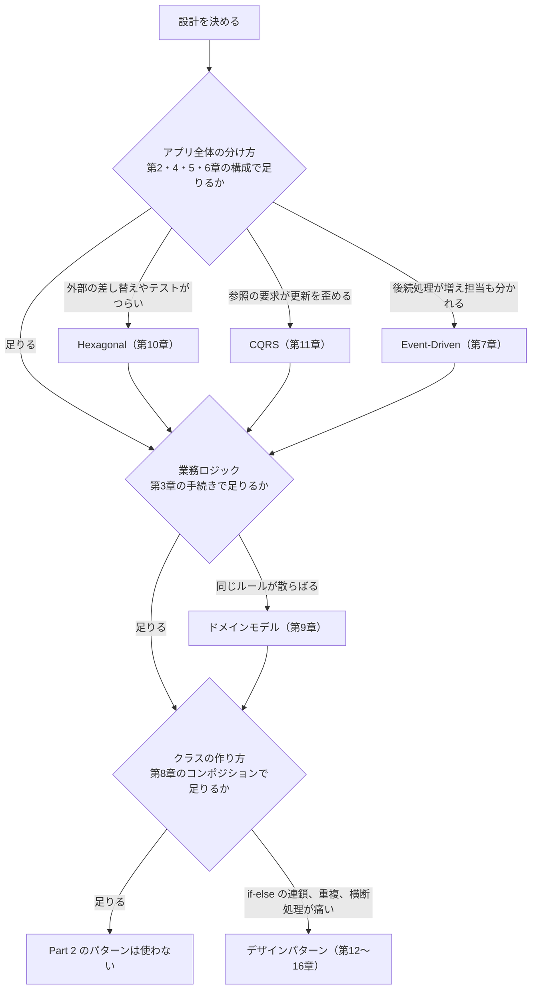

# 第18章: パターンを選ぶ基準

> この章の軸: すべての軸に共通（選び方の総まとめ）

## この章のゴール

規模、変更の頻度、チームの構成から、どの設計を使うか、あるいは使わないかを判断できるようになります。最初の問いは「Part 1 の構成で足りるか」です。足りないときだけ、Part 2 の設計を条件に照らして選びます。この章では、コードは書きません。各章の解答例を比べて、判断の根拠を言葉にします。

## Why: なぜ選び方を学ぶのか

ここまでで、多くの設計とパターンを学びました。しかし、現場で最も多い失敗は、**知ったパターンを全部使ってしまうこと** です。過剰な設計は、不足した設計と同じくらい、保守を難しくします。

第1章で「物差し」を学びました。この章は、その物差しを使って、設計を選ぶ判断を下す章です。

## 前提

第4章以降の公開済みの章を、読み終えていること。

## 選ぶ順番

設計は、大きいものから小さいものへ決めます。

1. **アプリ全体の分け方（軸①）**: まず、第2章の役割分けと、第4章のLayeredまたは第5章のECBで足りるかを考えます。画面を持つなら、第6章のMVCも検討します
1. **業務ロジックの置き方（軸②）**: 第3章のトランザクションスクリプトで足りるかを考えます。同じルールが散らばってきたら、第9章のドメインモデルを検討します
1. **クラスの作り方（軸③）**: 継承より、第8章のコンポジションを選びます。`if-else` の連鎖や重複が実際に痛みになった箇所にだけ、第12〜16章のパターンを足します

Part 1 の構成で足りるなら、Part 2 は使いません。使わないことは、手抜きではなく、判断です。

図の分岐は、排他的ではありません。複数の条件が重なれば、複数の設計を組み合わせます。

## 実装の違いを数字で比べる

同じ題材を、設計を変えて分解した結果です。「コード行数」は、空行とコメントを除いた行数です。

### 軸①（注文アプリ）

| 章 | 設計 | ファイル数 | コード行数 | 分解前 |
| :--- | :--- | ---: | ---: | :--- |
| 02 | 役割分け | 7 | 226 | 1ファイル、約97行 |
| 04 | Layered | 8 | 252 | 1ファイル、約97行 |
| 05 | ECB | 7 | 250 | 1ファイル、約97行 |
| 06 | MVC | 5 | 206 | 1ファイル、約97行 |
| 07 | Event-Driven | 7 | 228 | 1ファイル、約97行 |
| 10 | Hexagonal | 11 | 282 | 1ファイル、約97行 |
| 11 | CQRS | 6 | 212 | 1ファイル、約97行 |

### 軸②③（注文処理）

| 章 | 設計 | ファイル数 | コード行数 | 分解前 |
| :--- | :--- | ---: | ---: | :--- |
| 03 | トランザクションスクリプト | 1 | 114 | 1ファイル、約91行 |
| 08 | コンポジション | 5 | 149 | 4ファイル、約135行 |
| 09 | ドメインモデル | 5 | 199 | 1ファイル、約91行 |
| 12 | Strategy | 5 | 132 | 1ファイル、約91行 |
| 13 | Observer | 5 | 148 | 1ファイル、約91行 |
| 14 | Decorator | 3 | 144 | 1ファイル、約104行 |
| 15 | Factory | 5 | 129 | 1ファイル、約91行 |
| 16 | Template Method | 3 | 135 | 2ファイル、約175行 |

### この数字から読み取れること

- **ほとんどの設計で、コードの量は増えます。** 増えた分に見合う価値が、変更の起きやすさにあるかが、判断の分かれ目です。例外は、コピーを取り除いたTemplate Methodと、手続きの形を保ったまま整えたトランザクションスクリプトです
- 第2章の役割分けは、ファイル数が7つで済みます。Layered や ECB は、その役割に、依存の向きの約束を足したものです
- Hexagonalは、ファイル数が最も多く、コード行数も最大です。外部との接続が少なければ、この負担は見合いません
- MVCは、ファイル数が少なく、効果も限定的（出力の切り離し）です。出力の形が変わらないなら、効果も小さくなります
- 分解前の神クラスは、短くて一望できます。**読みやすさは、神クラスの長所でもありました**

## 判断の基準

### 基準1: 変更が実際に起きるか

最も大切な問いです。パターンは、変更に備える仕組みです。変更が起きない場所に使うと、複雑さだけが残ります。

| 状況 | 判断 |
| :--- | :--- |
| 過去に何度も変更された、または近々変更が決まっている | 分ける価値が高い |
| 変更が起きそうだ、という想像だけ | 待つ。起きた時に、そこだけ分ける |
| 一度も変更されていない | 分けない |

### 基準2: 変更の理由が複数あるか

第1章の「単一責任」の問いです。変更の理由が1つのクラスに複数あり、それぞれ別の人や時期に動くなら、分ける理由になります。

### 基準3: チームの構成

| 状況 | 向く傾向 |
| :--- | :--- |
| 1〜2人で保守する小さなアプリ | 神クラスに近い単純な構造。必要な箇所だけ分ける |
| 複数人が、並行して別の機能を触る | Layered、ECB、MVC。担当の境界に、分け方を合わせる |
| 複数チームが、別々のシステムとして保守する | Hexagonal、Event-Driven。チーム間の依存を、ポートやイベントに閉じ込める |

### 基準4: 外部との接点の多さと、変わりやすさ

外部サービスや保存先が多く、替わる可能性が高いなら、Hexagonalが効きます。外部がほとんどなく、替わらないなら不要です。

### 基準5: 更新と参照の非対称性

参照が更新の10倍以上あり、参照の要求が複雑なら、CQRSを考えます。そうでなければ、1つのモデルで十分です。

## 状況別の早見表

| こんな状況 | 検討するパターン |
| :--- | :--- |
| どこに何を書くか、クラスの置き場所が決まらない | 役割分け（第2章）、Layered（第4章）、ECB（第5章） |
| `if-else` の連鎖が、種類の追加のたびに伸びる | Strategy（第12章）、Factory（第15章） |
| 本業の処理の後に、反応する処理が増える | Observer（第13章）、Event-Driven（第7章） |
| ログ、計測、認可が、あちこちに重複している | Decorator（第14章） |
| ほぼ同じ内容のクラスが、コピーで増えている | コンポジション（第8章）、Template Method（第16章）、Strategy |
| 長いメソッドが読めない | トランザクションスクリプトの整理（第3章） |
| 同じ業務ルールが、複数の処理に現れ始めた | ドメインモデル（第9章） |
| 画面、業務、保存が混ざっている | Layered（第4章）、MVC（第6章） |
| 外部サービスの差し替えやテストが、つらい | Hexagonal（第10章） |
| 参照の要求が、更新のモデルを歪めている | CQRS（第11章） |
| 後続処理が増え、担当チームも分かれている | Event-Driven（第7章） |

## 演習: 判断してみよう

次の3つの場面について、**どのパターンを使うか、あるいは使わないかを、理由とともに** 言葉にしてください。答えは1つに決まりません。理由を物差し（第1章）と判断の基準で説明できれば十分です。

### 場面A: 社内向けの、月1回動くバッチ

注文データを読み込んで集計し、CSVに出力するだけのバッチです。保守するのは1人で、仕様は3年間変わっていません。

### 場面B: 3つのチームが保守する、BtoBのSaaS

注文、請求、在庫の3つの機能を、チームごとに別々に保守しています。注文が成立したら、請求と在庫が連動して動きます。外部の決済サービスを2社使っていて、今後増える見込みです。

### 場面C: 急成長中の、ECサイトの注文一覧画面

注文の登録処理はシンプルなままですが、一覧画面の要望（検索、並び替え、集計）が毎月増えています。一覧の表示が遅く、登録が遅くなる原因にもなっています。

> **🔍 確認・実験してみよう**
> 各場面で、「使わない」という選択肢も検討してください。使わないことで、何が節約でき、何を諦めることになるかを書き出します。

## 他のパターンと比べる

この章全体が比較の章ですが、最後に、よくある組み合わせを示します。

| 組み合わせ | 例 |
| :--- | :--- |
| Layered + ドメインモデル | 業務層の中に、`Money` や `Stock` のようなオブジェクトを置く |
| Hexagonal + Strategy / Factory | 中心の内側で、割引ルールをStrategyで差し替える |
| CQRS + Event-Driven | 更新後のイベントで、読み取りモデルを更新する |
| Layered + Decorator | 業務層の呼び出しに、ログや計測のデコレータを重ねる |

パターンは、排他的な選択肢ではありません。**軸が違えば、組み合わせて使えます。** 第0章で示した3つの軸を、もう一度見直してください。

> **💼 現場Tip**
> 設計の相談では、「パターン名」を先に出すより、「何が変わりやすいと考えているか」を先に伝えてください。パターン名は、その考えを短く伝える共通語彙です。

## もっと良くしてみよう

### 理解確認

1. 「変更が起きない場所に、パターンを使ってはいけない」のはなぜですか
1. 3つの軸（クラスの作り方、ロジックの置き方、アプリ全体の分け方）を、それぞれ一言で説明してみましょう
1. 神クラスの長所を、1つ挙げてみましょう

### 発展改善クイズ

1. 自分が今関わっているコード（または、学習で書いたコード）から、パターンを使うと良さそうな箇所を1つ探してください。その箇所の「変わりやすい部分」と「変わりにくい部分」を書き出してみましょう
1. 逆に、すでにパターンが使われているが、効果が出ていない（過剰な）箇所はありませんか。「使わない」ほうが良い理由を、言葉にしてみましょう

---

| [← 第17章: クラスの種類](./17-class-kinds.md) | [全章目次](./README.md) | |
| - | :-: | --: |
