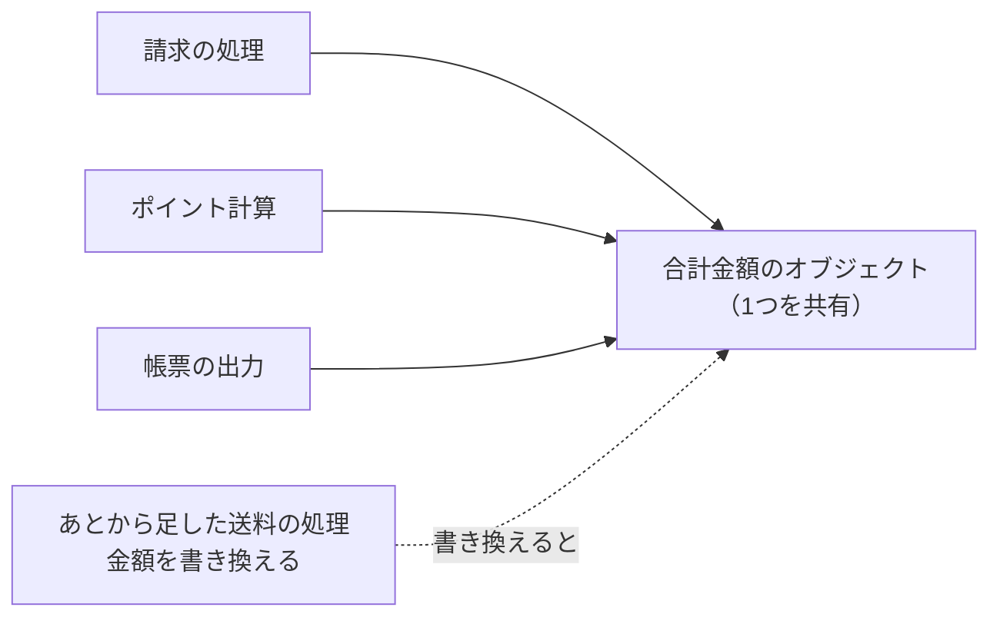
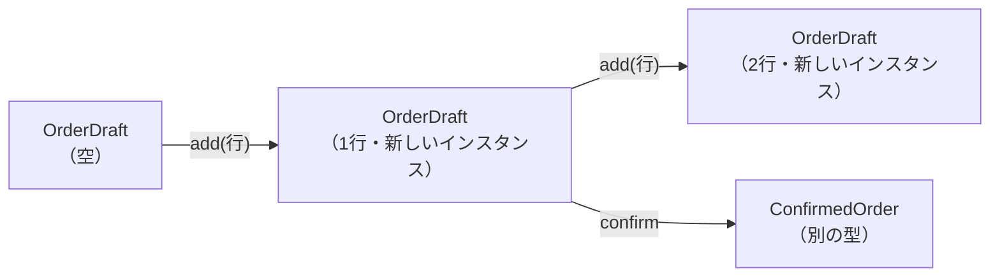

# 第19章: 変わらないオブジェクトで設計する（イミュータブル）

> この章の軸: すべての軸に共通（どのクラスの種類にも使う設計判断）

## この章のゴール

一度作ったら中身が変わらないオブジェクト（イミュータブルなオブジェクト）を、Java で確実に作れるようになります。9つの技法を、「漏れている実装」と比べながら身に付けます。あわせて、「変えられない」ことが、なぜ将来の自分やチームを助けるのかを理解します。

## まず言葉から: イミュータブルとは

イミュータブル（immutable）は、英語で **「変えられない」** という意味です。反対の「変えられる」は、ミュータブル（mutable）と言います。プログラミングでは、**一度作ったら、中身が二度と変わらないオブジェクト** のことを指します。

聞き慣れない言葉ですが、実はもう使っています。Java の `String` は、イミュータブルです。

```java
String name = "taro";
String upper = name.toUpperCase();
// upper は "TARO"。name は "taro" のまま変わらない
```

`toUpperCase` は、`name` を書き換えません。大文字にした **新しい文字列** を作って返します。`LocalDate` の `plusDays` も同じです。

「変えられない」は、「何もできない」という意味ではありません。**変えたいときは、新しい値を作る** のが、イミュータブルの考え方です。お店の領収書を思い浮かべてください。金額を間違えたら、領収書を書き換えずに、新しく発行し直します。元の領収書は、元のまま残ります。

## 「不便だ」と感じるのは自然なこと

他の人が書いたクラスを直そうとして、次のような場面によく出会います。

- 数量を変えたいのに、`setQuantity` のようなメソッドがない
- フィールドに代入しようとしたら、`final` のせいでコンパイルエラーになる
- 受け取った `List` に要素を足そうとしたら、`UnsupportedOperationException` が起きた

初めて出会うと、「なぜこんな不便な作りにしたのか」と感じます。その感覚は自然です。しかし、この不便さは偶然ではありません。**最初に書いた人が、意図して置いた柵** です。

## 変えられないことは、書いた人からのメッセージ

コードは、書いた人が隣にいなくても、読む人に意図を伝えます。イミュータブルな作りは、次のメッセージを伝えています。

| コードの形 | 読み取れる意図 |
| :--- | :--- |
| セッターがなく、フィールドが `final` | 「この値は、作ったら変わらない前提で、他のコードが書かれている」 |
| `of` で作り、そこで検証している | 「この値は、いつ受け取っても正しい。安心して使ってよい」 |
| `withQuantity` のようなメソッドがある | 「変えたいなら、新しい値を作って差し替えてほしい」 |
| 返した `List` が変更できない | 「中身を変えられると困る。変えたいなら、自分のコピーで」 |

なぜ「変わらない前提」が大切なのでしょうか。注文の合計金額を、請求、ポイント計算、帳票の3か所で使っている場面を考えます。



金額を書き換えられる作りだと、あとから送料の処理を足した人が、金額を書き換えることがあります。すると、同じオブジェクトを見ている請求、ポイント、帳票の結果まで変わります。足した人は、送料の処理しか見ていないので、その影響に気づけません。

イミュータブルな作りなら、書き換えようとした時点でコンパイルエラーになります。エラーは、**「この値は、他の場所でも使われている可能性がある。書き換えは危ない」** という警告の代わりです。改造のリスクを、コンパイラが代わりに伝えてくれます。

最初に作るときは、少し手間が増えます。しかし、その手間が効くのは、何年もたってから改造するときです。書いた人がチームを離れたあとでも、コードの形が意図を伝え続けます。イミュータブルは、**未来の改造者を守るための、書いた人からの手紙** と考えてください。

## 不便を感じたときの対処

イミュータブルなクラスを変えたくなったら、次の順に考えます。

1. **新しい値を作って差し替える**。`with` や `plus` のメソッドがあれば、それを使います。これで済むことがほとんどです
1. **セッターを足す前に、使われている場所を調べる**。そのクラスを使っている箇所を検索し、「変わらない前提」で書かれたコードがないか確かめます。分からなければ、書いた人やレビュアーに相談します
1. **本当に変わるものか、考え直す**。在庫の数のように、変化そのものが仕事なら、エンティティとして設計し直します（第17章、第18章）

> **⚠️ よくある失敗・誤解**
> 「不便だから」とセッターを1つ足すと、そのクラスはイミュータブルではなくなります。これまで「変わらない」と信じて書かれてきたコードが、すべて前提を失います。足すのは簡単ですが、影響は見えないところに広がります。

## Why: なぜイミュータブルにするのか

イミュータブルにするかどうかは、Java の書き方の問題である前に、**設計の判断** です。[第1章](./01-yardstick.md)の結合度の言葉で言うと、書き換えられるオブジェクトを複数の場所で共有することは、**見えない結合** を作ります。共有している場所どうしは、コードの上ではつながっていません。それでも、片方の書き換えが、もう片方の結果を変えます。イミュータブルにすると、この見えない結合を、設計の段階で断てます。

第17章では、Value Object、DTO、イベント、Config を「変えない」種類として紹介しました。しかし、`private final` を付けるだけでは、変わらないオブジェクトにはなりません。中身が外に漏れて、知らないうちに変わることがあります。

イミュータブルにすると、次のことが嬉しくなります。

- **知らないうちに変わらない**: 渡した先で書き換えられる心配がありません。どこで値が変わったかを、追いかけなくて済みます
- **検証が1回で済む**: 作る時点の値が正しければ、ずっと正しいままです
- **Set や Map のキーにしても安全**: 値が変わらないので、ハッシュ値も変わりません
- **共有してよい**: 複数のスレッドや複数の処理から、同じインスタンスを使っても壊れません

## 前提

[第17章](./17-class-kinds.md)を読み終えていること。この章では、コードを書く課題はありません。実装例を読み、テストで違いを確かめます。

実装例は、[ch19_immutability パッケージ](../src/main/java/com/example/orders/ch19_immutability/)にあります。`before` パッケージには、イミュータブルに見えて中身が漏れている実装を置いています。

## 悪い実装を読む

次の3つのファイルを開いてください。どれも、フィールドに `final` が付いています。それでも、中身を外から変えられます。

| ファイル | 漏れ方 |
| :--- | :--- |
| [LeakyCart.java](../src/main/java/com/example/orders/ch19_immutability/before/LeakyCart.java) | 受け取った `List` をそのまま持ち、そのまま返す。呼び出し側の変更が、カートに漏れる |
| [LeakyMonthlyTargets.java](../src/main/java/com/example/orders/ch19_immutability/before/LeakyMonthlyTargets.java) | 受け取った配列をそのまま持つ。`final` は「どの配列を指すか」しか守らない |
| [MutableSku.java](../src/main/java/com/example/orders/ch19_immutability/before/MutableSku.java) | セッターがある。`Set` に入れたあとで値を変えると、`Set` から見つからなくなる |

`MutableSku` の問題は、テストで再現できます。

```java
MutableSku mutable = new MutableSku("A001");
Set<MutableSku> set = new HashSet<>();
set.add(mutable);
mutable.changeCode("B002");
set.contains(mutable); // false: 同じオブジェクトなのに見つからない
```

`Set` は、入れた時点のハッシュ値で置き場所を決めます。あとから値が変わると、探す場所がずれて、見つからなくなります。

## どのクラスをイミュータブルにするか

すべてのクラスを、イミュータブルにする必要はありません。第17章と第18章の種類ごとに、目安を示します。

| 種類 | イミュータブルにするか | 理由 |
| :--- | :--- | :--- |
| Value Object | **必ず** | 値そのものなので、変わったら別の値 |
| イベント | **必ず** | 起きた事実は、あとから変わらない |
| Config | **必ず** | 起動時に決まり、実行中は変えない |
| DTO | 基本はする | 運ぶ途中で変わると、どこで変わったか分からなくなる |
| Enum | 自然にそうなる | 定数なので、フィールドも変えない |
| エンティティ、集約 | 状態は変わってよい | 状態の変化そのものが仕事。ただし、持たせる部品（金額、数量）はイミュータブルにする |
| ビルダー | 組み立て中は変わる | 組み立てが終わったら、イミュータブルなオブジェクトを返す |

エンティティは「状態が変わるもの」です。そのエンティティでも、**中に持つ値をイミュータブルにして、丸ごと差し替える** と、変化の入口がはっきりします。

## 9つの技法の早見表

ここまでは、何をイミュータブルにするかという設計の判断でした。ここからは、その判断を **Java で確実に守らせる手段** です。言語が変われば書き方は変わりますが、守りたい約束は同じです。

| 番号 | 技法 | 防ぐこと | 実装例 |
| :--- | :--- | :--- | :--- |
| 1 | クラスを `final`、フィールドを `private final`、セッターなし | 書き換え、子クラスによる可変化 | すべて |
| 2 | 作る時点で検証する | 不正な値のまま使われること | `Money.of`、`Quantity.of` |
| 3 | 変更の代わりに、新しいインスタンスを返す | 元の値が変わること | `Money.plus` |
| 4 | with メソッド | セッターが欲しくなること | `CartLine.withQuantity` |
| 5 | コレクションの防御的コピー | 受け取った `List` や、返した `List` からの漏れ | `Cart` |
| 6 | 配列の防御的コピー | 配列の中身の書き換え | `MonthlyTargets` |
| 7 | 中身もイミュータブルな型を選ぶ | 部品からの漏れ | `ConfirmedOrder` の `LocalDate` |
| 8 | 状態の移り変わりを、別の型で表す | 「確定後に行を足す」などの誤った操作 | `OrderDraft` → `ConfirmedOrder` |
| 9 | 共有の定数にする | 同じ値の作り直し | `Money.ZERO` |

## 技法ごとの実装例

### 1. クラスを final、フィールドを private final、セッターを作らない

最も基本の技法です。3つとも揃えて、初めて意味があります。

```java
public final class Money {
    private final int yen;
    // セッターは作らない
}
```

| 付けるもの | 理由 |
| :--- | :--- |
| クラスの `final` | 子クラスを作らせない。子クラスが可変なフィールドを足すと、親の約束が破られる |
| フィールドの `private` | 外から直接触らせない |
| フィールドの `final` | クラスの中でも、代入し直させない |

> **⚠️ よくある失敗・誤解**
> `final` は「変数が、別のオブジェクトを指さない」という意味です。指している先の中身までは守りません。`final List<CartLine>` でも、`List` に要素を足せます。中身を守るのは、技法5と技法6です。

### 2. 作る時点で検証する

コンストラクタを `private` にして、作り方を `of` のような静的メソッドに集めます。そこで検証します。

```java
public static Money of(int yen) {
    if (yen < 0) {
        throw new IllegalArgumentException("金額は0円以上にしてください: " + yen);
    }
    return yen == 0 ? ZERO : new Money(yen);
}
```

イミュータブルなオブジェクトは、作ったあとに変わりません。そのため、**作る時点で正しければ、ずっと正しい** ことが保証できます。使う側で、毎回検証する必要がなくなります。

### 3. 変更の代わりに、新しいインスタンスを返す

計算や変更のメソッドは、自分のフィールドを書き換えず、結果を新しいインスタンスで返します。

```java
public Money plus(Money other) {
    return Money.of(yen + other.yen);
}
```

`String` の `toUpperCase` や `LocalDate` の `plusDays` も、同じ形です。新しいインスタンスも `of` を通して作るので、計算の結果が不正なら、そこで止まります。たとえば `Quantity.of(98).plus(2)` は、上限の99を超えるので拒否されます。

> **⚠️ よくある失敗・誤解**
> 戻り値を受け取り忘れると、何も変わりません。`total.plus(price);` と書いても、`total` は変わりません。`total = total.plus(price);` のように、変数に入れ直します。変数の中身を差し替えるだけで、オブジェクトは変わっていません。

### 4. with メソッド（一部だけ変えた新しいインスタンス）

項目の多いクラスで、1つだけ変えたいときに使います。セッターの代わりです。

```java
public CartLine withQuantity(Quantity newQuantity) {
    return new CartLine(sku, unitPrice, newQuantity);
}
```

`withQuantity` は、数量だけが違う新しい行を返します。元の行は、そのまま残ります。名前を `with` で始めると、「新しいインスタンスを返す」ことが読み手に伝わります。`set` で始めると、書き換えると誤解されます。

### 5. コレクションの防御的コピー

`List` を受け取るときと、返すときの、両方で守ります。

```java
public Cart(List<CartLine> lines) {
    this.lines = List.copyOf(lines);
}

public List<CartLine> lines() {
    return lines;
}
```


`List.copyOf` は、**変更できないコピー** を作ります。受け取るときにコピーすれば、呼び出し側の `List` と切り離せます。中身が変更できない `List` なので、返すときはそのまま返して構いません。

`Collections.unmodifiableList` との違いに注意します。

| 書き方 | 作るもの | 元の `List` の変更 |
| :--- | :--- | :--- |
| `List.copyOf(source)` | 変更できない **コピー** | 見えない |
| `Collections.unmodifiableList(source)` | 変更できない **読み取り専用の窓** | 見えてしまう |

読み取り専用の窓は、窓からの変更は防ぎます。しかし、元の `List` を持つ人が変更すると、窓から見える中身も変わります。受け取るときの防御には、コピーを使います。

### 6. 配列の防御的コピー

配列には、`List.copyOf` のような「変更できない版」がありません。受け取るときと返すときの両方で、`clone` でコピーします。

```java
public MonthlyTargets(int[] targets) {
    this.targets = targets.clone();
}

public int[] toArray() {
    return targets.clone();
}
```

返すときは、毎回コピーするか、配列ではなく `List` で返します。配列を外に出さないメソッド（`target(month)`）だけを用意するのが、最も安全です。

### 7. 中身もイミュータブルな型を選ぶ

フィールドの型が可変だと、技法1〜3を守っても、部品から漏れます。最初からイミュータブルな型を選べば、コピーは要りません。

| イミュータブル（コピー不要） | 可変（コピーが必要） |
| :--- | :--- |
| `String`、`Integer` などのラッパー | `StringBuilder` |
| `LocalDate`、`LocalDateTime`、`Instant` | `java.util.Date`、`Calendar` |
| `BigDecimal` | 配列 |
| `List.of`、`List.copyOf` で作った `List` | `ArrayList`、`HashSet` など |
| Enum、この章で作ったイミュータブルなクラス | セッターを持つクラス |

`ConfirmedOrder` は、確定日を `LocalDate` で持ちます。`LocalDate` はイミュータブルなので、受け取った値をそのまま持って構いません。古い `java.util.Date` を使う場合は、受け取るときと返すときにコピーが要ります。

### 8. 状態の移り変わりを、別の型で表す

「下書き」と「確定済み」のように、状態で操作が変わるときは、状態ごとに型を分けます。



```java
public OrderDraft add(CartLine line) {
    List<CartLine> next = new ArrayList<>(lines);
    next.add(line);
    return new OrderDraft(customerId, next);
}

public ConfirmedOrder confirm(String orderId, LocalDate confirmedOn) {
    return new ConfirmedOrder(orderId, customerId, lines, confirmedOn);
}
```

`ConfirmedOrder` には、行を足すメソッドがありません。そのため、「確定済みの注文に行を足す」という誤りは、**コンパイルの時点で書けなくなります**。状態を Enum で持って `if` で拒否する方法（第18章の `PlacedOrder.cancel`）と比べると、誤りを見つける時点が早くなります。

- **第18章の集約との違い**: 第18章の `PlacedOrder` は、状態が変わるエンティティです。この章の `OrderDraft` は、変わる代わりに新しいインスタンスを返します。どちらも正解で、使い分けます
- **向く場面**: 状態の数が少なく、状態ごとにできる操作がはっきり違うとき。状態が多いと、型が増えすぎます

### 9. 共有の定数にする

イミュータブルなオブジェクトは、誰が使っても壊れません。そのため、よく使う値は、1つを共有して構いません。

```java
public static final Money ZERO = new Money(0);
```

`Money.of(0)` は、毎回新しく作らず、`ZERO` を返します。JDK の `BigDecimal.ZERO` や `List.of()` も、同じ考え方です。可変なオブジェクトを定数にすると、誰かの変更が全員に影響します。**共有してよいのは、イミュータブルなものだけ** です。

## record について

Java 16 以降には、`record` という書き方があります。`record` は、`private final` のフィールド、コンストラクタ、アクセサ、`equals`、`hashCode` を自動で作ります。技法1の多くを、1行で済ませられます。

ただし、技法5と技法6は、`record` を使っても自動では行われません。`List` や配列を持たせるなら、コンストラクタの中でコピーを書きます。この教材では、仕組みを見せるために `record` を使わず、手で書いています。

## イミュータブルにしないほうがよい場面

| 場面 | 理由 |
| :--- | :--- |
| 状態の変化そのものが仕事のエンティティ | 毎回新しく作ると、「同じもの」の追跡が難しくなる。部品だけをイミュータブルにする |
| 大量の要素を、頻繁に1つずつ変える | 変更のたびにコピーすると、時間とメモリがかかる |
| フレームワークが、引数なしのコンストラクタとセッターを求める | フレームワークの規約に従う。境界の DTO だけを可変にし、中ではイミュータブルな型に詰め替える |
| ビルダーの組み立て中 | 組み立て中は変えてよい。`build` でイミュータブルなものを返す |

> **💼 現場Tip**
> 迷ったら、まずイミュータブルで書きます。困ったときに可変にするほうが、逆より簡単です。コードレビューでは、`set` で始まるメソッドと、`List` や配列をそのまま返すアクセサを見つけたら、技法4と技法5を提案します。

## 混同しやすい組み合わせ

| 組み合わせ | 違い |
| :--- | :--- |
| `final` と イミュータブル | `final` は変数の指す先を固定するだけ。イミュータブルは、中身も含めて変わらないこと |
| コピー と 読み取り専用の窓 | コピーは元と切り離される。窓は元の変更が見える |
| イミュータブル と 定数 | 定数は名前の付いた1つの値。イミュータブルは、インスタンスがいくつあっても、それぞれが変わらないこと |
| with メソッド と セッター | with は新しいインスタンスを返す。セッターは自分を書き換える |

## 動作確認

この章のテストは、最初から全て green です。[ImmutabilityTest](../src/test/java/com/example/orders/ch19_immutability/ImmutabilityTest.java)を読んでください。漏れている実装と技法を使った実装に、同じ操作をして比べています。次の点が確かめられます。

- 可変なオブジェクトを `Set` に入れて変更すると、見つからなくなる
- 受け取った `List` をそのまま持つと、呼び出し側の変更が漏れる。返した `List` からも変更される
- `Collections.unmodifiableList` は元の変更が見えるが、`List.copyOf` は見えない
- `final` な配列でも、コピーしないと中身を変えられる
- 計算や with メソッドは新しいインスタンスを返し、元の値は変わらない
- 下書きに行を足しても元の下書きは変わらず、確定すると別の型になる
- 技法を使ったクラスは、すべて `final` で、フィールドもすべて `private final`

```bash
mvn test -Dtest=ImmutabilityTest
```

## もっと良くしてみよう

### 理解確認

1. `private final List<CartLine> lines;` と書いても、イミュータブルにならないのはなぜですか
1. `List.copyOf` と `Collections.unmodifiableList` の違いを、「元の List が変更されたとき」で説明してみましょう
1. 可変なオブジェクトを `Set` に入れると困るのは、なぜですか
1. クラスに `final` を付ける理由を、子クラスという言葉を使って説明してみましょう
1. イミュータブルなクラスに、セッターを足したくなりました。足す前に、何を確かめますか

### 発展改善クイズ

1. 第17章の `OrderSummaryDto` や `ShopConfig` を読み、この章の9つの技法のどれを使っているか、足りない技法はないか確かめてみましょう
1. 第18章の `PlacedOrder` を、この章の `OrderDraft` と同じく、変更のたびに新しいインスタンスを返す形にしたとします。何が嬉しく、何が困るでしょうか
1. 自分のプロジェクトで、`List` や配列をそのまま返しているアクセサを3つ探し、漏れが起きないか確かめてみましょう

---

| [← 第18章: 業務ロジックを担うクラスの種類](./18-business-classes.md) | [全章目次](./README.md) | [第20章: 見せる範囲を決める →](./20-visibility.md) |
| - | :-: | --: |
