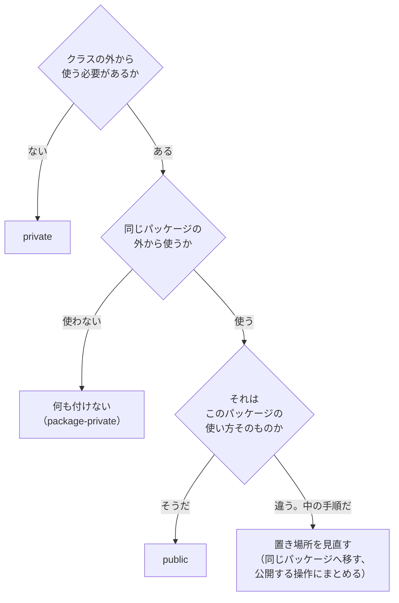
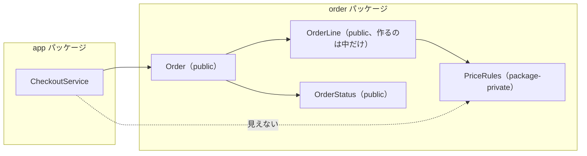

# 第20章: 見せる範囲を決める（可視性とパッケージ境界）

> この章の軸: すべての軸に共通（どのクラスの種類にも使う設計判断）

## この章のゴール

`public`、`private` などの見せる範囲を、「誰に、何を約束するか」という設計の判断として選べるようになります。あわせて、パッケージを1つの部品として扱い、外に見せるクラスを絞れるようになります。

## Why: なぜ見せる範囲を決めるのか

Java を学び始めたころは、とりあえず `public` を付けることが多いはずです。動かすだけなら、それで困りません。しかし、`public` には、**「このクラスやメソッドは、誰が使ってもよい」という約束** の意味があります。

約束したものは、変えにくくなります。たとえば、ある `public` メソッドの引数を変えるとします。そのメソッドを呼んでいるすべての場所を、直す必要があります。呼んでいる場所が別のチームのコードなら、相談も必要です。反対に、`private` のメソッドなら、そのクラスの中だけを見れば、安心して変えられます。

[第1章](./01-yardstick.md)の言葉で言うと、**結合は、見えるところにしか生まれません。** 見せる範囲を狭くするほど、結合できる相手が減ります。その結果、あとから変えてよい範囲が広がります。

[第19章](./19-immutability.md)では、「変えられない」作りが、書いた人の意図を伝えることを学びました。「見えない」作りも同じです。`private` は、「ここは中の事情なので、外から頼らないでほしい」というメッセージです。

## 前提

[第18章](./18-business-classes.md)と[第19章](./19-immutability.md)を読み終えていること。この章では、コードを書く課題はありません。実装例を読み、テストで違いを確かめます。

実装例は、[ch20_visibility パッケージ](../src/main/java/com/example/orders/ch20_visibility/)にあります。

| パッケージ | 中身 |
| :--- | :--- |
| `before` | すべてを `public` にした注文。外から決まりを破れる |
| `order` | 見せる範囲を絞った注文。外に見せるのは3つのクラスだけ |
| `app` | `order` の外から、注文を使うサービス |

## 悪い実装を読む

[OpenOrder.java](../src/main/java/com/example/orders/ch20_visibility/before/OpenOrder.java)と[OpenOrderLine.java](../src/main/java/com/example/orders/ch20_visibility/before/OpenOrderLine.java)を開いてください。クラスとメソッドは、すべて `public` です。その結果、次のことが外からできてしまいます。

| 外からできること | 起きる問題 |
| :--- | :--- |
| `setStatus("PLACED")` を呼ぶ | 行が1つもないのに、確定済みの注文になる |
| `lines()` で受け取った行の `setQuantity` を呼ぶ | `addItem` にある数量の上限の確認を、迂回できる |
| `recalculate()` を呼び忘れる | 合計が、古い値のままになる |
| コンストラクタに好きな状態を渡す | 確定済みで、行の入った注文を、確認なしに作れる |

テストで再現すると、次のようになります。

```java
OpenOrder order = OpenOrder.draft("C001");
order.addItem("P001", 1000, 1);
order.lines().get(0).setQuantity(1000); // 上限の99個を迂回できる
order.total();                          // 0: recalculate を呼び忘れた
```

`addItem` を書いた人は、上限を守るつもりでした。しかし、ほかの入り口が開いているので、その確認は守りになっていません。また、`recalculate` は中で使う手順なのに、`public` になっています。そのため、「`addItem` のあとに `recalculate` を呼ぶ」という決まりを、使う側が覚えておく必要があります。

## 考え方

### 4つの見せる範囲

Java には、4つの見せる範囲があります。「誰に見えるか」は、そのまま「誰と約束するか」です。

| 書き方 | 見える相手 | 約束の重さ |
| :--- | :--- | :--- |
| `private` | そのクラスの中だけ | 約束なし。いつでも変えてよい |
| 何も付けない（package-private） | 同じパッケージのクラス | パッケージの中の約束。パッケージの中を見れば、使う場所が全部分かる |
| `protected` | 同じパッケージと、子クラス | 継承する人との約束。子クラスがどこにあるかは分からない |
| `public` | どこからでも | 誰とでも約束する。使う場所を全部は把握できない |

何も付けない書き方は、「パッケージプライベート（package-private）」と呼びます。付け忘れと見分けにくいので、意図して付けていないときは、クラスの説明に書いておくと親切です。

### 狭い方から始める

迷ったら、**まず `private` にして、必要になったら広げます。** 広げるのは簡単です。使う人がまだいないからです。しかし、狭めるのは難しくなります。すでに使っている人のコードが、コンパイルできなくなるからです。



最後の問いが大切です。外から使いたくなった理由が「中の手順を直接呼びたい」なら、`public` を付ける前に設計を見直します。

### 操作を見せて、手順を隠す

[Order.java](../src/main/java/com/example/orders/ch20_visibility/order/Order.java)は、外に見せるメソッドを、次の7つに絞っています。

| 見せるもの | 理由 |
| :--- | :--- |
| `create` | 作り方を1つに絞る。外から、確定済みの注文を直接作れない |
| `addItem`、`place` | 業務の操作。中で確認してから状態を変える |
| `total`、`customerId`、`status`、`lines` | 読むための操作。`lines` は変更できないコピーを返す |

同じ商品を探す `indexOf` は `private` です。合計は、読むたびに計算します。そのため、「計算し直す」という手順そのものがなくなりました。**使う側が覚えておくべき決まりを、クラスの中に閉じ込める** のが、見せる範囲を絞る一番の効果です。

`setStatus` は、ありません。状態を変えられるのは、空でないことを確かめる `place` の中だけです。

### コンストラクタを隠して、作り方を絞る

[OrderLine.java](../src/main/java/com/example/orders/ch20_visibility/order/OrderLine.java)は、クラスは `public` ですが、コンストラクタは package-private です。

```java
public final class OrderLine {
    OrderLine(String productId, int unitPrice, int quantity) {
        PriceRules.checkQuantity(quantity);
        // ...
    }
}
```

外のパッケージから、行を読むことはできます。しかし、作ることはできません。行を作れるのは、同じパッケージの `Order` だけです。そのため、上限の確認を通っていない行が、外で作られることはありません。第18章の集約で、`PlacedLine` のコンストラクタを package-private にしていたのは、この理由です。

### パッケージを1つの部品として扱う

この章の `order` パッケージは、外に3つのクラスだけを見せています。



金額と上限の決まりを持つ [PriceRules.java](../src/main/java/com/example/orders/ch20_visibility/order/PriceRules.java)には、`public` を付けていません。外のパッケージからは、クラスの名前すら見えません。計算の仕方を変えても、`order` パッケージの中を直すだけで済みます。

パッケージで何を公開するかは、[package-info.java](../src/main/java/com/example/orders/ch20_visibility/order/package-info.java)に書いておけます。このファイルは、パッケージそのものの説明を書く場所です。

> **⚠️ よくある失敗・誤解**
> Java のパッケージには、親子の関係がありません。`order` と `order.internal` は、名前が似ているだけの、別のパッケージです。`order.internal` から、`order` の package-private なクラスは見えません。一緒に隠したいクラスは、同じパッケージに置きます。

パッケージが大きくなり、パッケージの単位では隠しきれなくなったら、Java のモジュール（`module-info.java` の `exports`）という手段もあります。モジュールでは、外に見せるパッケージを選べます。この教材では扱いませんが、名前だけ覚えておいてください。

### protected は、思ったより広い

`protected` は、「子クラスにだけ見せる」と思われがちです。実際は、**同じパッケージのクラスにも見えます。** さらに、子クラスは、どのパッケージにでも作れます。つまり、`protected` にしたメソッドは、使う場所を把握しきれません。

`protected` を使うのは、継承されることを前提に設計したときだけです。[第16章](./16-template-method.md)の Template Method が、その例です。継承を前提にしないクラスは、`final` にして、`protected` を使わずに済ませます。

### テストのために、広げない

テストを書くとき、`private` のメソッドを直接呼びたくなることがあります。しかし、そのためだけに `public` を付けるのは、避けてください。本番のコードからも、テストのための入り口を使えてしまいます。

代わりに、次の順に考えます。

1. **公開された操作を通して確かめる**。`indexOf` は、`addItem` で同じ商品をまとめた結果を見れば確かめられます
1. **テストを同じパッケージに置く**。テストのクラスを同じパッケージ名にすれば、package-private のものは見えます
1. **別のクラスに切り出す**。`private` のまま直接確かめたいほど複雑なら、それは別の責務の合図です。切り出して、そのクラスを確かめます

この章のテストは、あえて `order` とは別のパッケージに置いています。外から見える範囲だけで、正しく使えることを確かめるためです。

## コードアーキテクチャとの関係

見せる範囲は、コードアーキテクチャで決めた区画を、Java で守らせる手段にもなります。

| コードアーキテクチャ | 見せる範囲の使い方 |
| :--- | :--- |
| Layered（第5章） | 層ごとにパッケージを分け、上の層に見せるのは、サービスの入り口だけにする |
| Hexagonal（第10章） | ポート（インターフェース）は `public`。アダプターの実装は、組み立ての場所からだけ使う |
| ドメインモデル（第9章）、集約（第18章） | 集約の中の部品は、コンストラクタを package-private にし、ルートからだけ作る |

## 絞りすぎにも注意する

見せる範囲は、狭いほど良いわけではありません。

| やりすぎ | 困ること |
| :--- | :--- |
| 何もかも package-private にするため、1つのパッケージに全部を詰め込む | パッケージそのものが、神クラスのように大きくなる |
| 読むためのアクセサまで隠す | 使う側が必要な情報を得られず、同じ計算を自分で書き始める |
| 社内アプリで、外部向けのライブラリと同じ厳しさを求める | 手間に見合わない。変更の影響を自分たちで追える範囲なら、そこまで厳しくしなくてよい |

> **💼 現場Tip**
> コードレビューでは、新しく `public` になったものを1つずつ見て、「これは外の誰が使いますか」と聞きます。答えがなければ、範囲を狭めます。とくに、`public` なセッターと、`public` な中の手順（`recalculate` のようなもの）は、約束の破り口になりやすい箇所です。

## 混同しやすい組み合わせ

| 組み合わせ | 違い |
| :--- | :--- |
| `private` と `final` | `private` は見える範囲を決める。`final` は変えられるかを決める。別々の判断 |
| package-private と `protected` | `protected` は同じパッケージに加えて、どこにある子クラスにも見える。package-private のほうが狭い |
| 見えない と 安全 | 見せる範囲は、意図を伝えて誤りを防ぐもの。リフレクションを使えば中は見えるので、秘密を守る仕組みではない |
| クラスの見せる範囲 と コンストラクタの見せる範囲 | クラスが `public` でも、コンストラクタを隠せば「読めるが作れない」にできる |

## 動作確認

この章のテストは、最初から全て green です。[VisibilityTest](../src/test/java/com/example/orders/ch20_visibility/VisibilityTest.java)を読んでください。テストは `order` パッケージの外に置いているので、外から見える操作だけを使っています。次の点が確かめられます。

- すべて `public` の注文は、空のまま確定済みにでき、上限も迂回でき、合計の計算し直しを忘れられる
- 見せる範囲を絞った注文は、公開された操作だけで、同じ商品をまとめて合計を出せる
- 上限超え、空の確定、確定後の追加、返した一覧の変更は、どれも拒否される
- `Order` の `public` なメソッドは決めた7つだけで、コンストラクタは `public` でない
- `OrderLine` は外で作れず、`PriceRules` は `public` でない
- 別のパッケージの `CheckoutService` からも、公開された操作だけで注文を確定できる

```bash
mvn test -Dtest=VisibilityTest
```

## もっと良くしてみよう

### 理解確認

1. `public` を付けることが「約束」だと言えるのはなぜですか。変更のしやすさという言葉を使って説明してみましょう
1. 見せる範囲を「広げる」のは簡単なのに、「狭める」のが難しいのはなぜですか
1. `OrderLine` のクラスは `public` なのに、コンストラクタを package-private にしたのはなぜですか
1. `order.internal` というパッケージから、`order` の package-private なクラスが見えないのはなぜですか
1. `private` のメソッドを直接テストしたくなりました。`public` を付ける前に考えることを、3つ挙げてみましょう

### 発展改善クイズ

1. `Order` に「行を削除する」操作を足すとします。どのメソッドを `public` にし、どこで何を確かめるか考えてみましょう
1. 第10章の Hexagonal のアダプターを読み、`public` でなくてもよいクラスやメソッドがないか探してみましょう
1. 自分のプロジェクトで、`public` なセッターを3つ探し、外の誰が呼んでいるかを調べてみましょう。誰も呼んでいなければ、どうしますか

---

| [← 第19章: 変わらないオブジェクトで設計する](./19-immutability.md) | [全章目次](./README.md) | [第21章: 失敗を設計する →](./21-failures.md) |
| - | :-: | --: |
