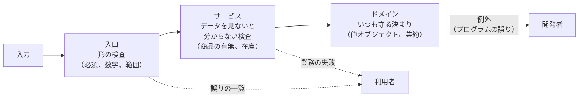

# 第21章: 失敗を設計する（検証・例外・エラーの伝え方）

> この章の軸: すべての軸に共通（どのクラスの種類にも使う設計判断）

## この章のゴール

失敗を種類ごとに分け、「どこで見つけるか」「どう伝えるか」「どこで捕まえるか」を決められるようになります。入力の検証をどの層で行うかも、この章で判断できるようになります。

## Why: なぜ失敗を設計するのか

うまくいく流れだけなら、書くのは難しくありません。注文を受けて、在庫を確かめて、決済して、在庫を減らすだけです。しかし、現場で起きる不具合や問い合わせの多くは、**うまくいかなかったとき** の流れから生まれます。

- 利用者が「注文できません」と問い合わせてきた。原因が在庫なのか、カードなのか、ログから分からない
- 決済会社につながらなかったのに、在庫だけが減っていた
- 本当はプログラムの誤りなのに、「入力が誤っています」と表示され、誰も気づかなかった

どれも、失敗の伝え方を決めていなかったことが原因です。失敗の流れは、うまくいく流れと同じくらい、設計で決めるものです。

## 前提

[第17章](./17-class-kinds.md)の Result とバリデータ、[第18章](./18-business-classes.md)のサービスとゲートウェイを読み終えていること。この章では、コードを書く課題はありません。実装例を読み、テストで違いを確かめます。

実装例は、[ch21_failures パッケージ](../src/main/java/com/example/orders/ch21_failures/)にあります。`before` パッケージには、失敗をすべて同じ値で返す実装を置いています。

## 悪い実装を読む

[SilentOrderService.java](../src/main/java/com/example/orders/ch21_failures/before/SilentOrderService.java)を開いてください。注文に成功すると合計を、失敗すると `-1` を返します。

```java
try {
    String customer = customerId.trim();
    int quantity = Integer.parseInt(quantityText);
    // ...
    return total;
} catch (Exception e) {
    return -1;
}
```

次の5つは、どれも `-1` になります。

| 起きたこと | 本当の原因 | 直せる人 |
| :--- | :--- | :--- |
| 数量に `abc` と入力した | 入力の誤り | 利用者 |
| 在庫より多く注文した | 業務の決まり | 利用者（数量を減らす） |
| カードが断られた | 業務の決まり | 利用者（別のカードにする） |
| 決済会社につながらない | 外の一時的な失敗 | 時間をおく、運用担当者 |
| 顧客IDに `null` が渡された | プログラムの誤り | 開発者 |

直せる人が違うのに、伝え方が1つしかありません。そのため、画面には「注文できませんでした」としか出せません。さらに、`catch (Exception e)` で理由を捨てているので、あとから調べることもできません。プログラムの誤りまで隠れるので、不具合に気づく機会もなくなります。

## 考え方

### 失敗を4つに分ける

失敗を分ける一番の手がかりは、**「誰が直せるか」** です。直せる人が違えば、伝える相手も、伝え方も変わります。

| 種類 | 例 | 直せる人 | 伝え方 |
| :--- | :--- | :--- | :--- |
| 入力の誤り | 必須の項目が空、数字でない、範囲の外 | 利用者 | 誤りの一覧を戻り値で返す。全部まとめて伝える |
| 業務の失敗 | 在庫不足、上限超え、カードの拒否 | 利用者（行動を変える） | 種類つきの結果を戻り値で返す |
| 外の一時的な失敗 | 決済会社やDBにつながらない | 時間、運用担当者 | 例外で伝え、入口で「時間をおいて」と伝える |
| プログラムの誤り | `null`、ありえない値、呼ぶ順番の誤り | 開発者 | 例外で止める。隠さない |

この章の実装では、上の2つを [PlaceOrderResult.java](../src/main/java/com/example/orders/ch21_failures/PlaceOrderResult.java)で返します。業務の失敗の種類は、[OrderFailure.java](../src/main/java/com/example/orders/ch21_failures/OrderFailure.java)の Enum で表します。下の2つは、例外です。

### 検証をどこでするか

入力を確かめる場所は、1か所ではありません。**確かめる内容によって、置き場所が変わります。**



| 場所 | 確かめること | この章のクラス | 誤りの返し方 |
| :--- | :--- | :--- | :--- |
| 入口 | 形（必須、形式、範囲） | [OrderRequestValidator](../src/main/java/com/example/orders/ch21_failures/OrderRequestValidator.java) | 全部集めて、一覧で返す |
| サービス | データを見ないと分からないこと（商品の有無、在庫、重複） | [OrderService](../src/main/java/com/example/orders/ch21_failures/OrderService.java) | 業務の失敗として返す |
| ドメイン | どこから作られても守る決まり（数量は1〜99） | [Quantity](../src/main/java/com/example/orders/ch21_failures/Quantity.java) | 例外で止める |

数量の範囲は、入口のバリデータと `Quantity` の両方で確かめています。これは、無駄な重複ではありません。**目的が違います。**

- 入口の検査は、**利用者を助けるため** です。誤りを全部集めて、一度に直してもらいます
- ドメインの検査は、**決まりを守るため** です。入口を通らない呼び出し（バッチや別の画面）からも、不正な値を作らせません

ドメインの検査で止まるのは、入口の検査を通さずに呼んだときだけです。つまり、プログラムの誤りです。だから、例外で止めます。

> **⚠️ よくある失敗・誤解**
> 在庫の確認を、入口のバリデータに入れたくなることがあります。しかし、在庫はデータを見ないと分かりません。バリデータがリポジトリを持ち始めると、形の検査と業務の判断が混ざります。データを見る検査は、サービスに置きます。

### 例外か、戻り値か

[第17章](./17-class-kinds.md)では、「ありえる失敗は Result、ありえない異常は例外」と学びました。この章では、もう1つ問いを足します。**呼び出し側は、その場で手を打てるのか** です。

| 問い | 答え | 選ぶもの |
| :--- | :--- | :--- |
| 呼び出し側が、失敗の種類ごとに分岐するか | する | 戻り値（Result、種類つきの結果） |
| 呼び出し側が、その場では何もできないか | できない | 例外。何かできる場所まで、上に伝える |

決済会社につながらないとき、サービスにできることはありません。入口まで伝えて、利用者に「時間をおいて」と伝えるしかありません。そのため、[OrderService](../src/main/java/com/example/orders/ch21_failures/OrderService.java)は、`PaymentUnavailableException` を捕まえずに、そのまま通します。

### 境界で翻訳する

外の部品の失敗は、外の部品の言葉で届きます。決済会社のライブラリは、通信に失敗すると `IOException` を投げます。この例外を内側まで持ち込むと、サービスが通信の事情を知ることになります。

[PaymentGateway.java](../src/main/java/com/example/orders/ch21_failures/PaymentGateway.java)は、境界で例外を翻訳します。

```java
try {
    return client.authorize(customerId, amount);
} catch (IOException e) {
    throw new PaymentUnavailableException(e);
}
```

翻訳するときは、**元の例外を原因（cause）として渡します。** 原因を捨てると、ログに「決済を利用できません」としか残りません。それでは、通信の失敗なのか、設定の誤りなのか、調べられなくなります。

翻訳は、内側から外へ向かうときにも行います。[OrderController.java](../src/main/java/com/example/orders/ch21_failures/OrderController.java)は、結果と例外を利用者向けの文章に変えます。サービスは、失敗の種類だけを返し、画面の文章を知りません。画面の文章が変わっても、サービスを直さずに済みます。

| 境界 | 翻訳の向き | この章のクラス |
| :--- | :--- | :--- |
| 外の部品との境界 | 外の部品の例外 → この教材の例外 | `PaymentGateway` |
| 利用者との境界 | 結果と例外 → 利用者向けの文章 | `OrderController` |

### 捕まえる場所と、捕まえ方

例外を捕まえるときは、次の3つを避けます。

| 避けること | 書き方の例 | 困ること |
| :--- | :--- | :--- |
| 握りつぶす | `catch` の中で何もしない | 失敗したことが、誰にも伝わらない |
| まとめて捕まえる | `catch (Exception e)` | 想定していたもの以外の失敗まで、同じ扱いになる。プログラムの誤りが隠れる |
| 原因を捨てる | 原因を渡さずに、新しい例外を投げる | 本当の理由を、あとからたどれない |

`OrderController` が捕まえるのは、`PaymentUnavailableException` だけです。`NullPointerException` のようなプログラムの誤りは、捕まえずに通します。

まとめて捕まえてよい場所は、アプリの一番外側の1か所だけです。そこで想定外の例外をログに残し、利用者には「エラーが起きました」と返します。フレームワークを使う場合は、フレームワークがこの役を持っていることが多いです。

### 失敗したときに、何が残るか

失敗の設計では、「途中で失敗したら、データがどうなるか」も決めます。`OrderService` は、決済が通ったあとで在庫を減らします。そのため、カードが断られても、決済会社につながらなくても、在庫は元のままです。

順番を逆にすると、在庫を減らしたあとで決済に失敗したとき、在庫を戻す処理が必要になります。**取り消しが難しい処理ほど、後ろに置きます。** [第18章](./18-business-classes.md)の `OrderService` が、決済に成功してから保存していたのも、同じ考え方です。

### 「見つからない」と null

「見つからない」も、失敗の1つです。`null` で返すと、呼び出し側が確認を忘れたときに、離れた場所で `NullPointerException` が起きます。

[StockBook.java](../src/main/java/com/example/orders/ch21_failures/StockBook.java)の `unitPriceOf` は、`Optional` で返します。

```java
public Optional<Integer> unitPriceOf(String productId) {
    return Optional.ofNullable(prices.get(productId));
}
```

`Optional` は、「空のことがある」と型で伝えます。呼び出し側は、中身を取り出す前に、空かどうかを確かめることになります。

| 場面 | 向く書き方 |
| :--- | :--- |
| 1件を探して、ないことがある | `Optional` で返す |
| 複数件を探して、ないことがある | 空の `List` で返す。`null` は返さない |
| 引数が `null` なのは、呼び出し側の誤り | `Objects.requireNonNull` で、すぐに止める |
| フィールドや引数の型 | `Optional` は使わない。戻り値のための型 |

## やりすぎにも注意する

| やりすぎ | 困ること | 目安 |
| :--- | :--- | :--- |
| 失敗ごとに専用の例外クラスを作る | クラスが増え、どれを捕まえればよいか分からなくなる | 捕まえ方が同じなら、1つの例外か、Enum の種類で足りる |
| すべてを Result で包む | 呼び出し側が `if` だらけになり、本筋が読めなくなる | その場で分岐しない失敗は、例外で上に伝える |
| すべての層で同じ検証を繰り返す | 決まりが変わったとき、直し漏れが出る | 形は入口、データを見るものはサービス、守る決まりはドメイン、と1回ずつにする |

> **💼 現場Tip**
> 障害の調査で困るのは、「失敗したこと」ではなく「なぜ失敗したかが残っていないこと」です。レビューでは、`catch` を見つけたら、「この失敗は、誰に、どう伝わりますか」と聞きます。答えられない `catch` は、握りつぶしの可能性があります。

## 混同しやすい組み合わせ

| 組み合わせ | 違い |
| :--- | :--- |
| 入力の誤り と 業務の失敗 | 入力の誤りは、データを見なくても分かる形の誤り。業務の失敗は、データや決まりに照らして初めて分かる |
| カードの拒否 と 決済会社につながらない | 拒否は、決済会社が答えた業務の失敗。つながらないのは、答えがない外の失敗。前者は別のカードで直り、後者は時間をおけば直る |
| 検査例外 と 非検査例外 | 検査例外（`IOException` など）は、`throws` で書くことを強制される。内側に持ち込まず、境界で非検査例外に翻訳することが多い |
| バリデータの検証 と 値オブジェクトの検証 | バリデータは、全部の誤りを集めて利用者に返す。値オブジェクトは、最初の誤りで止めて、不正な値を作らせない |

## 動作確認

この章のテストは、最初から全て green です。[FailureDesignTest](../src/test/java/com/example/orders/ch21_failures/FailureDesignTest.java)を読んでください。次の点が確かめられます。

- before の実装は、入力の誤り、在庫不足、カードの拒否、通信の失敗、プログラムの誤りを、すべて `-1` で返す
- 入口のバリデータは、最初の誤りで止めず、すべての誤りを集める
- 入力の誤りは、決済まで進まない
- 商品なし、在庫不足、上限超えは、業務の失敗として種類つきで返る
- カードの拒否では、在庫が減らない
- 通信の失敗は、この教材の例外に翻訳され、元の `IOException` が原因に残る
- 入口は、成功、入力の誤り、業務の失敗、決済の停止を、それぞれの文章に変える
- プログラムの誤りは、隠さず例外で止まる

```bash
mvn test -Dtest=FailureDesignTest
```

## もっと良くしてみよう

### 理解確認

1. 失敗を4つに分けるとき、一番の手がかりにした問いは何でしたか
1. 数量の範囲を、入口とドメインの両方で確かめています。それぞれの目的を説明してみましょう
1. 在庫の確認を、入口のバリデータに入れないのはなぜですか
1. `PaymentGateway` が、`IOException` を別の例外に包み直すのはなぜですか。原因を渡すのはなぜですか
1. `catch (Exception e)` を書いてよいのは、どこですか

### 発展改善クイズ

1. 「同じ注文を、二重に送ってしまった」という失敗を足すとします。4つの種類のどれに当たり、どこで見つけるのがよいでしょうか
1. 決済会社につながらないとき、自動で1回だけやり直すことにしました。どのクラスに書くのがよいか、理由とともに考えてみましょう
1. 自分のプロジェクトで、`catch` を3つ探し、この章の「避けること」に当たらないか確かめてみましょう

---

| [← 第20章: 見せる範囲を決める](./20-visibility.md) | [全章目次](./README.md) | [第22章: テストしやすく設計する →](./22-testability.md) |
| - | :-: | --: |
