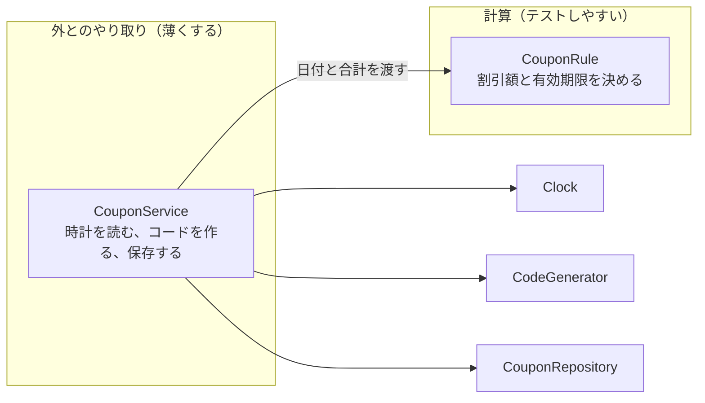

# 第22章: テストしやすく設計する（時間・乱数・外の部品を外から渡す）

> この章の軸: すべての軸に共通（どのクラスの種類にも使う設計判断）

## この章のゴール

テストしにくいコードの原因を、「隠れた入力」として見つけられるようになります。見つけた入力は、引数やコンストラクタで外から渡す形へ直せるようになります。

## まず言葉から: テストしやすいとは

この教材では、次の3つがそろっていることを、「テストしやすい」と呼びます。

- **毎回同じ結果になる**: 同じ入力なら、いつ、何回動かしても、同じ結果になる
- **すぐ終わる**: 本物のDBや外部のサービスにつながず、一瞬で終わる
- **ほかのテストに左右されない**: どの順番で動かしても、結果が変わらない

テストを書いていて「期待値を1つに決められない」「動かす順番で結果が変わる」と感じたら、どれかが欠けています。

## Why: なぜテストしやすさを設計で考えるのか

テストしにくさは、テストの書き方の問題に見えます。しかし、多くの場合は **設計の問題** です。

テストしにくいクラスは、引数で受け取らない入力を、中で勝手に取ってきています。たとえば、今日の日付、乱数、アプリ全体で共有している保存先です。[第1章](./01-yardstick.md)の言葉で言うと、これは **見えない結合** です。引数を見ても、何に左右されるクラスなのか分かりません。

テストを書こうとすると、この見えない結合に、最初に気づけます。つまり、テストしやすさは、結合度を測る身近な物差しです。

[第2章](./02-roles.md)と[第4章](./04-composition.md)では、部品を外から渡して組み立てる形（依存性注入、DI）を学びました。この章で扱うのは、DI が一番よく効く場面です。

## 前提

[第18章](./18-business-classes.md)を読み終えていること。この章では、コードを書く課題はありません。実装例を読み、テストで違いを確かめます。

実装例は、[ch22_testability パッケージ](../src/main/java/com/example/orders/ch22_testability/)にあります。`before` パッケージには、隠れた入力を持つ実装を置いています。

## 悪い実装を読む

[HardToTestCouponService.java](../src/main/java/com/example/orders/ch22_testability/before/HardToTestCouponService.java)を開いてください。注文の合計が5000円以上なら、クーポンを発行します。割引は500円で、週末は2倍です。

```java
LocalDate today = LocalDate.now();
// ...
String code = customerId + "-" + UUID.randomUUID();
GlobalCouponStore.INSTANCE.save(code);
```

このクラスには、引数に出てこない入力が3つあります。

| 隠れた入力 | テストで困ること |
| :--- | :--- |
| `LocalDate.now()` | テストを動かす曜日で、割引額が変わる。「週末なら1000円」を、平日に確かめられない |
| `UUID.randomUUID()` | コードが毎回変わるので、期待値を書けない |
| `GlobalCouponStore.INSTANCE` | アプリ全体で1つの保存先なので、前に動いたテストの結果が残る |

その結果、テストは次のような、弱い書き方しかできません。

```java
int discount = new HardToTestCouponService().issue("C001", 5000);
assertTrue(discount == 500 || discount == 1000);
```

これでは、「週末は2倍」という決まりが壊れても、テストは green のままです。

## 考え方

### 隠れた入力を見つける

次のものがクラスの中にあったら、隠れた入力の候補です。

| 隠れた入力 | 例 |
| :--- | :--- |
| 今の時刻 | `LocalDate.now()`、`LocalDateTime.now()`、`System.currentTimeMillis()` |
| 乱数 | `UUID.randomUUID()`、`new Random()`、`Math.random()` |
| 共有の状態 | `static` な変数、`INSTANCE` で取り出すシングルトン |
| 中で作る外の部品 | DB やメールの部品を、クラスの中で `new` している |
| 環境 | 環境変数、ファイル、画面への出力 |

どれも、「引数を見ただけでは、結果を予想できない」という共通点があります。

### 3つの直し方

隠れた入力は、簡単な順に、次の3つで外に出します。

| 直し方 | この章の例 | 向く場面 |
| :--- | :--- | :--- |
| 1. 引数で渡す | `CouponRule.discountFor(orderTotal, today)` | 計算に使う値。呼ぶ側がすでに持っている |
| 2. コンストラクタで渡す | `CouponService` の `Clock`、`CodeGenerator`、`CouponRepository` | 何度も使う部品。外の世界とつながるもの |
| 3. 組み立ての場所で本物を選ぶ | `CouponWiring.production` | 本物の時計や乱数を選ぶのは、1か所だけにする |

[CouponRule.java](../src/main/java/com/example/orders/ch22_testability/CouponRule.java)は、日付を引数で受け取ります。時計、乱数、保存先のどれも持たないので、値を渡して答えを確かめるだけで済みます。

```java
public int discountFor(int orderTotal, LocalDate today) {
    // ...
}
```

[CouponService.java](../src/main/java/com/example/orders/ch22_testability/CouponService.java)は、時計、コードの作り方、保存先を、コンストラクタで受け取ります。中では、`LocalDate.now(clock)` のように、受け取った時計を使います。

```java
public CouponService(Clock clock, CodeGenerator codes, CouponRepository repository, CouponRule rule) {
    // ...
}
```

本物の時計と乱数を選ぶのは、[CouponWiring.java](../src/main/java/com/example/orders/ch22_testability/CouponWiring.java)だけです。サービスの中は、本物か偽物かを知りません。

### 計算と、外とのやり取りを分ける

この章の分け方を図にすると、次のようになります。



業務の決まりは、計算のクラスに集めます。計算のクラスは、同じ引数なら同じ答えを返すので、テストが一番書きやすい場所です。外とのやり取りをするクラスは、計算を呼んで結果を保存するだけの、薄い作りにします。[第0章](./00-paradigms.md)で触れた関数型の考え方を、オブジェクト指向の中で使う形です。

### Java の Clock

時刻を外から渡すために、Java には `java.time.Clock` が用意されています。自分でインターフェースを作る必要はありません。

| 書き方 | 使う場面 |
| :--- | :--- |
| `Clock.systemDefaultZone()` | 本番。今の時刻を返す |
| `Clock.fixed(instant, zone)` | テスト。いつ読んでも、同じ時刻を返す |
| `Clock.offset(clock, duration)` | テスト。決まった時間だけ、ずらした時刻を返す |

`LocalDate.now()` を引数なしで呼ぶと、内部で本番の時計を使います。`LocalDate.now(clock)` と書けば、受け取った時計を使います。

### テスト用の偽物の種類

外から渡す部品は、テストでは偽物に差し替えます。偽物には、役割ごとに名前があります。どれも、モックのライブラリを使わずに、手で書けます。

| 名前 | 役割 | この教材の例 |
| :--- | :--- | :--- |
| スタブ | 決まった値を返す | テストの `SequenceCodeGenerator`（`C-0001` から順に返す） |
| フェイク | 簡単な作りで、本物の代わりに動く | `InMemoryCouponRepository`、第21章の `FakePaymentClient` |
| スパイ | 呼ばれ方を記録して、あとで確かめられる | 第21章の `FakePaymentClient.calls()` |

偽物を渡すと、テストは次のように、結果を丸ごと決め打ちできます。

```java
Clock saturday = Clock.fixed(/* 2026-11-21 の正午 */, TOKYO);
CouponService service = new CouponService(saturday, new SequenceCodeGenerator(), repository, new CouponRule());
Coupon coupon = service.issue("C001", 8000).orElseThrow();
// コードは C-0001、割引は1000円、有効期限は 2026-12-21
```

### テストしにくさを、設計の合図として読む

テストが書きにくいと感じたら、テストの工夫で乗り切る前に、設計を見直します。

| テストで感じること | 設計の合図 | 見直し方 |
| :--- | :--- | :--- |
| 期待値を1つに決められない | 時刻や乱数が隠れている | 引数かコンストラクタで渡す |
| 動かす順番で結果が変わる | 共有の状態がある | 保存先をインスタンスにして、外から渡す |
| 準備のコードが長い | クラスの責務が多い | 責務ごとにクラスを分ける |
| 偽物を5つも6つも渡す | 依存する部品が多すぎる | 部品をまとめるか、クラスを分ける |
| `private` のメソッドを直接確かめたい | 別の責務が隠れている | 別のクラスに切り出す（第20章） |

## やりすぎにも注意する

| やりすぎ | 困ること | 目安 |
| :--- | :--- | :--- |
| すべての `new` を、外から渡す形にする | 部品の数が増え、組み立てが読めなくなる | 値オブジェクト、`List`、`String` は中で `new` してよい。外から渡すのは、時刻、乱数、外の世界とつながるもの |
| テストのためだけに `public` を増やす | 本番のコードからも使えてしまう | 公開された操作で確かめるか、テストを同じパッケージに置く（第20章） |
| 偽物だけでテストし、本物を一度も組み立てない | 組み立ての誤りに、本番で初めて気づく | 本物を組み立てて1回動かすテストを、1つは置く |

この章のテストの `productionWiringWorks` が、最後の目安の例です。本物の時計と乱数で組み立てて、発行できることだけを確かめています。値は乱数なので、決め打ちしません。

> **💼 現場Tip**
> 「時刻に関わる不具合」は、月末、年末、うるう年、時差の境目で起きがちです。時計を外から渡す作りにしておけば、そうした日付を、いつでもテストで再現できます。レビューで `now()` を引数なしで呼んでいる行を見つけたら、時計を渡す形を提案します。

## コードアーキテクチャとの関係

| コードアーキテクチャ | 外から渡す部品 |
| :--- | :--- |
| Layered（第5章） | サービスに、リポジトリを渡す |
| Hexagonal（第10章） | ポートが、そのまま差し替え口になる。テストでは、アダプターの代わりに偽物を渡す |
| Event-Driven（第8章） | イベントの発行先を渡す。テストでは、発行されたイベントを記録する偽物を渡す |

Hexagonal のポートは、「テストで差し替えられる口」を、アプリ全体の分け方として先に決めたものです。この章の `Clock` や `CodeGenerator` は、同じ考えを、1つのクラスの中で使ったものです。

## 混同しやすい組み合わせ

| 組み合わせ | 違い |
| :--- | :--- |
| スタブ と フェイク | スタブは、決まった値を返すだけ。フェイクは、簡単な作りでも、本物のように動く |
| 引数で渡す と コンストラクタで渡す | 引数は、その呼び出しだけで使う値。コンストラクタは、そのクラスがずっと使う部品 |
| テストしやすい設計 と テストのために設計を曲げる | 前者は、隠れた入力を外に出すこと。後者は、テストのためだけに中を公開すること。前者は設計を良くし、後者は約束を増やす |
| `Clock` と 日付の引数 | `Clock` は、サービスが「今」を知るための部品。日付の引数は、計算に使う値。計算のクラスには、日付を渡す |

## 動作確認

この章のテストは、最初から全て green です。[TestabilityTest](../src/test/java/com/example/orders/ch22_testability/TestabilityTest.java)を読んでください。次の点が確かめられます。

- before の実装は、曜日で結果が変わるので、「500か1000のどちらか」としか書けない
- before の実装は、共有の保存先を使うので、件数が、それまでに動いたテストに左右される
- `CouponRule` は、日付を渡すだけで、平日、週末、下限未満を確かめられる
- 止まった時計と順番のコードを渡せば、発行されるクーポンを丸ごと決め打ちできる
- 下限に届かなければ、空を返し、何も保存しない
- 保存先をテストごとに作るので、別のサービスの結果が混ざらない
- 本番用の組み立ても、本物の時計と乱数で発行できる

```bash
mvn test -Dtest=TestabilityTest
```

## もっと良くしてみよう

### 理解確認

1. この章で「テストしやすい」と呼んだ3つの条件を挙げてみましょう
1. `HardToTestCouponService` の隠れた入力を3つ挙げ、それぞれテストで何が困るか説明してみましょう
1. `CouponRule` には日付を引数で渡し、`CouponService` には `Clock` をコンストラクタで渡しています。なぜ渡し方を変えたのでしょうか
1. スタブとフェイクの違いを、この教材のクラスを例に説明してみましょう
1. すべての `new` を外から渡す形にしないのはなぜですか

### 発展改善クイズ

1. 「クーポンは、1人の顧客に1日1枚まで」という決まりを足すとします。どのクラスに何を足し、どうテストするか考えてみましょう
1. 第18章の `TaxCalculator` は、日付で税率を決めます。今日の税率を求めるサービスを作るとしたら、時計をどこで受け取るのがよいでしょうか
1. 自分のプロジェクトで、`now()` を引数なしで呼んでいる場所を3つ探し、テストで困らないか確かめてみましょう

---

| [← 第21章: 失敗を設計する](./21-failures.md) | [全章目次](./README.md) | [第23章: 名前で意図を伝える →](./23-naming.md) |
| - | :-: | --: |
